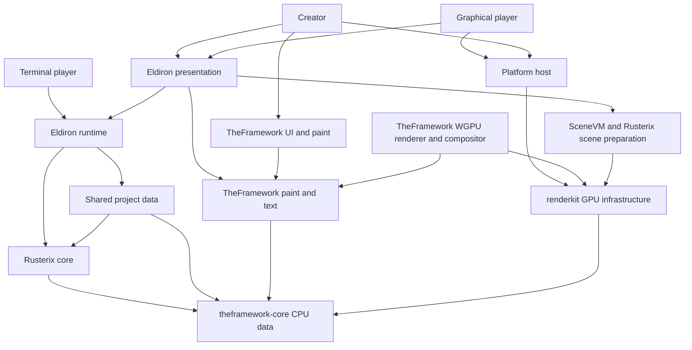

# Native WGPU architecture audit and modular rewrite plan

Date: 2026-11-10

Status: Execution activated by the user on 2026-11-11. The full M0–M9 objective is active under section 11. See `native-wgpu-rewrite-progress.md` for implementation evidence, remaining work, and checkpoints. The audit sections retain their historical baseline observations.

Audit baseline: working tree based on `696cc68a`, including existing local edits. Other source edits arrived concurrently during the audit; this document describes the sampled architecture and does not modify or roll back those edits. Source references name files and symbols because line numbers will change during the rewrite. This is a source/dependency audit; no new runtime benchmarks, screenshots, browser runs, or Apple/Windows/Linux compatibility tests were performed for it.

## 1. Decision and scope

Convert Eldiron through a selective rewrite of rendering interfaces, ownership, and application orchestration. Preserve useful widget interaction logic, layout algorithms, project data, gameplay, scene builders, and authoring operations. Introduce a common GPU presentation foundation used by Creator and the graphical clients.

Replacing Pixels alone is insufficient. Pixels already presents through WGPU. The architectural cost comes from CPU framebuffer contracts, recursive buffer composition, scene readbacks, and separate application loops with overlapping ownership.

The intended result is:

- Creator controls, graphs, tools, previews, and world viewports compose through one ordered GPU presentation system.
- SceneVM renders into explicit offscreen targets. Applications own presentation and surface lifecycle.
- Rust-created WGPU presentation surfaces must support both native Rust windows and the Xcode host's supplied `CAMetalLayer`, using the same renderer/compositor architecture.
- TheFramework widgets emit paint commands without accessing a destination pixel buffer.
- Authored game screens share rendering primitives and text resources with the editor while keeping their own interaction model.
- Creator Play and graphical/terminal clients use one session orchestration boundary.
- CPU images remain first-class editable/exportable assets. Readback becomes a requested operation rather than an implicit consequence of drawing a view.
- Text uses **Swash-generated glyph images cached in atlases and blitted by the GPU**, as requested. Fontdue-based painting is retired from the migrated presentation paths.

Desktop Winit is the first delivery target. Browser WebGPU and Apple document/Metal-layer hosts are explicit subsequent deliverables. The terminal client remains independent of GPU initialization.

Networking, new gameplay rules, project-format redesign, a new editor UX, and a second general widget toolkit are outside this rewrite. The runtime boundary must remain compatible with the separate [networking/MMO concept](networking-mmo-concept.md).

## 2. Current architecture and evidence

### 2.1 Dependency and ownership map

| Area | Present dependency/owner | Architectural consequence |
| --- | --- | --- |
| Creator and classic player | `TheApp` -> `TheWinitApp` -> `TheUI` and application callbacks | Host lifecycle, UI processing, framebuffer painting, and application timing share one loop. |
| TheFramework | `TheContext` owns drawing services and UI context; `TheCanvas` owns `TheRGBABuffer` | Layout nodes also become image storage and CPU compositing nodes. |
| Rusterix facade | `Rusterix` owns `Assets`, `Server`, `Client`, audio, `SceneHandler`, and bake state | A convenient combined owner is also required by many startup and drawing helpers. |
| Scene preparation | `SceneHandler` publicly owns `SceneVM` | Scene preparation and renderer ownership are directly coupled. |
| SceneVM | Owns VM layers, atlas, GPU state, output texture, and optional window surface | Offscreen rendering and application presentation are coupled. |
| WGPU player | SceneVM runner owns one VM; `EldironPlayerApp` owns another through Rusterix | Rendering and input callbacks use `std::mem::swap` to make the runner's window-backed VM active. |
| Shared project code | `shared` depends on Rusterix, SceneVM, and TheFramework | Project data, authoring helpers, presentation bridges, and runtime setup coexist. |
| Rulesets and server data | Use framework color/palette/time/data types | Removing widget rendering does not by itself remove the framework dependency. |
| Terminal player | Owns `Project`, `Assets`, `Server`, and `TextSession` directly | Shares gameplay foundations but has separate startup, timing, update, and event collection. |

The terminal-only dependency tree currently has no WGPU package. It still depends on TheFramework through `shared`, `rusterix`, and `eldiron-ruleset`; the workspace framework dependency enables `ui`. Preserve the existing GPU-free property and remove the unnecessary UI dependency through data extraction.

### 2.2 Actual frame paths

**Creator world view:** `Editor::update_ui` drives ticks and state synchronization, prepares/draws through Rusterix, writes the result into `TheRenderView::render_buffer_mut()`, then adds tool HUD pixels. For ordinary SceneVM frame rendering, native `render_frame` calls the blocking draw/readback path. `TheRenderView::draw` scales/copies its buffer into a canvas. `TheCanvas::draw` copies child buffers upward. `TheUI::draw` adds transient layers and copies the final image into the host frame. `PixelsBackend::present` copies that frame into Pixels for GPU presentation.

**Classic graphical client:** `Client::update_ui` advances simulation, collects outputs, invokes `draw_game_with_widget_overlays`, and copies/scales the game result into the UI canvas through `insert_game_buffer`. Presentation then follows TheFramework's framebuffer path.

**WGPU graphical client:** `EldironPlayerApp::render` uses `prepare_game_scene_for_present` and `SceneVM::render_to_window`. The main supported game view avoids framebuffer readback. Game screens, controls, text, portraits, and messages still go through `draw_ui_overlay_only`, CPU rasterization/composition, byte copying, and RGBA-overlay upload. The direct preparation path selects the first game widget. It explicitly returns false for sprite-isometric 2D cameras; native WGPU presentation is therefore not a demonstrated replacement for every classic-client mode.

**Sprite-isometric rendering:** Rusterix has a distinct sprite/terrain compositor with CPU images, ground caches, guides, avatars, and GPU-assisted lighting. `draw_scene_gpu_cached` still accepts `TheRGBABuffer`; SceneVM's isometric pass copies GPU output back into albedo bytes. This path requires a dedicated texture-output migration. A normal 3D viewport conversion does not cover it.

**Auxiliary previews:** geometry, appearance, and material editors have their own jobs/workers and GPU pipelines. Several return CPU images. Material bakes can legitimately need pixels, but interactive preview display should consume GPU resources directly. Geometry preview results already carry epoch/projection/pose information useful for safe asynchronous presentation and picking.

**Browser:** TheFramework's Pixels backend has asynchronous browser setup. SceneVM's separate `run_scenevm_app` browser runner uses `WasmRenderCtx`, `render_frame`, and Canvas2D `ImageData`. A common Rust app trait does not establish GPU-direct browser presentation.

**Apple:** `Xcode/Client` uses the WGPU player static library and a `CAMetalLayer` runner. Creator's static-library path exposes `rust_draw` into caller-provided bytes. The older `Xcode/Eldiron` wrapper draws those bytes with Metal and has bridge signatures that need reconciliation with current Rust exports. These are separate hosts requiring explicit verification.

### 2.3 Drawing and interaction inventory

Counts from this working tree: 49 `TheWidget` implementations across 56 widget source files, 14 `TheLayout` implementations across 14 layout source files, 59 of 201 Creator Rust files matching `TheRGBABuffer`, `pixels_mut(`, or `draw_target(`, and 13 of 23 Rusterix client source files matching the same tokens. Counts indicate reach, not the number of files that require wholesale rewriting. They include legitimate image operations and some non-executable references.

| Surface | Preserve/adapt | Replace or extract |
| --- | --- | --- |
| Standard controls and chrome | IDs, values, state changes, accelerators, size policies, theme roles | `draw(buffer, ...)`, pixel-based borders, image-based overlay return values |
| Canvas/layouts | Allocation of logical rectangles, ordering, splitter behavior, scroll state | Mandatory framebuffer per canvas, recursive pixel copies, buffer-derived geometry |
| Menus/dialogs/popovers/tooltips/drag visuals | Contents, anchor policies, focus and capture behavior | Painting into the root buffer; implicit overlay ordering |
| Text fields/code/Markdown | Editing commands, undo semantics, highlighting, document structure | Independent measurement/raster loops, fontdue glyph painting, buffer clipping |
| New `thegraph` | Document, editor, reversible edits, viewport transform, observations, `GraphPainter` separation | `RasterGraphPainter` as the required display path; CPU-only preview lookup |
| Legacy node canvas | Existing features still used by callers | Pixel-rendered grid/wires and render buffer; migrate after caller inventory rather than merging graph models blindly |
| RGBA/tile/palette views | Editable source pixels, palette rules, selection, brush/fill operations | CPU zoom/scaling/checkerboard/display overlays |
| Render/SDF/color views | Interaction and logical dimensions | CPU-only image output assumptions and procedural display painting |
| Creator tools | Authoring actions, selection, gestures, undo grouping | `Tool::draw_hud` pixel-buffer contract and global renderer access |
| Game screens | Authored layout, commands, bindings, visibility rules, fixed/responsive viewport semantics | Screen rasterizer, HUD paint loops, framebuffer hole-punching around game views |
| SceneVM UI demo | Useful drawable/atlas experiments | Do not make its smaller control set Creator's replacement UI framework |

`ThePainter` provides paths, strokes, and gradients but rasterizes through Zeno into `TheSurfaceMut`. `TheRasterTarget`/`TheSurfaceMut` still hold CPU bytes; they are useful CPU utilities, not a renderer-independent interface. The newer `GraphPainter` is a stronger starting example of separation and should receive an adapter to the common paint system.

## 3. Target modules and allowed dependencies

Use modules for implementation organization and crates where a boundary needs dependency enforcement. Proposed new crate names below are concrete planning names; establish them in the first implementation milestone and keep their scope small.

| Module/crate | Owns | Must not own/depend on |
| --- | --- | --- |
| **`theframework-core`**, new small CPU crate | Common color, palette, time, geometry/ID/image data required by project/rules/server code; plain opaque image-handle values | Widgets, Winit, dialogs, WGPU, font rasterizers, Eldiron project/runtime |
| **`renderkit`**, new GPU infrastructure crate | Explicit `GpuContext`, texture registry, upload/readback queues, GPU generations, target descriptors | Widgets, gameplay, documents, application event loops |
| **`theframework::platform`** | Neutral input/platform requests; Winit/browser/Apple host adapters, window/surface lifecycle, frame scheduling | Owning a world VM or implementing game rules |
| **`theframework::paint`** | Backend-neutral ordered paint lists, clips/transforms, image and text-run handles | CPU destination buffers, SceneVM, game-screen semantics |
| **`theframework::text`** | Font registry/fallback, shaping/layout/cluster mapping, Swash glyph generation, bounded CPU glyph caches | Widget-specific editing policy, world simulation, swapchain ownership |
| **`theframework::render_wgpu`** | Paint execution, glyph atlases, path rendering, compositor, frame-local GPU bindings | Documents, gameplay updates, scene camera selection |
| **`theframework::ui`** | Widget tree/state, focus/capture, layout, theme resolution, invalidation; emits paint | Renderer internals, required pixel storage, Eldiron/SceneVM |
| **SceneVM renderer** | Scene layers, atlas/geometry resources, per-view render state, GPU passes | Application window/input lifecycle, widgets, simulation clock |
| **Rusterix core** | Rules execution, entities/maps, assets needed by runtime, simulation and scene-preparation algorithms | Initializing a GPU/window merely to create a session |
| **`eldiron-runtime`**, new crate | `GameSession`, local host adapter, startup/tick orchestration, runtime view and addressed output batches | TheFramework UI, WGPU, Creator widgets, terminal rendering |
| **`eldiron-presentation`**, new crate | Game-screen model/controller, cameras, scene preparation adapters, graphical HUD emission | Owning/advancing an authoritative server or window surface |
| **Creator application modules** | Documents/undo, tools/controllers, view composition, Play-session ownership | Sharing mutable renderer/window state through globals |
| **Client entry points** | CLI/platform wiring and presentation selection | Separate copies of startup/tick/event-draining logic |

Dependency direction, where arrows mean “depends on”:



Applications assemble the host, compositor, and scene renderers. TheFramework does not import SceneVM; it composites an opaque image handle produced by any renderer. SceneVM can depend on the small `renderkit` infrastructure without acquiring a dependency on TheFramework's widget/application crate.

Keep algorithms in existing Rusterix modules where practical. Move the aggregate game-presentation owner and controller outward so `eldiron-presentation` can depend on `eldiron-runtime` without making a dependency cycle through Rusterix. `shared` must stop importing that outward presentation owner; move its graphics-specific startup bridges to `eldiron-presentation`.

Initially extract common data with compatibility re-exports from TheFramework. Preserve existing serde representations and compressed image encoding. Changing a Rust ownership boundary must not silently change `.eldiron` files. Do not try to move every broad prelude import in one commit.

The new CPU image representation should own size/pixels and image metadata, independently of a widget's logical position or display scale. Bridge serialized legacy `TheRGBABuffer` data with explicit adapters while moving callers. Moving the current buffer type unchanged into a new crate would reduce dependencies but would not finish separating image data from UI layout.

### Feature/package contract

- Framework features separate `ui`, `text`, `render-wgpu`, `platform-winit`, `platform-web`, `platform-apple`, and optional legacy CPU adapters. Requesting a platform must not implicitly select Pixels.
- Rusterix core and `eldiron-runtime` build with graphics disabled. SceneVM and GPU infrastructure are pulled in through presentation features/dependencies.
- Terminal/ruleset/project tooling must not depend on the full UI crate once data extraction completes. Font/image data used by gameplay may still exist as CPU assets.
- Pin a single compatible WGPU family across `renderkit`, SceneVM, materials, and previews. The audited lockfile currently resolves WGPU 29.0.3. Avoid mixing a WGPU version upgrade into the ownership rewrite.
- Establish feature gates inside the existing crates before extracting additional physical crates. The four new boundaries above have concrete isolation purposes; avoid creating a separate crate per widget, painter, or application view.

## 4. Ownership and interfaces

Names and signatures in this section are proposed API sketches, not declarations that already exist.

### 4.1 Host and GPU lifetime

`ApplicationHost` owns platform surfaces and the scheduling loop. Its assembled application owns a single explicitly constructed `GpuContext` per device domain, the compositor, and view renderers. A `SurfaceState` owns configuration/acquisition/presentation for each window or canvas. The host selects a surface-compatible adapter before creating shared resources.

**Required Xcode compatibility:** the Rust surface-creation abstraction must accept an externally supplied `CAMetalLayer` from the Xcode/Swift view as well as a native Rust/Winit window. Rust creates and manages the WGPU surface for that target, selects a compatible adapter/device, configures it, and presents the shared renderer/compositor output directly to it. The Xcode application retains ownership of its view/layer and supplies its handle, physical drawable size, scale, lifecycle events, and frame callbacks through the FFI host adapter. This path must work without creating a second Winit window or event loop, copying completed frames through CPU memory, or introducing a separate Swift/Metal rendering implementation. These are alternative surface targets for the same architecture; they do not require sharing one surface instance between different native views.

Define the FFI lifetime/thread contract during M0/M1: layer validity, renderer creation/destruction, resize/scale updates, suspend/resume, and which host callback schedules each frame. Rust owns WGPU acquisition/presentation; the wrapper must not also acquire/present the same drawable independently. Destroy the Rust surface before releasing or replacing its backing layer. Full wrapper conversion and platform verification remain M9 work, but a Winit-only surface API cannot pass the M1 interface gate.

SceneVM receives access to this context. Auxiliary previews and MaterialZ use the same device through explicit injection. Retire the hidden `GLOBAL_GPU` initialization path for application-owned rendering. An offscreen command-line renderer may construct its own explicit context without a window.

Resource identity includes a device generation. Sharing cloned device/queue handles is valid ownership sharing; separately requesting another device does not make its textures compositable. Cross-device imports are outside the initial contract.

Handle zero-size/minimized surfaces, resize, fractional DPI, suspend/resume, timeout/lost/outdated acquisition, device loss, and unsupported initialization explicitly. Surface recovery recreates targets and invalidates affected bindings. Device recovery rebuilds derived resources from retained CPU assets/descriptions. A window or Metal layer outlives its renderer surface; drop surfaces before destroying native handles.

### 4.2 Scene rendering

Replace the application-facing `render_frame(&mut [u8], width, height)` dependency with:

```text
prepare_scene(scene_changes, asset_updates, time) -> prepared scene state
render_view(view_id, camera, target_descriptor, frame_context) -> SceneOutput
SceneOutput = image handle + dimensions + color/alpha metadata + view revision
```

`SceneOutput` stays on the GPU. The compositor samples it at any position in the ordered paint stream. A retained scene can render several view IDs with independent camera, size, history, scratch targets, and picking state while sharing immutable geometry/atlases. A second view must not overwrite the first view's output or temporal state.

Preserve all VM layers, editor guides, material/lighting modes, postprocessing, transparent output, and isometric passes. Refactor normal and sprite-isometric output to the same external target contract. Do not translate the entire scene instruction model as part of this change.

For isometric views, extract ordered sprite/terrain/guide submissions from the CPU compositor. Upload source images, placement/depth/material metadata, and changed ground-cache content; draw sprites and lighting into GPU targets. Preserve anchor rules, terrain projection, transparency, particle ordering, and avatar orientation. Merely uploading a CPU-composited viewport each frame and retaining GPU lighting would leave the central migration incomplete. CPU reference composition can remain available for comparison and explicit offscreen tooling.

`capture_image(output, request)` is a separate readback API with a ticket, result revision, and cancellation. CPU bytes and staging buffers are allocated on demand. The existing `scenevm::Texture` always carries CPU data and creates a readback buffer when GPU storage is created; separate CPU images, GPU render targets, and readback staging storage.

Some current passes submit internally. Start with documented ordered submissions on one queue and explicit completion dependencies. Move to a shared frame encoder where practical; do not claim one submission until internal submits are audited. No normal viewport presentation may wait for a mapped color framebuffer.

### 4.3 UI painting and composition

```text
Widget::event(input, ui_context) -> actions + invalidation
Widget::layout(constraints, measure_context) -> layout result
Widget::paint(paint_context) -> ordered PaintList
```

`PaintList` supports filled/stroked paths, rectangles/rounded rectangles, gradients, images, glyph runs, transforms, rectangular/path clips, and explicit opacity groups. It preserves painter order. Batching can merge compatible neighbors; it cannot reorder overlapping content to save draw calls.

Image commands use the same resource mechanism for asset images and scene outputs, with explicit sampling. Pixel artwork can request nearest sampling and integer scale; text/UI uses device-density rendering. Remove CPU framebuffer dimensions/stride from widget APIs.

A canvas stores logical layout and paint/cache IDs. A GPU layer texture is allocated only for a justified cache or isolation group, rather than automatically for every canvas. Scroll views can change transforms/clips without repainting unchanged children.

Replace one dirty Boolean with layout, paint, resource, and scene invalidation plus animation deadlines. Cache keys include size, DPI, theme/font revision, content revision, and device generation where relevant. A changing viewport must not regenerate an unchanged toolbar. Idle editor scheduling can sleep while retaining independent session/job deadlines.

Transient content becomes explicit layers: base content and embedded views, local tool overlays, modal scrim/dialog, anchored popovers, menus/tooltips, drag visuals, cursor according to a defined policy. Paint order and hit testing use the same layout/transform tree. Modal input blocks world controls even though the world view remains visible.

Choose a tested color/alpha policy before implementing blending. Recommended target: declare source color spaces; use premultiplied alpha for compositing; perform sRGB conversion exactly once at defined boundaries. Scene output is already tonemapped/gamma-encoded in some paths. Do not assume it can be sampled/blended like linear HDR data. Legacy gamma-space differences need reviewed visual baselines, including translucent game artwork.

### 4.4 Text: Swash glyph generation, atlas blitting

**Required direction:** build glyph images with [Swash](https://github.com/dfrg/swash), by dfrg, also the author of [Zeno](https://github.com/dfrg/zeno). Use those images for cached WGPU text blits across Creator, framework controls/graphs, and graphical game screens. Text quality is a first-class acceptance criterion, including small UI text and fractional display scales.

Swash provides font inspection, shaping, and glyph rendering, while leaving higher-level layout and composition to the application. Its [scaling API](https://docs.rs/swash/latest/swash/scale/index.html) supports hinting, fractional placement, outlines, and color/bitmap glyph sources. Select and pin its version during implementation. This audit adds no dependency.

Proposed pipeline:

```text
text + style + locale + logical bounds
    -> font resolution, script/direction analysis, shaping and line layout
    -> positioned glyph IDs and source clusters
    -> Swash glyph rasterization at effective physical pixel size on cache miss
    -> upload coverage/color glyph images to bounded atlases
    -> ordered textured glyph quads blitted by WGPU
```

Own layout/fallback/bidirectional analysis explicitly; adding a glyph rasterizer does not supply those policies. Keep the text service interface independent of the concrete higher-level layout implementation. Use the resulting runs for width calculation, wrapping, selection rectangles, and caret hit testing; do not measure with fontdue while displaying Swash glyphs.

Atlas keys include font identity/revision, face index, glyph ID, variation settings, effective physical size, hinting/render mode, and quantized fractional placement. Ordinary coverage glyphs should not be cached separately per text color. Track color glyphs in a suitable separate atlas format. Font or DPI changes invalidate dependent layout/raster resources. Bound atlas memory, evict safely, and pin entries referenced by in-flight frames.

Rasterize at the final display density, including graph zoom where appropriate. Avoid rendering text at logical resolution and stretching a completed UI bitmap. Preserve fractional advances/baselines and consistent raster placement; do not force every layout metric to integer pixels.

Use grayscale coverage as the default for transparent layers, arbitrary backgrounds, and transformed views. RGB subpixel masks need a separately validated policy for opaque backgrounds and display geometry; they are not an automatic quality improvement for every compositor target. Compare hinting and placement choices visually at actual target sizes. Static text may require multiple raster-size cache entries when zoom changes.

Retain grapheme-aware editing and source-cluster mappings for ligatures, combining marks, and bidirectional text. Keep physical shortcuts separate from committed text. Add explicit IME composition/commit/candidate-position events to the host contract; the current Winit handler does not show a complete IME path. Preserve system font discovery and test the shipped localized interfaces, including CJK and Cyrillic.

Fontdue may remain behind legacy adapters until callers migrate. Completion requires removing independent fontdue measurement/painting from migrated UI/HUD/graph paths. Reusing CPU glyph generation on cache misses is compatible with GPU-native presentation; repainting text into a whole CPU framebuffer each frame is not.

### 4.5 Resources, jobs, editing, and picking

`ImageAsset` is CPU-owned authored or decoded data; `ImageHandle` is an opaque generational value defined in the CPU core. Paint lists refer to that handle without depending on WGPU or `renderkit`. The renderer resolves it through its registry, which validates residency/device generation. CPU reference backends can resolve equivalent handles to CPU images. A presentation resource records dimensions, format, alpha convention, sampling, and content revision. Asset updates upload changed content/regions; palettes and animation can update resources without rebuilding unrelated UI.

GPU workers must not overwrite a texture still being sampled. Initially favor CPU preparation workers and application-controlled GPU execution. Where existing workers continue GPU work, use explicit queue ordering and published immutable output handles/leases, with double buffering or a small bounded pool. Retire superseded jobs by document/view revision; cancel on close. Never move a Winit surface into a worker.

Keep CPU brush/fill/undo operations and authoritative pixel data for tile/avatar/icon editing. GPU display scales the edited image and draws grids/selections. Painting must not require downloading the displayed viewport to find the source pixel.

Picking uses the same view rectangle, inverse transform, camera, revision, and projection that produced the displayed image. Prefer existing CPU analytic queries where they remain correct. For GPU ID/depth/paint-surface queries, return bounded asynchronous results tagged with view/document/frame revisions. Stale hover can be dropped; clicks that modify a document must resolve against the intended revision or retry. Isolate any interaction-required wait and measure it. A full-color framebuffer readback is never the default picking method.

Bake/export/Scepter screenshot jobs request explicit captures with size, output color convention, completion/error, and cancellation. Interactive previews publish GPU images; saving material channels or exported thumbnails can still request pixels. Do not remove currently useful CPU outputs indiscriminately.

### 4.6 Frame transaction and input routing

The shared host/application sequence is:

1. Normalize platform events into logical coordinates; preserve physical key information, committed text, IME events, and relative pointer deltas separately.
2. Resolve modal scope, focus, and pointer capture against the UI/view tree. Route consumed events once. The same click must not activate both a framework control and a game/tool handler beneath it.
3. Apply document/player commands, advance due session/animation clocks, collect runtime outputs once, and accept revision-compatible worker results.
4. Resolve layout and text runs, then produce a `FramePlan` containing view requests, an ordered paint/layer list, and resource updates. Painting reads presentation state; it does not tick the server or mutate authored content.
5. Process uploads and render dirty scene/preview targets. Register their outputs for the frame before executing paint commands that sample them.
6. Acquire the window target, execute ordered composition, and present once for that surface. Defer/skips caused by an unavailable surface must not discard runtime commands or output events.
7. Complete asynchronous capture/picking requests and release retired resources when safe. Choose the next wakeup from input, session ticks, animation, jobs, and presentation deadlines.

Keep the initial implementation on the platform thread for event dispatch and frame orchestration. Background CPU preparation and explicitly ordered GPU jobs remain available. A general render-thread/message-passing framework is not a prerequisite.

## 5. Runtime and application restructuring

### 5.1 One session boundary

Introduce `GameSession` in `eldiron-runtime` around startup, time advancement, input commands, runtime synchronization, region transitions, and event collection. Initially it wraps the existing local server and assets; extract incrementally rather than rewriting rules execution.

```text
GameSession::start(project_content, session_options)
GameSession::submit(player_command)
GameSession::advance(elapsed) -> SessionUpdate
GameSession::view() -> read-only RuntimeView
SessionUpdate = revisions + messages/choices/says + audio/log/control events
```

The session is the sole drainer of authoritative output queues. It distributes explicit output batches to visual/text/audio consumers so a second view does not consume another view's messages. A renderer does not advance the session or drain queues during painting.

Preserve existing gameplay modes and timing semantics first. Centralize `system_tick`/`redraw_tick` scheduling using supplied elapsed time and explicit deadlines; current movement/timers must be characterized before changing cadence. Draw suppression, minimization, or multiple views must not accidentally multiply or stop simulation. Keep game time, presentation animation, and background-job clocks distinct. Introducing a fixed-step movement simulation belongs with the networking work unless required to preserve existing timing during this extraction.

The proposed `RuntimeView` is the local read model that can later become the networking concept's `ClientWorld`. No new wire protocol is part of this work. Process-wide `REGIONPIPE`/`LOCAL_PLAYERS` and related registries currently limit independent worlds. An initial session adapter may retain that documented single-active-world restriction. Supporting simultaneous isolated Play sessions requires the separate world-ownership extraction; do not claim isolation merely by creating two `GameSession` values.

### 5.2 Creator ownership

Break `Editor` orchestration into application-owned modules:

| Module | Responsibility and current migration sources |
| --- | --- |
| `documents` | Open tabs, project/revision ownership, save/load, undo/redo; existing project/undo code |
| `workspace` | Dock layouts, menus, view IDs, focus and application actions |
| `authoring` | Tools, reversible edits, selection, action scripts, Scepter command routing |
| `views` | Map/profile/screen views, graphs, material/geometry/appearance panels and their scene-output requests |
| `play` | Owns the active `GameSession` and game presentation; preserves Play/Stop/Pause behavior |
| `jobs` | Scene building, preview jobs, bakes/capture/export, cancellation and revision tracking |

Pass narrow context borrows or commands to tools/docks. Retire `RUSTERIX`, `SCENEMANAGER`, `EDITCAMERA`, and renderer-related global access in converted paths. Move document/tool/undo state under explicit owners as those call sites migrate; do not leave a new rendering layer dependent on the same global locks. Read-only registries can remain shared when their lifetime and mutation policy are explicit.

Separate authored document changes from play-session entity updates. Existing code applies runtime entities/items back into project maps for display; model the authoring view and Play runtime view explicitly so starting/stopping a preview cannot accidentally persist transient state. Keep existing project-tab and undo behavior.

Convert `Tool::draw_hud` to an overlay paint/scene-guide contribution. Local geometry and 3D depth-aware guides may require different passes, but both attach to a named viewport. Convert `GraphPainter` through a paint-list adapter, retaining graph interactions and undo. Preserve active editor display/profile sessions and their cancellation when switching documents.

### 5.3 Graphical and terminal clients

`eldiron-presentation` owns a `GameScreenController`, camera/view state, hit testing, responsive/fixed layout, and immutable paint/scene requests. It consumes `RuntimeView` plus session events, and emits player commands. It does not own a server or request a surface.

Migrate Rusterix's current `Client` responsibilities into this owner in groups: viewport transforms/camera and mouse look; game views; screen geometry; controls/bindings; messages/choices/speech; profiles/portraits/inventory/stats/decorations; custom cursor and audio requests. Reuse existing behavior rather than redefining authored screen semantics.

Replace framebuffer hole-punching with actual ordered layers and clips. Background decorations, game views, and foreground screen art must interleave correctly, including authored negative/positive layers. Enumerate all game widgets deterministically, giving each a view ID and target. Support screens with no game view, multiple views, region changes, and sprite-isometric mode explicitly.

Keep `eldiron-client` as the canonical graphical executable after parity. Use `eldiron-client-wgpu` as the migration entry point, then reduce it to an alias/host wrapper or retire its duplicate app loop. Preserve the `scenevm_unified_app` library name and `unified_app_runner_*` compatibility exports until Apple packaging is migrated. Both entry points must call the same session/presentation components before any deletion.

The terminal executable adopts `GameSession` without graphical presentation. Keep `TextSession`, ratatui/plain-text modes, command parsing, and text AI behavior. Share runtime events/startup semantics; terminal-specific formatting remains in its presenter. Test terminal dependencies in isolation because workspace feature unification can hide an unintended GPU dependency.

## 6. Migration sequence and completion gates

Each milestone lands a coherent part of the destination architecture. Temporary adapters have an owner, a named removal milestone, and a count of remaining callers. Avoid adding a permanent GPU/CPU conditional to every widget.

| Milestone | Deliverables / source areas | Dependencies | Completion gate | Effort, developer-weeks |
| --- | --- | --- | --- | --- |
| **M0: contracts and baselines** | Lock ownership/paint/resource/text interfaces; record workflows, screenshots, timings and CPU/GPU transfer counters; inventory classic vs WGPU behavior; settle path rasterization/AA and text-layout integration | This audit | Representative fixtures and acceptance measurements exist; Swash text sample, alpha policy and target-sharing design reviewed | 1–2 |
| **M1: GPU ownership and scene outputs** | `renderkit`; split SceneVM surface/runner from rendering; injected context; GPU targets/readback queue; normal and isometric output contracts; surface API for Winit and Xcode-supplied CAMetalLayer | M0 | Two cameras/targets on one device compose without VM swapping or color readback; resize/loss behavior and capture work; Xcode surface/lifetime contract is explicit and requires no Winit host | 2–3 |
| **M2: paint renderer and Swash text** | Framework paint lists, resource resolution, clipping/opacity, glyph atlas/blits, paths/gradients, input/text service contracts | M0, M1 for GPU execution | Controls + graph curve + image + embedded scene + translucent layer render correctly; text metrics/caret agree at fractional DPI | 3–5 |
| **M3: framework widget migration** | Canvas/layout contracts, theme/style emitters, controls, text/Markdown, menus/overlays, RGBA/color/SDF views, graph adapters; CPU adapters isolated | M2 | Widget catalog and complex editor slice use GPU paint; no mandatory canvas framebuffer; no converted-widget pixel access | 3–5 |
| **M4: shared session extraction** | `eldiron-runtime`; split startup helpers; one event collector/clock; adopt terminal; core-data extraction and feature boundaries | M0; can proceed independently of M2/M3 | Terminal and a minimal graphical consumer use the same local session; no UI/GPU dependencies in isolated runtime build; timing/output semantics preserved | 2–3 |
| **M5: Creator conversion** | Explicit application owners, view IDs, tool/graph overlays, all map modes, Play host, material/geometry/appearance GPU previews, capture/export/Scepter | M1, M3, M4 | Full Creator workflow matrix passes; converted render paths have no global renderer ownership; stable preview/picking revisions | 3–5 |
| **M6: game UI and client convergence** | `eldiron-presentation`; migrate screen/HUD paint and input; multiple game views, isometric views; common player components; preserve Apple export facade | M1, M2, M4; share framework fixes with M3 | Classic/WGPU launchers use identical session/presentation logic; game-screen matrix passes without CPU full-screen UI composition | 2–4 |
| **M7: desktop parity and retirement** | macOS/Windows/Linux verification; remove Pixels from canonical desktop path, VM swaps, recursive framebuffer composition, deprecated caller adapters | M3, M5, M6 | Acceptance matrix and dependency checks pass; each retained CPU/readback path is explicitly classified | 1–2 |

M4 is not a reason to block renderer-interface work, but Creator Play and client cutover require it. M5 and M6 share foundations; budget their shared fixes once. Physical extraction into new crates follows tested module boundaries rather than preceding them with large mechanical moves.

**Planning range:** 17–29 developer-weeks of base desktop effort for one developer familiar with the code. Reserve roughly 25% for integration/visual/platform issues: approximately 21–36 developer-weeks. These are conventional developer-effort estimates, not predictions of autonomous-run wall time, a nightly work allowance, or reasons to stop execution. The earlier 12–20 week chat estimate covered a narrower renderer migration and is superseded for the full scope here. Re-estimate from implementation evidence after M0 and after the first complete application slice without stopping for routine approval.

Swash text integration is included, but a broad new typography/accessibility feature expansion is not. Reproducing existing text behavior and covering the shipped locales are required. Scheduling multiple implementers would change elapsed time and coordination needs, not remove interface dependencies.

### First implementation slice

After M0, use M1/M2 to build one production-shaped Creator panel containing a GPU scene, a standard control, editable Swash text, a graph wire, a tool overlay, a popover, and a modal. Give it two scene outputs to exercise ownership. This is an integration gate for the chosen interfaces, not permission to ship a special-case viewport compositor.

Capture/export the same panel through the explicit readback service. Resize across fractional DPI, switch documents with a preview pending, and verify focus/capture and picking transforms. Record the remaining legacy adapters before proceeding with broad widget conversion.

### Browser and Apple deliverables

| Extension | Required work | Gate | Additional base effort |
| --- | --- | --- | --- |
| **M8: browser** | Async GPU bootstrap, canvas WebGPU surface, RAF scheduling, async platform services, device loss and job policy; replace SceneVM Canvas2D/ImageData presentation | Browser Creator/player use the shared paint/scene path without color readback to Canvas2D; resize/DPR/text/input and supported project-loading flows pass | 3–5 developer-weeks |
| **M9: Apple wrappers** | Rust creates/configures/presents WGPU surfaces from Xcode-supplied CAMetalLayer handles through the shared host/surface API; versioned handle-based Creator FFI, document callbacks, view lifetime/suspend/touch/input; reconcile old bridge signatures | Existing client symbols remain compatible until cutover; Creator/client macOS and selected iOS targets load/save/play and resize through the shared renderer/compositor without CPU framebuffer presentation or a second Winit window | 2–4 developer-weeks |

Both depend on the shared contracts; preserve existing entry points until their replacement is validated. Investigate their lifecycle constraints during M0 so desktop APIs do not preclude them. Browser WebGPU availability and supported Apple target list must be stated at release; do not silently equate native support with all existing wrapper targets.

## 7. Temporary compatibility policy

### API migration ledger

| Current contract / owner | Destination contract / owner | Cutover milestone |
| --- | --- | --- |
| `TheTrait::draw(&mut [u8], ...)` and mixed host callbacks | Application update/layout/frame-plan interface plus separate platform requests | M2/M3; app callers M5/M6 |
| `TheWidget::draw`, `TheLayout::draw`, `TheStyle` buffer methods | Paint emission and shared measure context | M3 |
| `TheCanvas::buffer` as layout/composition storage | Logical canvas/layout tree plus optional explicit GPU cache layer | M3 |
| `TheWidget::draw_overlay -> TheRGBABuffer` | Ordered transient paint contribution with bounds/anchor/input scope | M3 |
| `TheRenderView::render_buffer_mut` for displayed scenes | Named view request and generation-checked image output | M1/M3/M5 |
| `SceneVM::new_with_window`, runner-owned VM passed into input | Injected renderer context plus platform-owned surface; input addresses a view/controller | M1, application callers M5/M6, wrappers M9 |
| `SceneVM::render_frame` as the display API | `render_view` GPU output; explicit `capture_image` for CPU consumers | M1/M5/M6 |
| `Tool::draw_hud(buffer, ...)` | View-local paint contribution and optional depth-aware scene guides | M5 |
| `RasterGraphPainter` / CPU preview lookup | `GraphPainter` adapter emitting paint and resource handles | M3/M5 |
| `start_server` / `setup_client` / `warmup_runtime` orchestration | `GameSession` startup plus `eldiron-presentation` setup | M4/M6 |
| `Client::insert_game_buffer` and `draw_ui_overlay_only` | Ordered game-screen paint and scene outputs | M6 |
| Separate classic/WGPU client tick loops | Same `GameSession` and `GameScreenController` with thin entry points | M6 |
| Creator `rust_draw` byte-pointer ABI | Versioned host/renderer handle ABI; old exports bridged during wrapper transition | M9 |

### Adapter retirement

| Adapter | Allowed use during migration | Removal/completion condition |
| --- | --- | --- |
| Legacy framebuffer presenter | Compare old screenshots and keep unmigrated applications usable | Removed from canonical desktop launchers at M7; explicit reference/offscreen tooling may remain |
| CPU widget image adapter | One isolated legacy widget paints a versioned image through the new resource interface | Converted widget families remove it at M3; application-specific users at M5/M6; no full-root-frame escape hatch |
| Legacy `TheRGBABuffer` re-export | Keep source/project compatibility while extracting CPU image/data types | Re-export can remain; painting APIs must no longer require it |
| Old SceneVM runner/API | Preserve demos and external wrappers during migration | Applications stop relying on renderer-owned windows/VM swaps at M1/M5/M6; wrappers move at M9 |
| CPU game-screen overlay | Keep game UI functional while screen groups migrate | All canonical graphical screens use paint/layer output at M6 |
| CPU preview job result | Bakes, exports, or an explicitly unmigrated preview | Interactive displayed previews publish GPU handles at M5; captures/bakes remain explicit CPU consumers |

Old implementations can remain as test/reference backends when isolated. A retained CPU backend must not dictate the new paint/widget contract or run silently in the normal GPU path.

## 8. Acceptance and validation plan

### Functional matrix

| Area | Required scenarios |
| --- | --- |
| Framework controls | Hover/focus/disabled/pressed states; sliders; lists/trees/tabs; splitter/scroll clipping; theme changes; menus/popovers/tooltips/drag images; keyboard navigation and clipboard |
| Text | Small regular/code text, selection/caret and scrolling, multiline wrapping, syntax/Markdown, fallback fonts, shipped locales, combining marks/ligatures, IME commit/composition, DPI/zoom transitions and atlas eviction |
| Creator documents | New/open/save/reopen; project-tab switching; unsaved-close prompts; undo/redo grouped gestures; Scepter edits/captures; no transient Play data written into authored content |
| Creator views | Top-down 2D, sprite-isometric 2D, 3D views, profile/surface/screen editing, graph editing, pixel/tile/palette views, material/geometry/appearance panels, bakes/previews and export |
| Play/runtime | Start/pause/resume/stop; project switch while running; region transitions; text/graphical presentation; messages/choices/speech/audio/logs delivered once; minimized/low-FPS timing |
| Game screens | Fixed/responsive layouts, aspect scaling/letterbox/input mapping, zero/multiple game views, foreground/background layers, portraits/equipment/inventory/stats, choices, custom cursor, isometric camera |
| Hosts/resources | 100/125/150/175/200% DPI, monitor changes, zero-size/suspend/resume, surface/device recovery, pending-job document close, missing assets, bounded atlas/target memory |
| Xcode surface integration | Rust WGPU surface created from the Swift-owned CAMetalLayer; shared scene/UI composition; physical size/scale updates; view recreation, suspend/resume and safe teardown; no Winit window or duplicate drawable presentation |

Use existing `3DStarter.eldiron`, `Hideout2D.eldiron`, `Hideout2D-MZ.eldiron`, and `UnendingNight.eldiron` as candidate workflows after checking their current authored modes. Add small deterministic fixtures for multiple game views, UI-only screens, translucent art, isometric output, text/fallback, and nested clips. Do not assume an existing project exercises every case from its filename.

### Performance and architectural gates

- In a warmed normal frame, **zero full-color viewport GPU-to-CPU transfers** and **zero CPU composition of the complete application framebuffer**. Explicit capture/bake/picking requests are counted separately and labelled.
- An unchanged UI produces no repeated full-window CPU texture upload and no repeated Swash rasterization for cached glyphs. Scene updates can still submit frames.
- Trace CPU input/update/layout/paint/prepare/upload/submit times, GPU pass times where supported, acquisition/present latency, bytes uploaded/read back, resource allocations, and peak cache memory. Existing `ELDIRON_PROFILE_EDITOR` and `ELDIRON_RENDER_DEBUG` are starting points; CPU submit timing is not GPU completion time.
- Compare release builds at equal viewport size, DPI, camera, effects, project state, and frame rate on the same hardware. Record p50/p95/p99 frame time, input-to-visible response, startup, and memory. Set numerical budgets from M0 measurements; do not promise an unmeasured speedup factor.
- Session behavior with zero, one, and two visual consumers is the same. Rendering twice must not tick twice or drain outputs twice.
- Test CPU image/palette/time serialization fixtures before/after extraction. A saved project reopens with identical authored content.
- Inspect dependencies separately for terminal, runtime, project/ruleset tooling, framework UI without a platform, GPU player, Creator, browser, and static libraries. Do not rely solely on one workspace build.
- New application-facing rendering signatures use view/target/resource handles. No VM swaps, per-widget GPU device creation, root framebuffer composition, or hidden blocking readback in canonical paths.

Use targeted tests for contracts: paint ordering/clips, resource generations, shaping/caret mapping, output delivery, timing, view independence, and saved-format preservation. Use visual comparison for actual text/alpha/path quality. Retain CPU golden/reference images where meaningful, allowing reviewed anti-aliasing differences rather than demanding identical bytes from different renderers.

## 9. Risks, decisions, and exclusions

| Issue | Proposed treatment / decision point |
| --- | --- |
| Choosing a GPU path rasterizer | Keep paths/strokes backend-neutral. In M0 compare a tessellation/coverage implementation with reuse of cached Zeno masks for static assets; choose based on curves, joins, gradients, clips, and small-icon quality. Dynamic controls/wires must not fall back to whole-widget CPU rasterization. Swash glyph generation is already the required text direction. |
| Text quality/layout changes | Centralize metrics and cluster mapping; compare real fonts/locales before migrating editor input. Swash is not a guarantee that every choice of hinting, blending, or placement is best. |
| Gamma/alpha regression | Record existing output conventions, declare conversion boundaries, review translucent sprites/glyphs and scene overlays. |
| Multiple views and atlas mutation | Independent view state/targets; shared immutable/revisioned assets; explicit frame references and resource retirement. |
| Isometric feature gap | Dedicated output contract and fixtures in M1/M5/M6; do not count a 3D-only demo as parity. |
| Runtime timing/global server state | Preserve characterized scheduling first; document single-world limits; coordinate deeper world/session changes with networking plan. |
| Large Creator globals/event handlers | Move ownership by feature with narrow contexts and regression workflows; moving code to new files alone is not completion. |
| FFI/window lifetime | Explicit host handles and thread ownership, compatibility exports until tested cutover; wrapper source is not proof of current build support. |
| Scope growth | Defer a new UX, new scripting/rules, distributed rendering, render-thread framework, multiple concurrent worlds, and new networking protocol. |

Unresolved choices to close in M0: supported native/browser/Apple target matrix; exact higher-level text layout/fallback/bidi integration around Swash; path/AA backend; whether color-policy changes require compatibility options; required readback latency for painting/picking; canonical client packaging/deprecation timing. The module and ownership direction above does not depend on those choices being solved by ad hoc per-view exceptions.

## 10. Audit references and checks

| Evidence | Source / relevant symbols |
| --- | --- |
| Workspace/default feature wiring | [Cargo.toml](../Cargo.toml), [framework manifest](../crates/theframework/Cargo.toml), [Rusterix manifest](../crates/rusterix/Cargo.toml), [shared manifest](../crates/shared/Cargo.toml), [ruleset manifest](../crates/ruleset/Cargo.toml) |
| Framework app/host/context | [thetrait.rs](../crates/theframework/src/thetrait.rs), [thecontext.rs](../crates/theframework/src/thecontext.rs), [thewinitapp.rs](../crates/theframework/src/thewinitapp.rs), [thewinitbackend.rs](../crates/theframework/src/thewinitbackend.rs) |
| Widget/layout/canvas contracts | [widget trait](../crates/theframework/src/theui/thewidget/mod.rs), [layout trait](../crates/theframework/src/theui/thelayout/mod.rs), [canvas](../crates/theframework/src/theui/thecanvas.rs), [TheUI](../crates/theframework/src/theui/mod.rs), [style](../crates/theframework/src/theui/thestyle/mod.rs) |
| CPU drawing/data | [thesurface.rs](../crates/theframework/src/thesurface.rs), [thergbabuffer.rs](../crates/theframework/src/thergbabuffer.rs), [thedraw2d.rs](../crates/theframework/src/thedraw2d.rs), [ThePainter](../crates/theframework/src/theui/thepainter.rs), [render view](../crates/theframework/src/theui/thewidget/therenderview.rs) |
| Existing modular graph editor | [graph interfaces](../crates/theframework/src/thegraph/README.md), [GraphPainter](../crates/theframework/src/thegraph/paint.rs), [raster adapter](../crates/theframework/src/thegraph/raster.rs), [Creator graph host](../creator/src/docks/nodes/mod.rs) |
| Creator orchestration/global state | [editor.rs](../creator/src/editor.rs), [tool trait](../creator/src/tools/mod.rs), [HUD](../creator/src/hud.rs), [editor display facade](../creator/src/editor_display.rs), [staticlib exports](../creator/src/lib.rs) |
| Previews/captures | [material worker](../creator/src/procedural_material/gpu.rs), [geometry worker](../creator/src/geometry_editor/preview.rs), [appearance worker](../creator/src/appearance_workspace/preview.rs), [Scepter preview](../creator/src/editor/scepter_preview.rs) |
| Rusterix aggregate/runtime | [Rusterix](../crates/rusterix/src/rusterix.rs), [SceneHandler](../crates/rusterix/src/scene_handler.rs), [server](../crates/rusterix/src/server/mod.rs), [shared startup helpers](../crates/shared/src/rusterix_utils.rs) |
| Game screen and direct path | [Client::prepare_scenevm_direct / draw_ui_overlay_only](../crates/rusterix/src/client/mod.rs), [screen rasterizer](../crates/rusterix/src/client/widget/screen.rs), [game backends](../crates/rusterix/src/client/widget/game_backend.rs), [HUD drawing](../crates/rusterix/src/client/draw2d.rs) |
| Isometric rendering | [Rusterix isometric compositor](../crates/rusterix/src/isometric.rs), [SceneVM isometric pass](../crates/scenevm/src/isometric.rs) |
| Scene renderer/runner/resource boundaries | [SceneVM / GPUState / render_frame / render_to_window / WasmRenderCtx](../crates/scenevm/src/lib.rs), [app trait](../crates/scenevm/src/app_trait.rs), [Texture/TextureGPU](../crates/scenevm/src/texture.rs), [UI scaffold](../crates/scenevm/src/ui/mod.rs) |
| Client implementations | [classic player](../clients/client/src/client.rs), [WGPU player](../clients/client-wgpu/src/app.rs), [player FFI](../clients/client-wgpu/src/lib.rs), [terminal](../clients/client-terminal/src/main.rs), [TextSession](../crates/shared/src/text_session.rs) |
| Data compatibility | [Project](../crates/shared/src/project.rs), [Asset](../crates/shared/src/asset.rs), [Tilemap](../crates/shared/src/tilemap.rs) |
| Apple hosts | [client wrapper README](../Xcode/Client/README.md), [client Swift FFI](../Xcode/Client/SceneVM/SceneVMFFI.swift), [older framebuffer wrapper](../Xcode/Eldiron/Eldiron%20Shared/Renderer.swift), [bridge](../Xcode/Eldiron/Eldiron%20Shared/Bridge.h) |

Checks performed for this audit: inspected source/manifest paths above; counted widget/layout implementations and CPU drawing references; inspected isolated terminal reverse dependencies. `cargo tree --locked --offline -p eldiron-client-terminal -i wgpu` reports no matching WGPU package in that dependency graph; the reverse tree for TheFramework shows ruleset/shared/Rusterix dependents. This supports the terminal isolation observations, not a claim of complete dependency separation today.

No builds or runtime validation were necessary for this documentation-only change. Implementation milestones must perform their own baseline builds and platform/visual verification; the earlier chat's successful compilation is not a fresh result for this working tree.

## 11. Autonomous overnight execution instructions

### Activation and objective

When the user says **“Start the whole rewrite”** and refers to this plan, treat that as authorization to execute the complete plan, including preflight, M0–M9, implementation, integration, verification, and fixes. The user does not need to repeat these operating instructions or approve each milestone. A weekly-limit reset alone does not activate the work. No implementation or scheduled run starts merely because this section was added.

The objective is the complete modular rewrite and its acceptance criteria. Milestones, the first implementation slice, and review gates are internal checkpoints and evidence checks. They are not requests for human approval, separate nightly assignments, or stopping points. Complete a milestone, record its evidence, and immediately advance to the next useful work. Continue browser and Apple work after desktop conversion wherever the environment permits; record unavailable platform checks explicitly.

Use a persistent Goal for the complete objective when supported by the execution environment, so finishing a turn does not become an unnecessary request to continue. Do not invent a token budget or a one-milestone limit. Respect actual account/session limits and any budget or deadline the user explicitly sets. “Overnight” permits sustained unattended work; it is not a promise of completion within a fixed number of hours and does not require stopping at morning or after an arbitrary duration.

### Decision authority and working boundaries

- Make routine architecture and implementation decisions autonomously within this plan. This includes module/API names, file organization, dependency versions compatible with the chosen stack, the M0 path/AA and text-layout decisions, test organization, and sequencing. Use repository evidence and primary documentation where needed. Record significant choices and tradeoffs, then proceed.
- Preserve the required Swash glyph-generation/atlas-blitting direction, project compatibility, existing workflows, dependency boundaries, and explicit adapter retirement. Do not silently replace the modular rewrite with a viewport-only optimization or relax acceptance criteria to call the work complete.
- Do not ask “shall I continue?”, “may I start the next milestone?”, or optional preference questions. An implementation choice that can be made responsibly and reversed is not a blocker. Missing aesthetic preferences use existing Eldiron behavior and themes.
- Authorization includes necessary local source/dependency/build/test/documentation changes, dependency downloads through permitted access, and isolated branches/worktrees. Local checkpoint commits may include only this rewrite's changes. Publishing, pushing, merging, deployment, external messaging, and destructive changes to unrelated work are outside this execution scope.
- Preserve the user's existing and concurrent edits. Inspect the working tree before starting. Establish an isolated checkout using a non-destructive snapshot of the required current code and this plan; record its baseline. Do not discard, reset, clean away, or sweep unrelated edits into rewrite commits. A worktree based only on HEAD may omit essential uncommitted code, so verify the snapshot before proceeding.
- Platform permissions, automatic approval review, credentials, and account limits remain enforced. Request eligible permissions through the configured mechanism when needed. A denial requires a materially safer authorized alternative or recording the blocked action; never bypass a denial or weaken security settings to keep the run going.

### Execution loop

1. Read this plan and applicable repository instructions. Recheck the current code and environment because the audit snapshot may have changed. Establish the baseline, isolation, available toolchains/targets, dependency access, and existing test/build failures as part of the run. Do not require a separate daytime preflight approval.
2. Maintain a live task/dependency list covering the whole rewrite. Resolve M0's open implementation decisions using the decision authority above. Clarify genuine conflicts with explicit user requirements only if no defensible implementation is available.
3. Implement a coherent part of the target architecture, run relevant checks, inspect results, and fix regressions. Continue through compilation errors, failed tests, and integration problems with evidence-driven diagnosis; those are ordinary work rather than reasons to hand the task back.
4. Update the durable checkpoint after meaningful progress or a change of approach, then continue. At milestone boundaries, verify the completion gate and record remaining adapters. Fix a failed gate or advance independent work while its blocker is investigated; do not mark an unverified gate complete.
5. Continue until the entire objective is verified or a genuine stopping condition below applies. Do not reduce scope because a milestone feels substantial, because a conventional effort estimate is large, or merely to finish a response.

Keep brief progress updates in the chat without requiring replies. Do not wait for acknowledgment of commentary. The user can steer the run at any time; incorporate compatible steering while retaining the full objective unless the user explicitly changes or pauses it.

### Blockers and recovery

If one task is blocked, record the exact action, evidence/error, affected dependencies, and what would unblock it. Continue other independent authorized work. Missing Windows hardware, a browser test environment, an Apple signing identity, or a permission for one operation must not stop unrelated implementation and available validation. Do not claim an unavailable test passed or remove it from the completion criteria.

Ask the user only when an answer or explicit approval is genuinely required for the remaining work and no independent authorized progress remains. Explain the concrete decision or permission boundary. Routine uncertainty, choosing among reasonable libraries, a failed build, or completing a milestone does not meet that condition.

Stop substantive work only when the full objective is verified, the user explicitly pauses/stops it, an actual execution/usage limit or unrecoverable environment failure prevents continuation, or all remaining useful work requires unavailable input/access. If interrupted, preserve recoverable state and report partial completion honestly. Do not mark the overall Goal complete because the available night or quota ended. Do not assume an interrupted run will automatically resume after a limit reset; a later user instruction to resume should continue from the checkpoint.

### Durable checkpoint and final report

During execution, maintain `concepts/native-wgpu-rewrite-progress.md` in the implementation checkout. Create it when implementation starts. It must record:

- Baseline revision/snapshot, branch/worktree location, and significant existing failures.
- Decisions made, milestone/task state, and precise next actions with dependencies.
- Changed modules and adapter callers still needing conversion.
- Verification commands/results, visual/performance evidence, and platform checks not yet performed.
- Blockers, attempted resolutions, and required external input/access.

Keep it sufficient to recover after context compaction, a tool interruption, or an account limit without restarting the audit or repeating completed work. At final completion or a forced stop, report what works, what was actually verified, what remains, and where to resume. Completion is determined by the plan's evidence, not by the amount of code written.

### Start instruction

Once ready, the user can say:

> Start the whole rewrite in `concepts/native-wgpu-modular-rewrite.md`. Follow its autonomous overnight execution instructions and create a persistent Goal for the complete rewrite. Continue across milestones without routine questions or milestone approvals. Implement, integrate, verify, and fix failures until the complete objective is verified or a genuine execution blocker remains. Preserve my existing work and keep a durable progress checkpoint.

That later instruction activates execution. The present documentation request leaves implementation unstarted.
