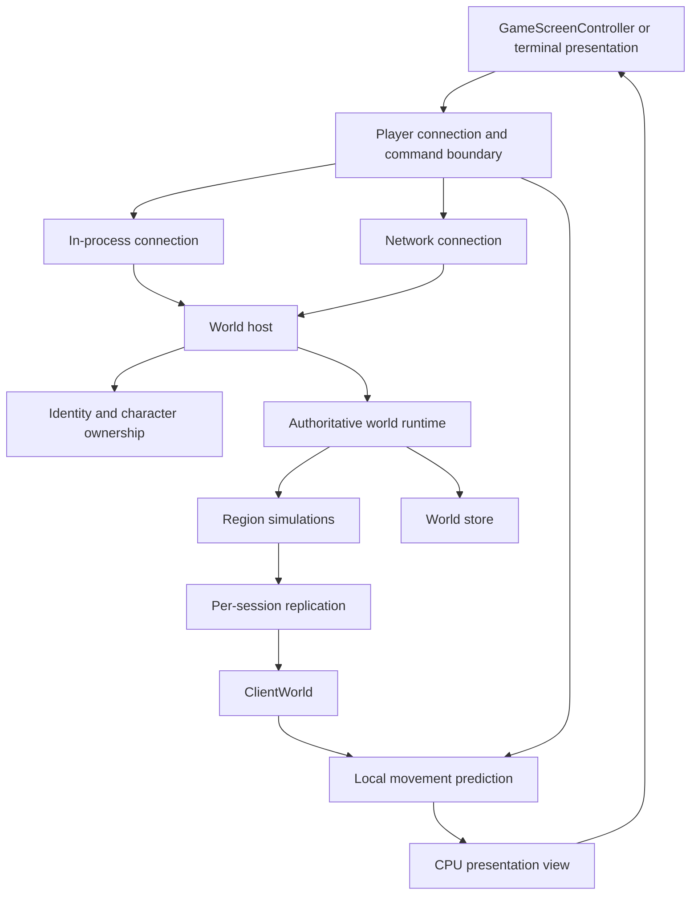

# Persistent networking and MMO concept

Date: 2026-11-07

Last reviewed: 2026-11-17, including the dedicated server, GPU Player, browser/WASM adapters, spatial/content delivery and operations foundation.

Status: Phases 1–7 and the phase 8 recovery/operations foundation are implemented: isolated embedded worlds, private snapshots, prediction/interpolation, durable characters, WSS/accounts, project-selected multiplayer, authoritative gameplay requests, spatial subscriptions and public geometry/collision loading. Phase 8 adds opt-in diagnostics, verified backups/fresh-path restoration, deployment-only migration and bounded overload handling. The subsequent optimization pass uses WSS protocol 4, shared public projections, compact entity poses and save container 2 with legacy reads. Dedicated saves now also use incremental journals and bounded action groups, documented in the dated implementation notes. The real-network release gate is documented in the latest dated note. The simulation follow-up adds finer profiling, movement optimizations and opt-in unoccupied-region suspension; see [simulation results](networking-evidence/simulation-performance.md). See [operations](../docs/server-operations.md) and [measured workload evidence](networking-evidence/phase8-load.md). Dated implementation notes below describe their original slices; their old outstanding-work statements are historical.

## Objective

Support a persistent shared Eldiron world with accounts, saved characters, and responsive movement while preserving offline single player and Creator playtesting. Graphical and terminal clients should participate in the same authoritative world.

Use one gameplay runtime across these modes. Change the host, connection, identity provider, and storage policy according to the mode.

| Mode | World host | Identity | Persistence |
| --- | --- | --- | --- |
| Online | Dedicated server process | Authenticated account and selected character | Durable shared world store |
| Single player | Embedded server | Automatic local identity | Local world and character save |
| Creator Play | Embedded server | Automatic test identity | Fresh temporary world by default |
| Creator persistent test | Embedded or development server | Test identity | Explicitly selected isolated test save |

Creator tests must not write to a production world. Ordinary local play must work without an account service or internet connection.

## Current code and reusable foundations

This proposal distinguishes existing local-runtime foundations from multiplayer features still to implement. The GPU migration improves the runtime/presentation boundary without changing the persistent-world objective.

| Area | Current implementation | Implication |
| --- | --- | --- |
| Simulation | `crates/rusterix/src/server/mod.rs`, `server/region.rs`, and `server/regionctx.rs` | Regions own gameplay execution and can be updated in parallel within one process. |
| World isolation | `crates/rusterix/src/server/world.rs` and `server/mod.rs` | Each server owns routing, player registration, runtime IDs, and shared world values; each region owns its context. This part of the original plan is implemented. |
| Runtime communication | `crates/rusterix/src/server/message.rs` | Actions, transfers, map changes, and entity/item updates already have internal message representations. |
| Partial replication | `crates/rusterix/src/server/entity.rs` and `server/item.rs` | Engine dirty-field updates remain internal. Recipient snapshots now capture complete authoritative state independently of dirty flags. |
| CPU session and startup | `crates/runtime/src/lib.rs`, `pump.rs`, `clock.rs`, and `crates/shared/src/runtime_assets.rs` | `GameSession` owns the local world and project, `SessionPump` collects output, and `SessionClock` schedules system ticks from supplied elapsed time. Startup no longer requires `Rusterix`. |
| Presentation input | `crates/runtime/src/view.rs` and `events.rs` | `RuntimeView` borrows recipient-owned `ClientWorld` maps during started play. Versioned baseline/delta DTOs and independent event/frame queues live in `crates/runtime/src/replication/`; `crates/network` supplies native/browser transport. |
| Creator | `creator/src/editor/play_session.rs` and `native_play.rs` | Native Play owns a `GameSession` separate from authored state and uses shared input/presentation policies; an explicit reference adapter remains. |
| Graphical player | `clients/client/src/main.rs`, `crates/player/src/native_player/mod.rs`, and `crates/runtime/src/player.rs` | The canonical launcher delegates to the shared `eldiron-player` application; desktop, browser, and Apple adapters use the common player stack. The duplicate WGPU client was retired. |
| GPU UI and scene views | `crates/presentation/src/game_screen/`, `screen/`, `scene_views.rs`, and `game_views.rs` | `GameScreenController` emits semantic effects, CPU layouts feed GPU painting, and `SceneViews` owns per-view graphics resources. Presentation does not tick the server or drain its channels. |
| Terminal client | `clients/client-terminal/src/main.rs` | Now owns the same `GameSession` and CPU startup/update path, with terminal-specific event interests and presentation. |
| Text presentation | `crates/shared/src/text_game.rs` and `text_session.rs` | Text observers explicitly select their controlled character and receive filtered private output. |
| Project storage | `crates/shared/src/project_io.rs` | `.eldiron` stores authored project content; it is not a complete running-world save format. |
| Editor API | `creator/src/scepter.rs` | Existing localhost editor tooling is separate from a gameplay connection. |

### Review outcome and remaining gaps

| Original requirement | Current status | Remaining work |
| --- | --- | --- |
| Independent local worlds | Server-owned routing/state/IDs; Creator Play remains temporary and local | Preserve isolation. |
| Shared CPU runtime/bootstrap | Embedded sessions and the dedicated executable use the same simulation | Fleet supervision and resource isolation. |
| Simulation/presentation ownership | GPU Player consumes private remote snapshots without a local simulation | Apple device execution and terminal remote adapter validation. |
| Independent timing | 20 ms movement; dedicated catch-up capped at 250 ms, discarded time counted | Tune against demanding authored worlds. |
| Output and transport | Versioned bounded MessagePack, native/browser WSS, HTTPS public geometry/collision | Full art export and optional partial geometry streaming. |
| Identity/control | Account ownership, character selection, connection generations and stale UI revocation | External login providers and account recovery. |
| Responsive movement | Shared controller, bounded replay/reconciliation, remote interpolation | Wider real-network/platform testing. |
| Durable world | Atomic file/IndexedDB stores, operation receipts, verified backup/restore | Domain-specific gameplay/schema migrations and off-site backup operations. |
| Authoritative gameplay | Validated combat, inventory and opaque dialogue requests; durable effects/receipts | New authored verbs as needed. |
| Interest management | Spatial cells, conservative object bounds, private pins and bounded preloads | Measure before adding cross-process region ownership. |
| Operations | Private phase/queue/save/bandwidth metrics, admission and per-client overload disconnects | Production monitoring, fleet controls and script/resource sandboxing. |

Current assumptions still to remove or extend:

- `local_player_action()` now addresses the implicit local connection only. Additional connections use server-resolved character ownership and their own input owners; public network requests use an explicit validated allowlist.
- `GameSession` owns one world and an implicit local current map. Additional connection views follow their own character/region within that world. Per-recipient snapshots and output delivery are implemented; native/browser WSS and durable account/character binding now use these same projections.
- `RuntimeView.session_id` identifies a local runtime incarnation or an explicit connection's view lifetime. It is not an account ID, proof of authentication, or input acknowledgment. `RuntimeView.player` supplies explicit observer/character selection. `tick_sequence` counts system ticks; it does not acknowledge processed movement inputs.
- GPU camera, party/HUD, mouse-look, command, text, and visibility paths now support explicit `PlayerView` selection. Legacy wrappers remain for authored previews/reference adapters; a pending explicit connection has no actor and never selects another player's body as a fallback.
- `SessionPump` drains engine output once and projects independent output for each connection before any consumer can drain it. Unstarted authoring fixtures and the explicit reference adapter retain their legacy local collector.
- `Server` retains internal synchronized maps for compatibility and authoring inspection. Started `GameSession` views borrow independently owned recipient replicas; network packets never serialize `Server`, `Map`, `Project`, or `Assets`.
- `SessionClock` schedules game and fixed movement ticks from explicit host elapsed time. `redraw_tick()` processes commands and publishes updates with zero elapsed time. The legacy host adapter measures wall time at the outer scheduling boundary. Frame-driven prediction/replay is an explicit opt-in path; ordinary embedded hosts retain direct semantic input.
- `EntityAction` includes both player requests and internal simulation actions. It should not become an unrestricted public wire protocol.

Source review also found existing isolation, clock, output-collection, and incarnation tests in `crates/runtime/tests/` and the runtime/server modules. New `player_connections.rs` tests exercise several connections in one world as a separate requirement from independent-world isolation.

## Proposed runtime boundaries

The following names describe responsibilities. Build on `eldiron-runtime`, `eldiron-presentation`, and `eldiron-player`; introduce the remaining boundaries inside this structure rather than restoring the retired client split.



### World runtime and host

The world runtime owns region instances, IDs, clocks, scripts, rules, command execution, and session-to-character routing. Region simulation is authoritative for movement, collision, combat, items, and interactions.

The world host supplies connection processing, identity, storage, and scheduling. An online host runs independently of any window. An embedded host is advanced by the local application, with simulation steps independent of rendering cadence.

`GameSession`, CPU `runtime_assets::start_server`, and `SessionPump` already supply the local host foundation. Keep world ownership separate from the new per-connection session lifecycle. `PlayerSession` currently combines local runtime and input policy; extend that policy to submit through a connection boundary instead of requiring an embedded `Server`.

Start with one server process owning the world and its regions. Regions remain the unit of simulation ownership. Moving regions between processes can follow once actual load justifies it.

### Session and identity

Keep these identities distinct:

- `AccountId`: durable owner of characters.
- `CharacterId`: durable identity of a playable character.
- `SessionId`: one active connection and its permissions.
- Runtime `EntityId`: efficient identity inside a running world.
- Authored template ID: identifies the Creator content used to instantiate an entity.
- Persistent object/item ID: durable identity for an individual saved instance.

Existing `creator_id` values identify authored content and must not double as unique identities for all instances of a template.

The server resolves the actor from the session. It validates character ownership, prevents conflicting simultaneous control, and routes actions to the character's current region. A client selects allowed creation options; the server constructs the entity and starting possessions.

Local identity uses this same authorization boundary with automatic setup. It does not require online login.

Preserve the existing runtime incarnation used to revoke stale UI/input and asynchronous results. Keep it distinct from connection identity and durable character identity. Reconnection may retain a character while replacing the connection generation; GPU recreation should retain the gameplay session.

### ClientWorld and presentation

`ClientWorld` now owns each connection's replicated maps, visible entities/items, world time, render state, and addressed UI events. It applies versioned CPU DTOs without a server, simulation clock, or GPU. Started local sessions also present these replicas through `RuntimeView`; trusted authoring inspection remains separate.

Preserve a common read-only presentation interface supplied by either the embedded runtime or `ClientWorld`. Adapt the existing `RuntimeView` boundary to those sources so `GameScreenController`, `SceneViews`, HUDs, and text consumers can continue to use CPU data without knowing which connection provides it.

Every client receives an explicit controlled entity ID. Update camera targeting, HUD bindings, party filtering, picking, and text helpers to use that identity. Other player entities remain visible without becoming camera targets or automatically appearing in the local party.

Keep the authoritative replica distinct from predicted local motion. Rendering combines the replica with local prediction and remote interpolation.

### GPU UI and resource lifetime

Retain the existing division between CPU screen/controller state and GPU view/image resources. Screen effects become requests at the session boundary; GPU painting, scene preparation, picking, and image upload must never drive simulation or mutate authoritative gameplay.

Networking replicates semantic world state, authorized events, and content references. GPU textures, `ViewId`s, renderer ownership IDs, paint-page residency, render targets, and local source revisions remain presentation/cache concerns, not durable gameplay identities or wire commands. Transfer authored/baked content through a versioned content mechanism where needed.

Keep existing session/map/content-scoped input validation. Extend stale-event rejection to reconnects, character changes, and new replication baselines. An old displayed hit, dialogue choice, drag/drop, or asynchronous completion must not act on a new character or region. UI eligibility remains advisory; the authoritative runtime validates the resulting request.

GPU/device recreation can invalidate view-dependent input and rebuild scene resources while preserving character state, connection ownership, pending authoritative requests, and prediction history where still valid. It must not register the player again or restore an old world snapshot. Conversely, a real world/session replacement must revoke stale presentation work even if map IDs are reused.

### Connection and protocol

Expose the same logical request/update interface through an in-process connection and a network connection. Local delivery can use typed queues without serialization. A fault-injection adapter can apply latency, jitter, loss, duplication, and disconnects during development.

Use `GameScreenController`'s existing semantic `ScreenEffect` output and `PlayerInput`/`PlayerControls` as integration points. Route gameplay requests through the connection; keep navigation, focus, text editing, clipboard, and visual resource work local. The current startup action queue and movement-state coalescing are input policy, not a prediction history or network acknowledgment system.

Define a versioned protocol with separate categories:

| Direction | Category | Examples |
| --- | --- | --- |
| Client to server | Session lifecycle | Authenticate, list/create/select character, enter world |
| Client to server | Movement input | Input sequence, controls, facing, simulation timing reference |
| Client to server | Gameplay request | Interact, inventory move, dialogue choice, ability request |
| Server to client | Session state | Controlled entity, world/content revision, region assignment |
| Server to client | Replication | Baseline snapshot, deltas, spawn/despawn, region transition |
| Server to client | Movement acknowledgment | Last processed input, authoritative movement state, simulation tick |
| Server to client | Addressed events | Private messages, dialogue, container access, audio, structured world text |

Use validated public requests rather than exposing arbitrary `RegionMessage` or `EntityAction` variants. Internal AI actions, debug edits, arbitrary entity creation, and administrative teleports remain privileged operations.

Messages need bounded sizes, explicit decode errors, and compatible schema versions. Reusing the current silent bincode error fallbacks at the network boundary would hide malformed messages.

Build complete baselines independently of global dirty flags. Include full initial inventory, equipment, and wallet state, and represent attribute deletion explicitly. Deltas must identify their region/baseline generation so delayed updates from a previous subscription or transfer can be discarded. Recovery can request a fresh baseline rather than applying a delta to missing state.

### First-version transport decision

Use binary WebSocket over TLS (`wss://`) for remote gameplay. This is the implemented first-version remote transport. Keep gameplay messages and binary encoding shared across targets, with native WebSocket/TLS adapters for desktop and Apple applications and the browser WebSocket API through `web-sys` for browser/WASM. Local single player and Creator tests retain typed in-process delivery.

Browser WebSocket is broadly supported, and Rust/WASM can send and receive binary payloads through the browser API; see the [browser API reference](https://developer.mozilla.org/en-US/docs/Web/API/WebSocket) and [official wasm-bindgen example](https://wasm-bindgen.github.io/wasm-bindgen/examples/websockets.html). Target Windows, Linux, macOS, native Apple mobile hosts, and current Chrome, Firefox, Edge, and Safari browser hosts. Platform adapters, TLS configuration, and reconnect behavior still require implementation and testing; protocol availability does not mean every device or network path has been validated. Deploy the public endpoint over TLS on port 443, subject to ordinary browser/network access policies.

WebSocket supplies reliable ordered delivery over TCP; see [RFC 6455](https://www.rfc-editor.org/rfc/rfc6455). A delayed or lost TCP segment can hold up subsequent gameplay updates. Client prediction and remote interpolation remain necessary, and cannot eliminate every stall. Bound queues, monitor browser `bufferedAmount`, coalesce obsolete unsent state safely, and define slow-client resynchronization. Load large static assets over a separate HTTPS content path so they do not queue ahead of movement messages on the gameplay connection.

Keep protocol categories separate so movement can use a different delivery strategy later if measurement warrants it. Native tokio-tungstenite/rustls, browser web-sys WebSocket, bounded binary MessagePack and local Argon2id accounts implement this path (protocol 3, `eldiron.v3`).

## Responsive movement

### Shared movement step

Extract reusable movement and collision logic from region execution. Both the client predictor and server call a movement step with explicit inputs:

```text
step_movement(state, controls, collision_view, movement_rules, fixed_dt)
    -> resulting_state
```

Movement state includes position, facing, and any mode-specific state needed to resume the calculation, such as vertical motion or an active movement mode. Prediction must not execute scripts, award items, apply damage, or emit authoritative world events.

Keep the movement clock distinct from lower-frequency rules/game ticks and presentation animation. Preserve existing realtime, grid, and turn-based behavior. Grid/turn requests must advance simulation once according to server policy; replaying prediction must not consume extra turns.

Reuse `SessionClock` for its existing lower-frequency system tick/catch-up responsibility. Add explicit fixed-step movement scheduling and pass simulation time into region logic; do not infer it from GPU frame completion, `poll()`, or a local `tick_sequence`. Review cooldown/condition timing separately so turn-based behavior retains its intended time policy.

Use the same calculation and compatible collision data on both sides. Exact agreement is not guaranteed: dynamic obstacles, timing differences, and floating-point behavior can still require correction.

### Local prediction and reconciliation

1. Sample controls and assign a monotonically increasing input sequence.
2. Simulate movement immediately on the client using fixed steps.
3. Retain a bounded history of input and predicted movement states.
4. Send inputs to the server; the server validates sequencing, movement mode, speed, and time budget.
5. The server replies with its authoritative state and the last input fully processed.
6. Compare that state with the client's historical prediction at the acknowledged input.
7. Restore authoritative state, discard acknowledged inputs, and replay remaining inputs.
8. Smooth a small visual correction while keeping corrected simulation/collision state immediate. Snap on teleports, region changes, or large corrections.

Example: an acknowledgment for input 105 is compared with the prediction for input 105, then inputs 106 onward are replayed. Comparing the acknowledgment with the current displayed position would incorrectly pull the player backward.

Define the relationship between input sequences and fixed server steps explicitly. Client timestamps and a flood of inputs must not grant extra movement time. Acknowledgments only cover input actually processed; bounded histories require an explicit resynchronization path when the acknowledged state is too old.

Movement input must also expire safely on disconnect or a stalled connection so a missing release message cannot leave a character walking indefinitely.

If movement later uses unreliable delivery, define redundant recent-input transmission, deduplication, and missing-input policy before enabling it. Durable gameplay requests retain reliable delivery and request-ID deduplication. Network loss simulation should exercise the delivery guarantees of the selected transport as well as the application's recovery rules.

### Remote movement and immediate feedback

Interpolate other players and NPCs between buffered authoritative snapshots using server timing. A late or missing snapshot should have a bounded presentation policy, followed by resynchronization where necessary.

Facing, camera response, and movement animations can react immediately. Ability animations and other speculative feedback need a way to resolve rejection without duplicating effects on acknowledgment or replay. Damage, loot ownership, shared container contents, and other gameplay results remain server decisions.

Feed predicted transforms and interpolated actors into the CPU presentation view consumed by game widgets and scene preparation. UI, picking, and camera policy need a consistent view of predicted local motion; do not implement walking only as a GPU matrix offset or overwrite the authoritative replica with smoothed render positions. Presentation source invalidation must account for corrections without rebuilding unrelated static geometry or resetting the session.

Terminal clients can use the same session and world protocol without graphical interpolation. Replace local-only movement/teleport shortcuts with authorized movement requests or server-resolved traversal actions.

## Regions, chunks, and interest management

### Existing chunk systems

Current rendering builds 32-unit chunks from a complete `Map`; the scene manager supports dirty chunk rebuilding and prioritizing work near a focus. Runtime mesh collision uses a separate 10-unit grid. Rendering chunk keys use world origins in the scene manager, while collision lookup uses cell coordinates. Any shared spatial utilities must make those conventions explicit.

These systems are useful foundations, but they do not yet provide network subscriptions or partial map streaming.

GPU scene/image ownership, asynchronous paint-page residency, and local visual-content revisions are additional resource-lifetime layers. Their upload, eviction, and completion policies must not decide network interest or whether a world entity exists. Keep content readiness and collision readiness explicit when presenting a replicated map.

### Spatial subscriptions

Keep a spatial index of dynamic entities and objects within each authoritative region. A session subscribes to nearby network cells, with margins appropriate to view distance, movement, sounds, interactions, and large objects.

- Entering interest sends a complete object baseline.
- Remaining in interest sends relevant changes.
- Leaving interest removes the object from that client's view without destroying it in the world.
- Public appearance and movement are separate from private inventory, wallet, dialogue, and owner-only attributes.
- Party and other explicit subscriptions may extend beyond physical proximity.

Interest management is a server policy. The client cannot obtain private state by requesting arbitrary cells. Server-side targeting and interaction validation remain necessary even when an object is replicated.

Network cell size is independently configurable. It may initially align with rendering chunks, but rendering, collision, persistence, and network cells need not share one granularity.

### Geometry and collision availability

Initially, clients can load versioned static region content as a package and receive dynamic state over the session connection. This avoids requiring a partial-map representation for the first multiplayer milestone.

Later, stream geometry/content chunks with revision IDs and a collision-ready margin ahead of movement. Prediction requires collision data for the destination before the player reaches it. Define behavior at an unavailable-content boundary explicitly, and prioritize required content loading.

Dynamic door, terrain, and prop changes need revisions and matching collision updates. Prediction may briefly use an older state; authoritative correction handles disagreement. Client render culling must not unload collision data still needed by prediction.

Crossing a network cell boundary updates subscriptions. Crossing a region boundary transfers simulation ownership and changes the session's region. The client applies a new baseline and resets/rebases movement history at the transfer boundary so old-region input cannot be replayed into a different region.

### Simulation activity

Filtering replication reduces bandwidth; it does not itself reduce NPC or script simulation cost. Initially keep loaded regions simulating under an explicit policy. Later introduce inactive-region scheduling or unloading with defined timer, respawn, and world-event behavior. Being outside every player's view does not automatically make a region safe to stop.

## Persistence and recovery

### World definition plus durable state

Treat `.eldiron` as the authored world definition: templates, maps, rules, assets, and behaviors. Give each running world a durable identity and a compatible content revision.

Store runtime changes separately:

- Character attributes, progression, inventory, equipment, wallet, and location.
- Persistent NPC/object/item identities and lifecycle state.
- Containers and item ownership, including dropped or transferred items.
- Changed doors, props, world/region variables, and generated content needed to reconstruct the same world.
- Required behavior state, conditions, timers, stashed/dead entities, and respawn state.

Define explicitly which attributes are persistent, public, owner-only, derived, or transient. Storage schemas and replication schemas have different purposes.

Do not serialize the runtime structs blindly as the save format. In particular, current `Entity` deserialization skips inventory, and runtime state also lives in `RegionCtx` and behavior systems. Introduce complete, versioned save records and restoration code.

### Lifecycle

Separate new-world creation, first character spawn, load/restore, session join, reconnect, and respawn. Restoring saved state must not rerun starting equipment/wealth grants, regenerate unrelated content, or duplicate authored NPCs.

Restore the world definition, apply compatible saved state, rebuild derived indexes/collision, and resume execution. Publish a client baseline only after restoration is complete.

Make offline-time policy explicit: for each timer type, either pause while offline or advance against a durable time reference. Realtime movement prediction does not determine how persisted timers behave.

### Transactions and checkpoints

Use a `WorldStore` boundary with temporary, local durable, and hosted durable implementations as needed. Choose a minimal durable backend during implementation; the concept does not require multiple database products at the outset.

Item transfers, trades, currency changes, and other ownership operations need an atomic durable result across all affected records. Assign gameplay request IDs and deduplicate retries so reconnects cannot apply an operation twice. Coordinate commit and simulation publication: a failed commit must not publish a successful durable operation, and a committed operation must recover correctly if the process stops before replying.

Position and other frequent non-economic state can use periodic checkpoints with an explicitly documented crash-loss window. Graceful logout/shutdown should flush pending saves, while crash recovery must also work without that flush.

Region transfers must recover to one authoritative location and one character instance. Begin with one world process and one persistence authority to keep these guarantees manageable.

Content updates require save-schema and content compatibility checks. An incompatible project revision should produce an actionable error or run an explicit migration before opening the world.

The later [world resource lifecycle contract](world-resource-lifecycle-contract.md) and [shared gameplay operation contract](shared-operation-contract.md) refine planned persistent stock, lifecycle timers, atomic operations, and stable outcome/retry identities. Align future saves and network requests with those semantics rather than introducing a second ownership or reward system. Those documents are proposals, not evidence that the runtime already implements the contracts.

## Creator and single-player behavior

Native Creator Play already creates an owned `GameSession` from project data, separate from the authored document. Preserve that behavior and the explicit reference adapter during migration. The planned default remains temporary state discarded on Stop; persistent testing selects a separate test world/save explicitly.

Preserve existing pause, resume, debug output, and graph/rule editing through a development-control interface. Changes that affect movement rules or collision must invalidate/rebase prediction as appropriate. Development controls are separate from ordinary player permissions.

Add a development connection panel showing simulated latency, jitter, loss, server tick, outstanding inputs, correction distance, and active subscriptions. Allow two test sessions to connect to the same isolated world.

Single player uses automatic local identity, local storage, and the same session/replication path. It should not serialize network packets or introduce artificial delay for normal play. Separate local saves from authored project files.

The current local player host pauses its embedded server on application suspension. Preserve the chosen local pause policy, but a connected online client must only suspend its presentation and release/cancel controls. Focus loss, minimized windows, GPU recovery, and browser/Apple lifecycle callbacks cannot pause the shared server. Define connection timeout, background receiving, and fresh-baseline behavior when the operating system suspends network execution.

## Implementation plan

Each phase should leave Creator and existing clients usable. Add focused tests for the new behavioral boundary and preserve existing gameplay checks relevant to the changes.

The 2026-11-16 review credits completed GPU migration foundations below. Phase numbers remain stable; no phase is marked complete merely because a local type has a session-like name.

### Implementation started: connection and observer foundation

The first implementation slice adds:

- Server-owned `PlayerConnectionId` handles with awaiting, spawning, and active registration states. Region acknowledgments bind one character to one connection; repeated start requests are idempotent.
- Connection-addressed actions/events and trusted host teleport operations. Compatibility local-player methods address only the implicit local connection. Region transfer updates the owning connection without moving other players' views.
- `GameSession` APIs to open/register/close additional in-process connections and borrow a connection-specific view of the same synchronized world. `PlayerInput::for_connection` retains explicit ownership through startup queues and rejects expired handles.
- Explicit `PlayerView` selection for GPU game cameras, party/HUD bindings, mouse-look, text observers, private world descriptions, first-person body suppression, and isometric cutaways. Character changes revoke stale UI context.
- Connection-aware transcript filtering rejects another character's messages, pause commands, and dialogue choices before they enter the local UI. This is presentation filtering, not a substitute for server-side private replication.
- Connection closure stops held movement and detaches control while retaining the body. A late spawn acknowledgment cannot resurrect a closed connection; world restart revokes all old handles. Saved character recovery and reconnection remain future work.

The initial slice used borrowed trusted simulation maps. The snapshot implementation below replaces started gameplay views with recipient-owned replicas. `RuntimeView` still borrows separately provisioned presentation content/assets and must never be serialized wholesale. The graphical and terminal launchers remain local hosts; no remote login/connect UI is added yet.

The new runtime and presentation tests cover independent control and observer selection, private text context, registration/disconnect/restart, and region transfer. Preserve existing local startup, screen, and world-isolation tests alongside them.

### Client snapshots and private replication implemented, 2026-11-16

`crates/runtime/src/replication/` now supplies the following boundary:

- `ClientFrame` contains protocol version, world/connection identity, baseline generation, frame sequence, system tick, controlled character/current region, state changes, and addressed events. Entity/item DTOs explicitly reconstruct inventory, equipment, wallet, nested contents, attributes, and transforms. They do not use persistence `Entity` deserialization, which intentionally skips inventory.
- New connections/subscriptions receive complete current baselines, including state whose engine dirty flags were already cleared. Deltas replace changed objects completely and explicitly remove departed entities/items, so deleted attributes and emptied inventory/equipment/wallet do not linger.
- Public entity/item attributes use an explicit `ReplicationPolicy` allowlist. The controlled actor and its server-managed party receive their private inventory/wallet and normal character attributes; internal `_...` fields are excluded except the public animation source key. Foreign inventories and wallets remain hidden. Custom public HUD/appearance/stat keys and prop state require explicit policy configuration through `GameSession::set_replication_policy`.
- Server-approved container sessions reveal the selected contents only to the authorized actor. Access is rechecked against ownership, party management, death/loot state and distance; moving away, removal, death, or transfer revokes access. Container-open events carry a recipient, including the case where two actors open the same shared chest. Valid trade sessions reveal only explicitly offered items/prices, with no seller wallet, other inventory, or bag contents.
- Messages, dialogue choices (including nested choice recipients), private world text, and container-open requests are projected before delivery. Speech and audio retain their existing region-broadcast semantics. All regions are currently subscribed; spatial interest filtering is a later phase.
- `ClientWorld::apply` checks identity/version, ordering, content readiness, object structure, and private event addressing before changing visible state. Gaps require a baseline; stale/duplicate frames cannot replay events. Transfers, control/content changes, policy changes, and explicit resync create a new generation and revoke stale UI scopes. Ordinary polls and GPU recreation preserve the scope. Unread transcript/audio survives a resync for the same actor; old choices/container requests are cleared.
- `GameSession::start` enables typed in-process projection for the implicit local player and additional connections. Native Creator Play, graphical single player and terminal use that same path, with no packet serialization or artificial latency. Native avatar preparation reads replica maps, and the terminal room/widget adapter copies the recipient map and scopes its player marker to the explicit observer. `inspect_region` remains trusted authoring inspection. Unstarted preview fixtures and the explicit legacy reference adapter retain their existing borrowed behavior.
- `subscribe_replication` / `take_client_frames` expose independent optional frame queues for future transport and tests. Queues hold at most 64 frames; overflow returns `Backpressure`, requiring resubscription or `request_baseline`. State recovery does not replay historical transient events. Client event retention is capped at 16,384 entries; `events_overflowed` / `take_connection_event_overflow` report a stalled consumer losing new transient output while world updates continue. Output errors from local projection/application surface in `SessionUpdate.replication_error`.

Static geometry/art uses `RegionContentRef` (map UUID, map revision, runtime content revision) and `ClientWorld::install_content`. Actors/items and prop runtime state are stripped from installed content, including profiles. Authored prop materials/parameters come from this separate content cache; packets contain sanitized prop state/identity/transforms. A static prop configuration change or runtime map replacement invalidates the content reference. A receiver must install matching content before applying that baseline. The helper accepts trusted, already provisioned content: it is **not** a public content exporter or sanitizer. A network content packager must omit server scripts/secrets rather than sending the authored `Map`/`Project`.

Still outside the snapshot slice: WSS adapters/endpoints, binary codec and hostile-byte decoding limits, public gameplay request allowlist, authentication, saves, and spatial subscriptions. Prediction/interpolation is implemented separately below. The DTOs have serde roundtrip coverage but are not an untrusted network decoder. Typed local delivery and independent replica tests do not establish browser socket, TLS, or live multi-process behavior.

### Phase 1: Explicit player connections within an isolated world

Implemented: server-owned world routing/state/IDs, region-owned contexts, connection-specific character control, explicit observers, and shared-world plus independent-world isolation coverage. Preserve these boundaries as remote transport is added.

Work:

- Add per-connection sessions and a controlled entity ID to the existing world-owned routing, with automatic local identity.
- Replace broadcast local-player input with addressed requests.
- Update GPU game widgets, camera/mouse-look, party/HUD, command, and text player resolution.
- Keep `GameSession` world ownership distinct from multiple player connections; do not instantiate a world per connected player.

Acceptance:

- Two sessions in one region control different characters and use independent cameras/UI/text views.
- Starting or stopping a second world does not clear or affect the first world.
- Native Creator Play, the shared desktop/browser/Apple player, terminal play, and explicitly retained reference adapters retain their local behavior.

### Phase 2: ClientWorld and in-process protocol

Implemented in-process: `ClientWorld`, serializable complete baselines and deltas, private projection, addressed events, ordering/generation checks, and bounded independent delivery queues. A public request allowlist and bounded binary wire decoder are still required before exposing a network endpoint.

Work:

- Extract client replicas from `Server` and supply the shared read-only presentation interface from embedded runtime or remote replica state.
- Define public request/update types and implement an in-process connection at the existing screen-effect/player-input boundary.
- Implement complete join baselines, incremental updates, removals, and per-session event routing.
- Separate owner-only state from public replication.
- Add baseline identifiers and ordering/resynchronization rules before transport is introduced.
- Preserve GPU view lifetimes and stale-input revocation across source changes, reconnects, and character switches.

Acceptance:

- A second session joining after the world has changed sees a complete current baseline.
- One client reading events cannot consume another client's events.
- Inventory, wallet, private dialogue, and container authorization remain session-specific.
- Region transfers update the correct session and remove stale replicas.
- Recreating GPU resources does not reset the world, repeat player registration, consume gameplay events twice, or authorize an input from an old baseline.

### Phase 3: Independent clock and reusable movement

Implemented: host-driven fixed movement/timer steps, chronological game ticks, bounded catch-up, reusable collision resolution without script execution, and generation/sequence-checked movement state. Visual prediction and interpolation remain Phase 4.

Work:

- Separate authoritative movement stepping from redraw cadence and expose a reusable movement/collision step.
- Define input-sequence processing and server time budgets.
- Preserve game tick, grid, and turn-based semantics.
- Reuse `SessionClock`/`SessionPump` for host scheduling and make region movement/timer time inputs explicit for local and dedicated hosts.

Acceptance:

- Movement speed is consistent across rendering frame rates and does not increase when clients submit excess inputs.
- Existing collision, facing, slopes/steps, and supported movement modes keep their behavior.
- Grid/turn input advances the intended amount exactly once.
- Polling, rebuilding a GPU device, and producing extra frames cannot advance fixed-step movement or grant additional simulation time.

### Fixed movement implementation, 2026-11-16

- `rusterix::simulation::SimulationClock`, re-exported as runtime `SessionClock`, schedules movement every 20 ms (50 Hz) alongside configured game ticks. Events run in time order; movement precedes a game tick at a shared deadline. Catch-up is capped at 128 movement steps and eight game ticks per call, retaining partial steps and remaining time debt. Pause discards elapsed-time debt.
- `SessionPump::advance` supplies host time. `GameSession::poll`, presentation borrows and `Server::redraw_tick` supply no time. `advance(Duration::ZERO)` may consume previously granted catch-up debt; `poll()` cannot. `tick_once` remains an explicit trusted-host/manual game-step operation, used for terminal/Creator text commands and startup, not a network input operation.
- Regions receive fixed steps through `movement_tick`. Movement, turning, cooldown/condition updates, avatar attack timers, hybrid timeouts and input debounce use supplied simulation time. Helpers converting seconds into stored game ticks use the configured game-tick duration, independent of rendering FPS.
- Turn/grid step requests coalesce until both the game and movement consumers finish the prior grant, bounding the turn backlog. A released grid step can finish its committed cell/rotation without starting another one. Hybrid timeout advances only when host time is supplied.
- `rusterix::movement::MovementWorld` / `move_by` implement the existing tile, dynamic-body/item, elevation and mesh-floor collision algorithm over read-only CPU sources. They mutate the supplied actor and return contacts. The authoritative region wrapper dispatches bump scripts and sector changes afterward; the reusable kernel does not execute VM actions or deliver gameplay events.
- `GameSession::submit_movement_input` accepts only typed movement state with a current replica generation and nonzero monotonic sequence. Duplicate/older sequences are ignored, expired handles fail, and pending input from a revoked baseline is dropped with a stop. Continuous movement coalesces to its latest state. Grid movement retains up to 32 changed press/release transitions per connection, consumes at most one transition per fixed step, and reports `Backpressure` when full. Repeated identical held state does not fill that queue. Input submission never grants simulation time.
- `accepted_movement_input` reports receipt only; it is **not** a processed movement acknowledgment. `movement_tick_sequence` and `SessionUpdate.movement_steps` expose issued movement ticks to hosts. Prediction history, processed-input acknowledgments and wire snapshot timing remain Phase 4 work. Local `PlayerInput` still uses trusted addressed semantic actions; the new sequenced movement API is ready for the prediction/transport adapter, not a complete public gameplay protocol.
- Native single player, Creator-owned/reference play, manual text stepping and legacy facade hosts use the shared timing boundary. Legacy hosts use `advance_wall_clock`; explicit reference bootstrap uses `advance_elapsed`. Native/browser builds share the CPU scheduler. Static drawing/streaming chunks still have no authority over simulation time.

Authoritative poses now advance at 50 Hz. Smoothing those samples at the rendering rate, predictive local movement and remote interpolation remain the next phase. WSS sockets, a binary wire decoder, accounts and persistence are still unimplemented.

### Phase 4: Prediction, reconciliation, and remote interpolation

Implemented as an opt-in CPU client and frame-input server path. Default single player, terminal and Creator Play retain their direct embedded controls; remote login/connect UI is still pending. `MotionClient::view` is compatible with the existing shared presentation stack. Local Creator/fault harnesses can opt into the new path without a socket or GPU.

Work:

- Add bounded local input/state history and authoritative movement acknowledgments.
- Implement correction, replay, visual smoothing, and hard resets for transfers/teleports.
- Add server-timed remote interpolation and connection fault injection.
- Define stale input expiry and history-overflow resynchronization.
- Integrate predicted state with the existing CPU game-screen/picking/camera view and invalidate only affected presentation sources.

Acceptance:

- Local movement responds on the next local simulation/presentation update without waiting for a roundtrip.
- Under simulated 100-200 ms roundtrip latency, walking into walls and around doors converges to server state without persistent drift.
- Duplicate, delayed, and dropped inputs do not grant extra movement or leave movement stuck on.
- Replay does not repeat gameplay events, item actions, or turn consumption.
- Teleport, region transfer, reconnect, and history overflow recover to an explicit baseline.
- GPU recreation preserves an active gameplay session, and a suspended online client never pauses the shared world.

### Phase 5: Durable characters and world state

Implemented as an opt-in runtime owner, `persistence::DurableSession<S>`. Native file storage, browser IndexedDB, temporary stores, restoration and staged durable operations share one record format. Existing launchers/Creator Play keep their temporary behavior until a host explicitly selects a save slot; no save-selection UI is added here. Implementation and validation details follow below.

Work:

- Introduce durable identities, explicit save records, schema/content revisions, and a minimal durable `WorldStore`.
- Implement creation versus restoration lifecycles, checkpoints, and transaction/deduplication rules.
- Add local single-player saves and opt-in persistent Creator test worlds.

Acceptance:

- Restart restores character inventory, equipment, wallet, progression, location, and representative world/behavior changes.
- Restoration does not repeat starter grants or duplicate NPCs/items.
- Interrupting an inventory transfer or region transfer at commit boundaries recovers one valid result.
- Retried gameplay requests cannot duplicate items or currency.
- Creator temporary play leaves authored content and persistent worlds untouched.

### Phase 6: Dedicated host, network transport, and accounts

Implemented as `eldiron-server`, the renderer-independent `eldiron-network` boundary, a native `eldiron-online` client and a WASM connection viewer. Username/password accounts use Argon2id and stable account UUIDs; future login methods can resolve to those identities. Dedicated saved worlds and accountless disposable demos are separate hosting modes. See [dedicated-server.md](../docs/dedicated-server.md) for commands, protocol/storage contracts, validation and current limitations.

The transport/session foundation is functional. Full GPU Player/Creator connect/login/HUD integration, public visual asset packages and network gameplay interactions remain follow-up work. The included browser demo displays shared actors and walking with compiled physics; it does not yet render a complete remote game.

Validation: 37 runtime tests passed alongside account/codec/host regressions, a real native WSS + HTTPS account test, and two Chromium tabs using the compiled WASM demo adapter. Native and browser Player/Creator builds and independent headless dependency boundaries passed. See the dedicated-host guide for exact scope.

Work:

- Build the dedicated entry point on existing `eldiron-runtime` and `runtime_assets` CPU bootstrap, without depending on `eldiron-player` or `eldiron-presentation`.
- Preserve the independently resolved headless feature boundary; audit startup content preparation and ensure the host does not initialize a window, GPU, or audio device. Trim unnecessary visual preparation separately where beneficial.
- Implement the selected binary WSS transport with native and browser adapters, bounded queues, and versioned network encoding; keep bulk content transfers on a separate HTTPS path.
- Implement authenticated sessions, character listing/creation/selection, exclusive control, reconnect, and logout.
- Use established authentication/credential handling and protected network connections; finalize the identity provider/backend here.

Acceptance:

- Two separate client processes share a persistent dedicated world and control different saved characters.
- One account cannot select or act as another account's character.
- Disconnect/reconnect restores ownership and a fresh baseline without spawning another copy.
- Incompatible content/protocol versions fail with a clear explanation.
- Local single player and Creator remain independent of the online account service.

### Phase 7: Spatial subscriptions and content loading

Work:

- Add per-region spatial indexes and per-session interest tracking.
- Implement enter/leave baselines, public/private filtering, and subscription margins.
- Start with packaged static region content; add partial geometry/collision streaming as a separate follow-up if needed.
- Make chunk coordinate conventions and content revisions explicit.

Acceptance:

- Distant changes are omitted when no explicit subscription requires them.
- Crossing cell boundaries produces no missing or duplicated objects, including large objects spanning cells.
- Collision remains available ahead of predicted motion.
- Moving outside interest only removes a replica; it does not delete persistent world state.
- Dynamic geometry changes update collision and replication consistently.

### Phase 8: Recovery, operations, and measured scale

Implemented foundation (2026-11-17):

- Opt-in bounded region/simulation/replication/encoding/save timings, private operator JSON and transport/queue counters; client-local correction distances and counts.
- Periodic coherent snapshots and verified per-world retention; immutable artifacts and fresh working-path restore, preserving accounts, characters, items and action/creation journals.
- Explicit deployment-only migration with strict source validation; gameplay/schema changes refuse automatic migration.
- Player admission 1–64, HTTP headroom beside gameplay sockets, and per-client socket/replica overflow disconnects. Storage errors still fail closed.
- All loaded regions tick; no offline catch-up; dedicated elapsed steps cap at 250 ms with discarded time counted. Embedded timing behavior is preserved.
- Reproducible optimized authored-world/synthetic-crowd measurements separate simulation, projection, encoding and file-save costs. The fixture-specific samples do not establish a universal player capacity or TLS/production guarantee.

See [operations/runbook](../docs/server-operations.md) and [measurement evidence](networking-evidence/phase8-load.md). Multi-process regions and full asset export remain deferred.

Work:

- Add useful metrics for region step time, bandwidth, correction size/frequency, save latency, and session queues.
- Exercise restart recovery, backups/restoration, content migrations, load limits, and overload behavior.
- Measure busy-region simulation separately from replication cost.
- Define inactive-region policy and pursue multi-process region hosting only when measurements require it.

Acceptance:

- A backup can restore a coherent world with compatible content.
- Slow clients and storage failures have bounded queues and explicit recovery behavior.
- Load measurements establish supported player/entity counts for representative worlds.
- Multiplayer behavior remains correct under latency, reconnects, restarts, and region transitions.

## Scope and open decisions

The initial online release targets one persistent world hosted by one process, with multiple region simulations and multiple concurrent player sessions. Player count is a measured outcome, not a promise implied by the term MMO.

Decisions to resolve at their implementation phase:

- Selected native tokio-tungstenite/rustls and browser WebSocket adapters, versioned binary MessagePack encoding, and local Argon2id credentials. Native macOS and actual browser/WASM delivery are exercised; Apple device builds and full graphical remote-session integration still need validation/work.
- Current movement/host update cadence is 20 ms; remote interpolation defaults to 100 ms, correction smoothing to 80 ms and pose snap distance to two world units. Tune per workload.
- Dedicated storage uses the existing atomic FileWorldStore; local username/password verification resolves stable account UUIDs. External providers and account recovery remain later work.
- Logout/disconnect presence, combat logout, and reconnect grace period.
- Selected initial policy: all loaded regions tick, no offline progression, capped dedicated catch-up. Sleeping regions remain future work.
- Strict compatible-content restoration and explicit deployment-only migration are implemented. Gameplay/schema migration remains domain-specific.
- Whether static region packages are sufficient before partial chunk streaming is needed.

Multi-process region migration, seamless simulation ownership across chunks, global economies/marketplaces, guild systems, and advanced lag compensation are later features. They should build on proven session, movement, replication, and persistence contracts.

## First reviewable milestone

The connection and snapshot portions of Phases 1 and 2 are tested with multiple players sharing one world. Creator uses this same runtime; a two-connection Creator panel remains future UI work. Fixed movement, the opt-in motion client and durable save/restore foundations are implemented. Preserve the existing isolation, `GameSession`, `SessionPump`, `RuntimeView`, and GPU boundaries. Later phases now provide authenticated WSS, public requests, remote content and recovery tools; the dated milestone notes below preserve their original validation scope.

## Review validation

The 2026-11-16 review inspected current runtime, server, Creator Play, shared player, presentation, and terminal paths, including existing isolation and local-session tests. `python3 tools/check_renderer_boundaries.py` passed its independently resolved dependency/source boundary checks for headless, native, browser/WASM, and Apple configurations. This verifies those dependency boundaries, not gameplay correctness or platform execution. No gameplay tests, platform builds, or multiplayer latency tests were run for this documentation update.

### Initial implementation validation, 2026-11-16

After the documentation review, the initial connection/observer implementation was validated with:

- `cargo test -p eldiron-runtime --offline`: 15 tests passed, including existing startup/world isolation and the new shared-world connection tests. The three connection tests were rerun after the final observer changes, including absent-body private text and per-player isometric cutaways.
- `cargo test -p eldiron-presentation --offline --test game_screen --test player_connections`: 39 tests passed; 16 tests remained ignored by suite defaults.
- Focused `rusterix` library tests: four `server::tests`, the first-person body-visibility test, and the new connected-transcript recipient test passed.
- `cargo check -p eldiron-player -p eldiron-creator -p eldiron-client-terminal --offline`: passed.
- `cargo check -p eldiron-client --features native-web --target wasm32-unknown-unknown --offline`: passed.
- `python3 tools/check_renderer_boundaries.py` and `git diff --check`: passed.

These checks exercise local runtime/presentation behavior and compile the supported host paths. They do not establish live network, TLS, browser connection, latency, accounts, or persistence behavior; those systems are not implemented yet.


### Client snapshot and private replication validation, 2026-11-16

- `cargo test -p eldiron-runtime --offline`: 22 tests passed. The six replication integration tests were rerun after final snapshot/host changes and passed, covering independent owned receivers, serialization with nested inventory, late-join privacy, removals, content replacement, prop materials, container/trade permission grants and revocations, private/public output routing, ordering/resync, and bounded queues. Existing registration, transfer, isolation, startup and clock tests also passed in the full run.
- `cargo test -p eldiron-presentation --offline --test game_screen --test player_connections`: 39 passed, 16 ignored by suite defaults.
- `cargo test -p eldiron-player --offline --lib`: 8 passed, 7 ignored by suite defaults (native GPU/Metal coverage).
- `cargo test -p eldiron-client-terminal --offline`: 11 passed, including explicit terminal player scoping and existing AI/text presentation checks.
- `cargo test -p rusterix --no-default-features --offline --lib server::tests`: 4 passed. The corresponding `--lib container` selection passed 12 tests covering container movement, stacking, money/loot, and interaction addressing.
- `cargo check -p eldiron-creator -p eldiron-player -p eldiron-client-terminal --offline`: passed after the final client adapters changed.
- `cargo check -p eldiron-client --features native-web --target wasm32-unknown-unknown --offline`: passed after the final shared player adapter changed.
- `python3 tools/check_renderer_boundaries.py` and `git diff --check`: passed.

These results establish typed in-process replication behavior, local host compatibility, and WASM compilation. They do not establish live browser networking, TLS, remote content export, account security, persistence, latency handling, or GPU/Metal execution of ignored tests.


### Fixed movement validation, 2026-11-16

- `cargo test -p eldiron-runtime --offline`: 23 passed, including existing connection, replication, startup, pause, isolation and clock coverage. The movement integration test was rerun after the final grid queue changes and passed: identical motion at 10/30/60/144 FPS, 10,000 sequenced updates without extra time, stationary polls, stale generation revocation, pause/resume, retained catch-up debt, a complete grid tap between updates, and bounded grid input backpressure.
- `cargo test -p rusterix --no-default-features --offline --lib movement`: 20 passed, including new kernel replay/mesh-height checks and fixed-region grid/poll/hybrid tests alongside existing stairs, platform/wall collision, facing and movement tests.
- The corresponding `--lib simulation::tests` selection passed two scheduler tests for timeline equivalence, partial steps, overload bounds and pause reset.
- The region progression selection passed 92 tests when excluding the two failing cases listed below. This includes the revised seconds/game-tick conversion check and existing rules, cooldown, condition, resource and action coverage.
- Presentation integration tests: 39 passed, 16 ignored. Shared player library: eight passed, seven ignored. Terminal: 11 passed. GPU/Metal-only ignored tests were not executed.
- Native Creator/player/terminal and browser `wasm32-unknown-unknown` checks passed. Legacy player examples/client reference binaries also compiled with `legacy-reference`. Renderer boundary checks and `git diff --check` passed.

The broader unfiltered headless engine suite was also run: **560 passed, six failed, one ignored**. That run preceded the seven new low-level scheduler/movement tests; it is not a claim that the entire engine suite is green. The following failures were outside the targeted movement checks and remain unresolved in this slice:

| Failing test | Observed failure |
| --- | --- |
| `ruleset_material::tests::native_ruleset_icons_are_palette_bound_32px_and_transparent` | Unbound icon base-color parameter. |
| `server::nodes::tests::hideout2d_nessa_opens_her_stock_from_the_shipped_graph` | Shipped dialogue advice branch produced no lines. |
| `server::nodes::tests::shipped_fixtures_carry_no_eldrin` | Hideout2D Torch fixture still contains source. |
| `server::region::ruleset_progression_tests::block_prop_door_interaction_is_authoritative_and_instance_local` | Look assertion expects a legacy `Message` rather than the private world-text delivery. |
| `server::region::ruleset_progression_tests::spawned_grid_player_startup_ignores_previous_item_context` | Test-provided context has no diagnostic sender; startup logging unwraps it. |
| `server::region_host::tests::official_ruleset_applies_character_defaults_and_unlocks` | Ruleset default assertion expected seven, received four. |

These Phase 3 results validate in-process fixed movement and compile the host paths. Phase 4 validation follows below; live browser sockets remain untested.

### Prediction, reconciliation and interpolation implemented, 2026-11-16

`crates/runtime/src/prediction.rs` adds a renderer-independent `MotionClient`. Its `ClientWorld` remains the exact recipient-filtered authoritative replica. Prediction changes a lightweight actor copy; `MotionClient::view` overlays predicted local motion and interpolated remote actors on separate presentation maps. Cameras, CPU picking, HUD and scene preparation consume that same `RuntimeView`. Static map content is retained across pose changes; GPU resources and host clocks are not owned by this client.

The opt-in frame protocol differs from Phase 3's coalesced held-state API:

- `MovementCommand` carries baseline generation, contiguous sequence, movement intent and bounded finite mouse yaw. Each command represents exactly one 20 ms movement step. The server accepts at most 32 queued frames and consumes at most one per host-issued movement tick. Receipt/polling never simulates a frame. Duplicates are ignored; missing sequences, invalid input, pause and backpressure are explicit errors. A transport retries the ordered pending window and handles those results.
- Version 2 `ClientFrame` adds server movement time and optional `MotionSnapshot`: last **processed** input sequence, movement rules, controller state, predictability and discontinuity revision. Non-frame connections omit motion metadata. Phase 3's `accepted_movement_input` continues to mean receipt only; the two input modes cannot be mixed on a connection.
- The shared pure controller in `crates/rusterix/src/movement/controller.rs` runs on both sides. It supports the camera movement modes, committed grid walks/turns, release edges, hold speed and blocked-step latching, using the shared tile/mesh/elevation collision kernel. Only the authoritative wrapper dispatches contacts, sector callbacks and turn requests. Replay executes no scripts, gameplay actions or event delivery. Inventory, combat, interactions and authored movement remain authoritative semantic requests.
- Prediction retains at most 128 commands. On acknowledgment it restores authoritative actor/controller state, drops acknowledged commands and replays the remaining commands. This implementation retains inputs rather than a full state copy for every step. Small position/facing errors decay in presentation only; collision and authority state are corrected immediately. Fractional-step preview and yaw make motion visible before the first 20 ms input sample or server roundtrip.
- Remote entities use at most 32 poses each, indexed by server movement tick, with 100 ms default interpolation delay and shortest-angle facing interpolation. The embedded setting uses zero delay. Missing packets freeze at the latest available pose rather than extrapolating indefinitely. Despawns prune buffers; revision changes and large jumps snap.
- Fresh baselines clear controls/history, reset presentation scope and clock, and revoke old inputs after transfer, control/content change, teleport, death/predictability change, pause/resume or explicit resync. Snapshot gaps, history overflow and suspension require a baseline. Queued or stalled moving inputs expire after 25 movement ticks (500 ms); absent input is never repeated movement. Reconnect starts from a fresh baseline rather than replaying an old connection's controls.
- CPU collision content is installed separately with its exact `RegionContentRef`. A client cannot predict or emit movement frames until matching collision is ready. Authoritative prop changes rebuild affected collision chunks, including old and new door geometry. Rendering chunk culling cannot remove this prediction data. Sanitized network content packaging and collision streaming remain future work.

For an in-process predicted player or Creator test:

```rust
let mut client = session.create_motion_client(connection, MotionSettings::embedded())?;
client.set_intent(MovementIntent::Forward);
session.advance_motion_client(connection, &mut client, elapsed)?;
let view = client.view(&session.project, &session.assets, None);
```

`advance_motion_client` is a zero-latency convenience adapter: collect pending scope changes, sample/retry inputs, advance the host and deliver updates/rebases. For several clients in one world, advance the host once separately, advance each client clock, use `pending_inputs` / `submit_input_frame`, then deliver that connection's `take_client_frames` through `receive`. This permits independent packet delays in tests and the later transport adapter. `install_motion_content` clones trusted local CPU content/collision for tests; it is not a remote content exporter. Enable frame input explicitly for custom adapters; creating/subscribing a motion client requests a new baseline.

Ordinary single-player, terminal and Creator Play retain direct `PlayerInput`/`PlayerControls`, typed local replication and their existing startup/pause behavior. They do not require prediction or an account/network connection. The graphical launcher has no remote connection UI yet. Presentation resource recreation leaves `MotionClient` intact; `suspend`/`resume` release its controls and require a baseline without pausing a shared server. No sockets, TLS, public wire decoder, account service or durable saves are introduced by this phase.

### Phase 4 validation, 2026-11-16

- Runtime suite: 30 passed before the final two recovery/collision cases were added. The final prediction suite passed all nine cases, bringing covered runtime tests to 32. Coverage includes 5 ms response before any roundtrip, 10/30/60/144 FPS in every camera mode, simulated 100/200 ms RTT with retries/duplicates/dropped inputs, correction convergence, private output delivered once, shortest-angle remote interpolation, teleport/despawn snaps, grid taps, bounded history, suspension, region/content rebases, collision readiness and a real `GameSession` exercising processed acknowledgments, input expiry, pause/resume, teleport and default embedded controls.
- A mesh door test opens the authoritative prop and rebuilds prediction collision without a GPU; both sides cross the opening without repeated correction. Presentation tests passed, including camera/picking consuming the predicted pose and UI recreation retaining the live gameplay view.
- Shared player library: eight passed, seven ignored. Terminal: 11 passed. Movement/kernel selection: 20 passed. Native Creator/player/terminal, browser player and browser Creator WASM compilation, legacy adapters and renderer boundary checks passed. GPU-only ignored tests were not executed. The broader engine suite's six failures recorded in Phase 3 remain outside these targeted checks.

This validates typed in-process and simulated transport behavior plus target compilation. Live WSS/TLS, browser socket lifecycle, multi-process clocks, production latency/jitter and GPU/Metal execution still need adapter-level validation.

### Durable saves and restoration implemented, 2026-11-16

`crates/runtime/src/persistence/` owns `WorldSave`, `WorldStore` and `DurableSession<S>`. `.eldiron` remains authored content, separate from save files. Ordinary `GameSession`, single-player launchers and Creator Play stay temporary unless their host explicitly opts into this owner. A persistent Creator test selects `SavePurpose::CreatorTest(slot_name)` and its own backend slot; loading a single-player/dedicated save under that purpose is rejected. No account service, socket or GPU is required.

Identity and compatibility:

- A durable world UUID and durable character UUIDs survive restart. Character records associate one world-local entity serial with one saved region and an optional trusted account UUID. World-local entity/item serials and their allocator high-water mark survive, including IDs of destroyed objects. Connections, prediction histories and view/session incarnations are newly established after restore. The existing `ClientFrame.world` remains a runtime incarnation guard; it is not this durable world identity.
- Schema version 1 and a SHA-256 content fingerprint guard opening. The fingerprint includes canonical authored project data, resolved rules, runtime package version and save-schema version. This is deliberately strict: even an authored configuration edit requires matching content or an explicit future migration. An incompatible/corrupt save returns an error and never falls back to a new world. Saves are checksummed and bounded to 128 MiB.
- Storage DTOs are distinct from replication. Explicit entity/item records reconstruct complete nested inventory, equipment, wallet, attributes, sequences and action state. Region records retain present/stashed bodies, respawn snapshots, private condition/behavior state, notifications, world/region variables, game time, simulation timers, generated/runtime geometry, props and render settings. Geometry records omit editor selections and baked GPU resources. Native behavior schedulers retain actor incarnations, pending events, watchers and ongoing activity; compiled plans rebuild from compatible content. Diagnostics and execution stacks are not durable state.

Restore lifecycle:

1. Read and validate the save and content compatibility before opening gameplay.
2. Bootstrap the CPU content/services and compile behavior programs with region initialization in restore mode. This skips authored occupant spawning, starter inventory/wealth grants, setup callbacks and world/region/entity Startup events.
3. Reconstruct all regions and derived collision/navigation data, then install saved world state and ID allocator together. Conditions and their existing FX retain their saved private state; restoration does not reapply them or repeat their effects.
4. Restore the host scheduler and game/movement counters. Offline time is paused: clocks, condition durations, notification deadlines and respawn timers resume from saved simulation time, with no wall-clock catch-up.
5. Attach the selected local saved character directly and publish a fresh recipient baseline. `start_player` remains idempotent for the restored local character. Other saved characters can be attached to a fresh connection with `join_character`, which rejects simultaneous control of one body. Account authorization remains a host responsibility for Phase 6. Old held movement/frame inputs are not restored; open dialogues/container UI are dismissed rather than restoring stale UI permissions.

Checkpoint and operation semantics:

- Capture settles bounded pending commands/transfers with zero-time polls, and rejects a world that cannot reach a checkpoint boundary. It captures authoritative contexts rather than presentation replicas or dirty-field updates. A stopped world cannot overwrite a save with empty state.
- `DurableSession::advance(elapsed)` drives the existing `GameSession` and checks a default five-second checkpoint interval, configurable by the host. `checkpoint().await` explicitly flushes; `shutdown().await` flushes before Stop and reports errors. Drop does not silently perform I/O. Ordinary simulation changes since the last checkpoint can be lost on a crash. Direct calls through `.game` require the host to schedule checkpoints itself.
- `commit_operation(request_id, fingerprint, edit).await` edits a staged complete record. The host's operation policy validates participants, quantities and domain rules in that closure; this is a trusted API, not a public arbitrary-state request. The runtime validates identity/location and unique ownership, prepares all fallible behavior/collision reconstruction, and commits the world image plus request outcome before updating live simulation or publishing a new baseline. Item/currency changes and a region relocation can therefore commit as one image.
- A committed request retry with the same fingerprint returns its stored outcome without executing the edit again, even after restart or a lost reply. Reusing an ID for different parameters conflicts. The initial ledger holds 4,096 outcomes and rejects new operations when full; it does not silently evict retry protection. Ledger compaction/scalable storage is future work.
- On storage failure the staged edit is not published. The owner refuses further durable writes until reopened, including ambiguous failures after a commit but before its reply. Recovery loads either the old complete image or the new complete image and its outcome ledger. Existing legacy gameplay actions are checkpointed; they are not automatically converted into immediate durable economic operations. The future public request dispatcher must route such requests through this boundary.

Backends:

| Store | Behavior |
| --- | --- |
| `MemoryWorldStore` | Temporary/test snapshots with portable `bytes()` / `from_bytes` support; no implicit filesystem/browser writes. |
| `FileWorldStore` (native) | Explicit save path, exclusive OS writer lock, checksummed bounded reads, revision compare-and-swap, same-directory temporary write, file sync, atomic rename and directory sync on Unix. An orphan temporary file is never a recovery head. `.eldiron` paths are rejected. |
| `BrowserWorldStore` (WASM) | IndexedDB database and explicit slot. The complete image, durable identity and revision commit in one read/write transaction, with strict durability requested. Concurrent tabs using an old revision conflict. Open, quota, transaction and permission errors propagate. Browser eviction/private-storage policy remains controlled by the browser. |

An opt-in native host can use:

```rust
use eldiron_runtime::persistence::{DurableSession, FileWorldStore, SavePurpose};

let store = FileWorldStore::open(save_path)?;
let mut session = DurableSession::open(
    authored_project, store, SavePurpose::SinglePlayer, options,
).await?;
session.advance(elapsed).await?;
let view = session.game.view();
// At a deliberate save or lifecycle boundary:
session.checkpoint().await?;
session.shutdown().await?;
```

WASM supplies `BrowserWorldStore::new(database, slot)` to the same async API and awaits storage instead of blocking browser execution. Persistent Creator harnesses use `CreatorTest(name)` and separate test slots. Graphical save-slot selection, automatic launcher wiring, authenticated character selection, migrations and production request routing remain separate integration work; default temporary play continues through its existing APIs.

### Durable save validation, 2026-11-16

- Persistence integration checks restart the shipped 3D starter project and compare the complete saved world before/after restoration: nested inventory, equipment/wallet/progression, dropped items, props, region/world variables, notifications, stashed/respawn state, character location, allocator and clock. No starter grants or authored occupants are allocated again, and repeated local registration is a no-op.
- Staged-operation tests cover duplicate item rejection, atomic inventory/currency transfer, failure before commit, lost reply after an atomic region transfer, restart recovery and retry deduplication, conflicting request parameters, exclusive character control, temporary Creator isolation, periodic checkpoints and safe shutdown. Store tests cover corruption, schema/content/purpose mismatch, revision conflicts, exclusive native locks and orphan temporary files.
- The scheduler restore check verifies completed Startup effects are not replayed and genuinely pending events survive exactly once. Existing runtime/motion, presentation, player and terminal regression checks also run for this slice; GPU-only ignored tests remain unexecuted.
- `node tools/verify_world_store_browser.mjs` passed using a disposable Chrome profile against the actual IndexedDB adapter: one CAS winner, aborted/stale/foreign writes leave the old head, slots remain isolated and reopening preserves bytes. This exercises browser storage, not a full graphical WASM save-menu flow. Browser player/Creator WASM builds and native host checks compile the common Rust save/restore API; renderer boundary checks pass.

The earlier broad engine suite's six failures listed under Phase 3 remain outside these targeted checks. Remote WSS/account lifecycle, cross-platform filesystem crash testing, save migrations, scalable ledger/storage and full application save-slot UI still need their own validation.


## Project execution mode integration

Single versus multiplayer is an authored project choice, not a player menu selection. `game.mode` defaults to `single_player`; `multiplayer` selects the configured WSS endpoint. Creator Play explicitly stays local for both modes, including documents without an endpoint. The canonical GPU player now has project-driven remote startup, an account/demo lobby and remote snapshot/prediction presentation. No local region instances are started for multiplayer clients. Explicit combat, inventory and dialogue requests are implemented; public visual content export remains separate work. See [project-play-modes.md](../docs/project-play-modes.md).

Future managed hosting is recorded separately in [eldiron-managed-hosting-concept.md](eldiron-managed-hosting-concept.md). Deployment metadata is public and provider-neutral; hosting administration and billing do not enter the gameplay protocol.


## Combat, inventory and dialogue implementation update

The graphical native/WASM Player now sends explicit bounded gameplay requests over protocol 2 (`eldiron.v2`). The connection determines the actor, the authoritative region checks ownership/range/context, and private opaque dialogue offers select exact server-issued choices. Shared engine handlers preserve local/Creator behavior. Movement prediction is unchanged; economic/combat/choice effects are replicated from the server.

Saved characters use durable monotonically increasing action streams, a high-water mark and 128 recent receipts. Effects and receipts commit before replies or frames, including denials; retries cannot repeat grants, payment or hits after restart or receipt compaction. Demo guests use memory only. See [network-gameplay-requests.md](../docs/network-gameplay-requests.md) for the current contract, supported requests, storage limits and hosting boundary. Earlier phase notes above describe their historical implementation state.


## Phase 7 implementation update: spatial subscriptions and content

Dedicated connections now use server-centered spatial interest with independent 32-unit X/Z networking cells, 64-unit entry radius and 16-unit leave margin. Owned/interaction targets and trusted pins preserve private projection. Enter/leave changes are complete upserts/removals and do not reset movement or delete saved world objects; embedded/Creator views remain complete.

Protocol 3 (`eldiron.v3`) provisions explicit public geometry plus compiled full-region collision over HTTPS. Required packages install before their frame; optional bounded native/WASM preloads run independently of gameplay and grant no live state. Physics stamps are separate from layout references, so distant door changes refresh collision without resetting movement or dialogue. Matching client releases still supply art/UI/prefab assets. Full asset export, partial geometry streaming and measured production scale remain follow-ups. See [the spatial/content contract](../docs/spatial-subscriptions-content.md).

## Phase 8 implementation update: recovery, operations and measured workloads

The dedicated host now has private, atomic JSON diagnostics, per-region and simulation/projection/encoding timings, save capture/commit latency, transport payload/queue counters, admission controls and client-local correction distance/frequency counters. Instrumentation is opt-in for embedded play. The phase-8 implementation used protocol 3; the later optimization follow-up below upgrades the shared wire format to protocol 4.

Periodic live backups checkpoint the coherent durable image, publish verified immutable artifacts, and retain verified images per world. `eldiron-world` provides sanitized inspection, committed-head copies, project-compatible restoration to fresh working paths and explicit deployment-only migration. Accounts, body/item identities, creation receipts and sequenced action journals stay together. Legacy missing geometry face IDs now normalize deterministically per owning object; independent loads retain the same release fingerprint and existing authored IDs/paint links remain intact. Gameplay/schema changes require a domain-specific migration. Storage ambiguity continues to stop the owner and require reopening the committed head.

A full gameplay transport leaves HTTP content headroom. Per-peer queued output is bounded by packet count and bytes; socket or replica overflow disconnects only that peer. Dedicated elapsed time caps at 250 ms and reports discarded wall time. All loaded regions still tick, including inactive ones; restarts do not simulate offline time. Embedded single-player/Creator time policy is unchanged.

Validation for this phase:

- Runtime/network suite: 56 passed, including local sessions, project mode/Creator override, private replicas, movement, prediction, spatial subscriptions, corrupt saves, restoration, durable retries and ambiguous commits.
- Dedicated server: five unit tests, four host integration tests (including a twenty-player join burst without timer ticks), one spatial integration and real native WSS/HTTPS integration passed. The account-backed restore test reloads the project independently, compares live inventory IDs with the backup and verifies the retried pickup remains present once.
- Native Player/Creator and WASM Player/Creator checks passed; the WASM network module built and two actual isolated browser clients passed WSS/HTTPS delivery, asynchronous preloads, fixed movement and sequenced gameplay requests.
- Bounded percentile timing test and renderer dependency/source boundary checks passed. Apple device execution was not tested.
- Optimized workload evidence and limits: [measurements](networking-evidence/phase8-load.md), with [raw JSON](networking-evidence/phase8-load.json). These are sequential fixture-specific in-process samples; no TLS throughput, full NPC AI, arbitrary project capacity or production service guarantee is claimed.

See [server operations](../docs/server-operations.md) for CLI examples and recovery procedures. The managed-hosting concept now lists these per-world building blocks while leaving fleet orchestration, resource/script isolation, off-site operations and billing for later work.


## Storage/replication optimization follow-up, 2026-11-17

WSS protocol 4 (`eldiron.v4`) and replication DTO version 3 add compact pose deltas for already-known actors. Full replacements retain ownership/privacy changes and attribute deletion semantics. Public immutable projections are shared within the authority, while private projections remain per recipient; client identity indices avoid quadratic update scans.

Durable stores can reuse `PreparedSave` encodings; typed payload decoding and a raw JSON container avoid redundant trees/escaped documents. Container 1 remains readable, world schema 1 is unchanged, and Unix file heads use a checked identity cache under the exclusive owner lock. Sequenced effects and action receipts still commit together before any success acknowledgment. Single-player/Creator typed delivery and WASM/IndexedDB remain supported.

See [the implementation contract](../docs/network-performance.md) and [measurement comparison](networking-evidence/storage-replication-optimization.md). Earlier phase 8 protocol-3 measurements remain historical evidence, not a production capacity guarantee.


### Incremental durable storage and bounded action groups, 2026-11-17

Implemented after the measured storage/replication pass. Dedicated working saves now use a checksummed format-3 committed-prefix head and private checkpoint/log sidecars. Changed records include complete actor/item ownership and all persisted region metadata; effects and receipts replay together. Portable exports remain container 2, and standalone/legacy saves load and upgrade explicitly through the selected adapter. Default embedded single-player, Creator and WASM/IndexedDB snapshot paths stay intact.

At most eight consecutive actions share capture/commit, collected for at most two milliseconds. Authentication, joins, ticks and other controls remain barriers. The committed head remains separate from staged action journals. All replies and replication are gated until durable publication succeeds; private offer revocation runs between actions inside the gate. Storage ambiguity fails closed. Replay is bounded to 128 records/16 MiB with checkpoint fallback and bounded sidecar artifacts. Corruption within the committed prefix is an error; only an unpublished tail may be discarded.

See [operations](../docs/server-operations.md) for working-save/export/recovery rules and [performance](../docs/network-performance.md) for the index/group contract. This preserves one owner and isolated per-world paths for future managed hosting. Full capture, simulation/script cost, checkpoint pauses, off-site operations and fleet supervision remain separate work.

Validation and controlled same-content measurements are in [incremental storage evidence](networking-evidence/incremental-storage.md). Grouped longest slices fell approximately 56%/77% in the two four-player fixtures; sparse individual journal writes can be slower in small worlds because of extra syncs. Busy simulation remains a separate limit.


### Simulation performance and opt-in inactive regions, 2026-11-17

Implemented detailed dynamic/geometry collision, cloning/merging, script and behavior timings. Actor collision rejects distant bodies before mode/height work, avoiding per-pair string allocations; identity-indexed merging preserves gameplay side effects and contact/order semantics. Active-region simulation cadence remains unchanged.

Dedicated projects may list `multiplayer.simulation.pause_unoccupied_regions` with an idle grace interval. Only named regions without controlled/spawning players may suspend. Incoming commands and pending transfers/effects wake or hold them active; outgoing snapshots do not. Region time, movement and local timers freeze; resume grants normal time without catching up. Shared world clocks continue. Default single player, Creator and unconfigured dedicated worlds keep all regions active. Policy leases are ephemeral; saves retain frozen state and reopen with a fresh grace period.

See [the contract](../docs/simulation-scheduling.md) and [measurement/validation evidence](networking-evidence/simulation-performance.md). Sleeping is a project gameplay choice; it does not unload assets or establish managed-hosting capacity. Busy occupied maps, full scripted AI, synchronous checkpoints and external resource/script limits remain separate concerns.

The final dispatch refinement avoids native worker dispatch when a scheduled world has at most one awake region. The 40-simulated-second saved runs retain players, checkpoints and receipts and verify fresh-host restoration; p95 is approximately 3–5 ms in those fixtures. Largest active-world p95 remains 52–57 ms. See [simulation evidence](networking-evidence/simulation-performance.md) before drawing hosting conclusions.


### Release hardening and real-network gate, 2026-11-17

Added a repeatable optimized child-process/TCP/TLS gate covering delayed and fragmented transport, competing item ownership, committed-but-unobserved replies, token takeover, forced kill/journal replay, slow-peer isolation, protocol/origin/hostname rejection and separate-world credential namespaces. Socket tasks are now owned, bounded and cancelled with the serving future; graceful shutdown joins them and checkpoints on Unix SIGTERM as well as Ctrl-C.

Native graphical Player and WASM demo input sends now follow the movement cadence instead of redraw frequency, preserving fractional frame time and avoiding empty input floods on high-refresh displays. Native lobby/demo tests and real browser fast-poll/reload checks accompany the server gate. Single player and Creator remain embedded, and wire/save formats are unchanged.

See [the contract](../docs/network-release-hardening.md) and [recorded results](networking-evidence/release-hardening.md). These are local real-socket tests with deterministic impairments, not WAN packet-loss simulation, a multi-hour deployment soak or managed-hosting capacity proof.


### Slow-content delivery and bounded graphical catch-up, 2026-11-17

Required geometry/physics downloads now run separately from socket receipt, input sends and heartbeats in native/browser graphical Player, WASM demo and the native online CLI. `ContentStream` delivers exact verified packages before their referencing frame, retaining every later frame, private event, offer and action reply in order. An optional newer cache entry cannot replace an older frame's physics stamp.

Gameplay staging is bounded to 256 packets / 4 MiB encoded bytes, one required fetch at a time, ten seconds waiting per front frame and 16 MiB of pre-frame package staging. Optional downloads remain bounded to four jobs and a four-region / 16 MiB cache. A terminal error is latched and cancels jobs. Native closure aborts HTTP work; browser closure/reload aborts fetches and clears timeouts. The graphical worker retains an unsent UI event under backpressure instead of dropping it or disconnecting during initial catch-up. Extended consumer stalls still fail explicitly at the queue bounds.

The added client diagnostics and local native/WASM delayed-content soaks complement the earlier persistent WSS restart/ownership gate. They preserve embedded single player, Creator testing, protocol/save formats and per-world deployment boundaries. See [the loading contract](../docs/client-content-delivery.md) and [recorded results](networking-evidence/client-content-delivery.md). Representative in-game region/door changes under heavy scripting, long WAN/mobile sessions and managed fleet limits remain separate release work.


### Longer local network and deployment validation, 2026-11-17

Added an opt-in saved-world deployment drill using two isolated dedicated processes, sustained authoritative requests/inventory transfers, exact retries, paced WSS/TLS, short and prolonged two-way outages, graceful restart, forced kill/reopen and verified-backup restoration to a fresh slot. It checks stable characters/starters, exclusive save ownership, bounded queues/cache/sidecars/backups, private metrics and teardown. Per-generation RSS samples are guarded against large growth without claiming a hosting memory quota.

The browser WAN-emulation gate uses separate bounded TCP relays per tab, actual WASM WebSocket/HTTPS, controlled content delays/cancellation, continued healthy-peer progress, explicit demo reconnect and client-local replica/motion/memory diagnostics. Its walking checks compare presentation against authoritative position after settling and observe held-movement expiry from another client. Relays pipeline propagation delay independently from bandwidth; they preserve TCP order and TLS verification and make no packet-loss claim.

Single player, Creator testing, WSS/replica/save formats and per-world ownership remain intact. No public control-plane or infrastructure deployment is introduced. See [the procedure](../docs/network-deployment-testing.md) and [recorded evidence](networking-evidence/deployment-testing.md). Geographic WAN/mobile tests, long deployment pilots, representative AI/content, script and operating-system quotas, and paid-hosting capacity remain separate work.

### Public multiplayer client export implemented, 2026-11-18

Creator and the CPU `eldiron-client-export` tool now publish `.eldiron-client` releases. The explicit display schema captures static geometry/UI, selected rendering settings, public UI rule metadata, fonts/audio/images, paint/bakes, frozen materials/icons/animations/avatars and visual appearance recipes. Authoring/behavior source, graphs, authored occupants, inventories, private configuration and rule effects are excluded. This completes the previously deferred basic public visual exporter; incremental art partitioning and a publishing/control plane remain future work.

The canonical desktop, browser and foreign/Apple Player loaders use the package's original canonical server fingerprint, preserving compatibility after private fields are stripped. Public packages are remote-only and rejected by Creator/local-test and authoritative startup paths. Source `.eldiron` loading, single player and temporary Creator Play remain available. The versioned ZIP verifies engine/protocol, payload digest and bounded typed content. A browser packaging option exports the public artifact without copying the private source into the web directory.

The hosting boundary is an immutable public engine/client release beside a separately owned private source and world store. Public deployment metadata may change without changing canonical gameplay identity. No account credentials, storage paths or control-plane secrets are required in the artifact. See [public client export](../docs/public-client-export.md) for the format, workflow and limits.

### Incremental public asset delivery implemented, 2026-11-18

Streamed format-two releases now contain a small public bootstrap and immutable hashed packs. Required global artwork is partitioned and loaded with bounded browser concurrency; regional geometry/paint/bakes are fetched on authoritative entry. The existing ordered content lane gates each referenced frame behind verified regional art and server physics, while socket/input/heartbeat progress remains separate. Optional physics preloads do not download unvisited region artwork. Single-file releases, single player and Creator Play retain their existing paths; WSS protocol 4 and save formats are unchanged.

The CPU exporter and browser packager support fresh streamed release directories. Pack paths derive from the bootstrap origin and digest, with no manifest-selected arbitrary URLs. Checks cover size/hash/decompression/kind/identity and aggregate source budgets. Connection teardown cancels pending regional fetches; installed regional assets are retained within the bounded release budget. This supplies a provider-neutral artifact/CDN contract, not a managed hosting control plane. Global-artwork-on-demand, very large per-region/media partitioning and foreign/Apple streamed-host integration remain separate extensions. See [the workflow and budgets](../docs/public-client-export.md#incremental-delivery).


### Account security and private recovery, 2026-11-18

Persistent hosts now support authenticated password changes and global logout. Argon2id verification/hashing stays on bounded workers; the serialized owner commits a higher private account security revision before publishing success and revoking all tokens/sockets. In-flight login/password jobs and resume tokens must match the current revision. Stable account UUIDs retain character/item ownership, and security commits do not consume character-creation receipts. Legacy account records default to revision zero.

The GPU Player exposes Account settings and F10 while playing, with masked current/new/confirmation inputs and secret clearing. Native/WASM workers drain final verified control replies before exposing socket closure. Capability negotiation leaves older servers playable; single player, Creator Play and accountless demos keep their existing paths. The private operator CLI can reset an existing account into a fresh matching-world snapshot without modifying the source. Future providers attach to the same UUID and honor its security revision. Email recovery, external providers and a managed identity/control plane remain separate extensions. See [account management](../docs/account-management.md) and [validation evidence](networking-evidence/account-management.md).


### Gameplay parity, logout policy and external identity — 2026-11-18

Implemented capability-gated camera/self-inspection/crafting requests, project-enabled authoritative terrain walking, GPU command-text conversion to typed requests, and explicit NPC-companion inventory destinations/sources. Foreign player inventories, raw AI/script actions and administrator operations remain outside the player vocabulary. Project camera/logout policy participates in content identity; endpoint/deployment addresses remain separate.

Public projection now retains procedural equipment render inputs, sanitized lights, particle/campfire properties and bounded string rendering modes. Optional safe-despawn waits for simulation-time departure/combat grace and absence of active targeting, commits removal, and restores the same living body on rejoin. Default body retention, genuine death rules, single player, Creator Play and demos retain their existing policies.

Persistent hosts can configure OIDC device providers privately. Provider credentials/device codes/tokens never enter public releases. Linking/unlinking reuses stable account UUIDs and durable security-revision revocation; pending/cancelled/old results cannot authorize a revoked account. Passwordless records use unique discarded random fallback secrets. The user explicitly deferred hosting implementation; no control plane, billing or cloud deployment is added. See [gameplay parity](../docs/network-gameplay-parity.md), [external login](../docs/external-login.md) and [validation](networking-evidence/gameplay-parity-and-identity.md).
