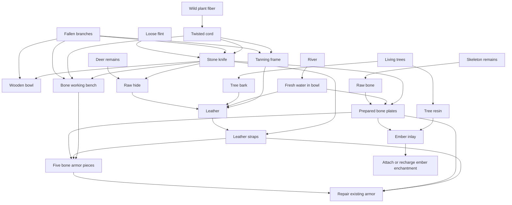

# Ruleset data model and bone armor production

Date: 2026-11-13

Status: Proposed data model for review. All TOML is illustrative, including new definition kinds, field names, and identifiers. It does not describe a supported schema or authorize implementation.

Implementation update (2026-11-17): the supplied rules now contain the complete bootstrap-to-equipped-bone-armor production slice, using grouped `items.<group>.<id>` definitions and the existing action/equipment paths. Hand-gathered flint, branches and fiber produce the first knife, bowl and stations; hides, bark, water and bones produce leather straps and plates. Recipes debit vessel contents and enforce owned tool wear and nearby deployed station capabilities atomically. Default classes expose the beginner recipes from skill zero; the proposed settlement-teacher knowledge gate is not implemented. Current bark harvesting takes one unit per operation, so this implementation's full-set knife ends at condition 52 rather than the illustrative fixture's 56. Full local/dedicated save/reload and encoded-host production/retry scenarios are covered by [runtime tests](../crates/runtime/tests/bone_production.rs) and [host tests](../servers/dedicated/tests/bone_production.rs). The next maintenance slice is also implemented: the bone category opts into positive-condition activation and torso wear on committed physical health damage, and a targeted repair recipe consumes one plate and strap, uses the existing bone-carving tool/workbench, and restores up to 20 condition without replacing the item. Default repair grants no training; preparing a surplus plate and repairing after the full chain leaves knife condition 50. The original repair/station field names below remain illustrative. Enchantments, universal contributions and timed operations remain proposed. TOML below remains illustrative: use the [current rulebook](../docs/docs/official_rules.md#world-to-bone-armor-production), [Authoring examples](../docs/docs/creator/authoring.md#bind-world-resources) and [bundled reference fixture](../crates/ruleset/rulesets/eldiron/v1/bone_production.toml) for implemented content and syntax.

## Purpose

Express the [integrated ruleset foundation](ruleset-foundation-concept.md) as an authorable data model, using a complete bone-armor production chain. The same model must support world harvesting, liquids, open character learning, item bonuses, and enchantments. One default ruleset serves small adventures and large sandboxes; authors select which parts their games expose.

The foundation's RPG scope and authoring model govern this proposal. Product decision updated on 2026-11-17: Eldiron supplies the complete ruleset, and ordinary creators place its content and choose starting options. Generic ruleset editing is internal maintenance tooling, hidden in standard Creator builds. The detailed records and TOML below describe shared meaning for maintaining that content; creators do not enable or configure every armor family. General support for unrelated gameplay genres is outside the model's purpose.

The [current authoring decision](ruleset-editor-concept.md) supersedes the earlier public guided-editor proposal. Definition presence, availability for a particular use, authored world usage and existing saved instances are distinct concerns. Selecting content must not be implemented as one global deletion or activation flag that rewrites all four.

Every required ingredient has a world origin. Vendors transfer or produce accounted goods. Materials cannot appear solely because a shop sells them or a recipe needs them. The example includes supporting materials, the first tools and stations, knowledge acquisition, all five armor pieces, and repair. An optional enchantment also uses materials from the same world.

The companion [capability gap review](ruleset-foundation-gap-review.md) compares this proposal with current source paths and identifies reuse, missing contracts, and simplifications to review before adopting a schema.

The [effective values and source contributions contract](ruleset-contribution-contract.md) refines item ratings, wearer projections, action-local bonuses, and attachment behavior. Its proposed semantics should guide review of the contribution fields illustrated here.

The [world resource and lifecycle contract](world-resource-lifecycle-contract.md) refines resource bindings, persistent instances, shared pools, recovery, and the tree, river, finite well, and skeleton-remains cases.

The [shared operation contract](shared-operation-contract.md) connects those domains through preparation, validation, commitment, failure, and structured outcomes, with worked production, repair, and enchanting examples.

The examples propose public authoring semantics, not Rust types or a project storage migration. The [GPU rewrite](native-wgpu-modular-rewrite.md) and [networking concept](networking-mmo-concept.md) retain their own implementation scope. Rules and scenario inspection remain independent of rendering.

## Definition model and ownership

### Shared definition kinds

| Definition | Owns | References |
| --- | --- | --- |
| Unit | Quantity dimension and representation | Optional compatible conversions |
| Property | Typed value, bounds, default, and evaluation contract | Applicable subjects and modifier policy |
| Item kind | Common storage and instance defaults | Units and properties |
| Item | A material, tool, vessel, station, equipment piece, or reagent | Kind, categories, capabilities, family, appearance |
| Resource profile | Supplies, permitted outputs, recovery, lifecycle, and interaction bindings | Items, parameterized actions, tools, skills |
| Creature template | Composition and its source of harvestable remains | Race or traits, behavior, corpse resource profile |
| Action | Shared target, execution, failure, and outcome semantics | Typed domain operation and supplied parameters |
| Recipe | Consumed inputs, produced outputs, requirements, quality, and learning opportunity | Items or categories, skills, capabilities, knowledge |
| Equipment family | Shared policy and explicit set membership | Slots, contributions, repair operation |
| Knowledge and learning source | What becomes known and how it is acquired | Recipes, actions, teachers, classes, books |
| Skill | Proficiency and advancement policy | Supporting attributes and meaningful activities |
| Class and talent | Starting choices, grants, aptitude, and optional progression | Properties, knowledge, skills, permissions |
| Contribution and enchantment | Subject, activation, calculation, grants or triggers | Properties, effects, source attachment state |
| Repair or enchanting operation | Transformation of an existing target item | Inputs, requirements, target constraints, resulting state |

Item categories classify eligible recipe inputs; tool and station capabilities describe what equipment can do. Neither executes behavior by itself. A knife supplies `skin`; a corpse interaction explicitly requires it. A profession can group services and learning without becoming a compulsory gate for every activity.

Materials are ordinary registered items. A reagent is an item used by a consuming operation. Liquid contents use the same item identity and a volume unit, while the vessel remains a separate item instance.

The illustrative property catalogue supplies metadata over the shared attribute and scoped-value model. Its protection and resistance identifiers must be reconciled with existing semantic roles and attribute IDs before adoption. It does not establish another independent stat evaluator or require authors to maintain equivalent values in two registries.

### Authoring and runtime ownership

| Location | Stores | Does not duplicate |
| --- | --- | --- |
| Effective project ruleset | Definitions and all shared mechanics | Per-tree stock or per-sword charges |
| Tile, object, prefab, or area defaults | Optional reusable resource binding | Global supply shared merely because artwork matches |
| Map placement TOML | Resource reference, allowed overrides, optional shared-pool identity | New material definitions or inline copies of recipes |
| Character and item setup | Ruleset choices, starting allocations and possessions | Global skill, recipe, enchantment, or class mechanics |
| Saved runtime state | Stable instance IDs, quantities, contents, acquisition records, attachments, clocks | Replayed rewards or permanently added equipment bonuses |
| Presentation bindings | Artwork and descriptions for semantic states | Supply, protection, learning, or hit authority |

Resolution applies ruleset defaults, explicit family or kind defaults, and permitted local configuration to produce one meaning per fact. `kind` and `family` are narrow composition relationships with declared fields; they are not arbitrary inheritance. Maps merge by declared key, scalar overrides replace, and lists replace unless a field explicitly declares another operation. Multiple appearance or equipment references never duplicate a logical instance.

### Reference and example conventions

Identifiers are stable and separate from display names. Typed fields identify their reference domain: `item = "raw_bone"` references the item catalogue, and `recipe = "shape_bone"` references recipes. Heterogeneous references use an explicit record such as `{ kind = "recipe", id = "shape_bone" }`. Display names are never lookup keys.

Unqualified IDs below resolve within the effective project ruleset. Cross-package qualification and aliases remain distribution decisions. References to capabilities, properties, slots, categories, and units are validated as well as item references.

Each TOML block is labeled by scope. Blocks in **ruleset scope** describe one combined conceptual ruleset, split here for reading. **Map scope**, **character setup scope**, and **runtime scope** are separate documents or records. Their eventual archive locations and exact syntax are open.

For recipes, the generic craft action supplies execution semantics; the recipe owns all inputs and outputs. For resource bindings, inline parameters resolve to one action invocation; the shared action does not restate yield or supply. No new action executor is needed for each recipe, material, or profession.

## Complete reference production chain

### Sources and transformations



Arrows include tool and station requirements as well as consumed ingredients. A knife or bench is used repeatedly and is consumed only when its own durability policy says so. There is no tanning chemical or fuel omitted from the reference recipes: tanning explicitly uses bark and water, and bone preparation is a cold washing and carving process. Adding heat, salt, oil, or another reagent requires extending its source chain.

| Source | Available material in this fixture | Extraction |
| --- | --- | --- |
| Loose flint patch | Flint stones | Hand collection |
| Fallen timber | Wood branches | Hand collection |
| Wild flax patch | Plant fiber | Hand gathering |
| Living tree | Bark, branches, resin in separate supplies | Declared interaction and tool requirements |
| River area | Fresh water | Fill a suitable vessel |
| Deer remains | One raw hide per corpse | Skin using a suitable knife |
| Skeleton remains | Six raw bones per corpse | Collect its single bone supply |

These are direct resource sources. Creature death creates one corpse resource instance; extracting that instance does not create another supply on reopening or revisiting it. A creature definition may instead transfer the same supply into loot directly, but direct loot and harvesting must not each award it.

### Tools stations and the first craft

The player can gather flint, fallen branches, and fiber by hand. Two fibers twist into two cords. One flint, one branch, and one cord make a stone knife. The knife can carve a water bowl and working bench; a tanning frame is assembled from branches and cord by hand. The basic example requires no metal tool that can only be made after the armor chain has already begun.

The knife supports pruning, bark and resin collection, skinning, bone carving, leather cutting, and inscription. Individual capabilities can later move to specialized tools without changing recipe identity. Bone armor requires a bone-working station; leather tanning requires a tanning frame. A station capability is available only from an accessible, deployed station, not from a station item in somebody's backpack.

Initial knowledge comes from a free basic craft lesson available at a declared settlement teacher. The teacher is placed in the reference map and does not supply materials. This permits a character with no possessions to start the chain. A game may also grant beginner knowledge through its starting class, as another acquisition path for the same knowledge definitions.

## Common units properties and item catalogue

**Ruleset scope.** Quantity is separate from an item's scalar properties. `count` cannot substitute for `liquid_measure`. Bone plates and hide sheets are discrete item units; their physical mass is a later extension rather than an implicit conversion.

```toml
[units.count]
dimension = "count"
representation = "integer"

[units.liquid_measure]
dimension = "volume"
representation = "integer"

[properties.quality]
type = "number"
minimum = 1
maximum = 100
default = 100

[properties.condition]
type = "number"
minimum = 0
maximum = 100
default = 100

[properties.physical_protection]
type = "number"
minimum = 0
default = 0
combination = "add_then_multiply_then_bounds"

[properties.fire_resistance]
type = "number"
default = 0
combination = "add_then_multiply_then_bounds"

[item_kinds.material]
unit = "count"
stack_limit = 100
stack_equal = ["quality", "condition", "material_properties", "attachments"]

[item_kinds.liquid]
unit = "liquid_measure"
storage = "contents"
merge_equal = ["item", "material_properties"]

[item_kinds.tool]
unit = "count"
stack_limit = 1
persistent_instance = true
initial_properties = { quality = 100, condition = 100 }

[item_kinds.vessel]
unit = "count"
stack_limit = 1
persistent_instance = true
initial_properties = { quality = 100, condition = 100 }

[item_kinds.station]
unit = "count"
stack_limit = 1
persistent_instance = true

[item_kinds.armor]
unit = "count"
stack_limit = 1
persistent_instance = true
initial_properties = { quality = 100, condition = 100 }

[categories.armor_bone]
kind = "equipment"

[categories.wood_branch]
kind = "material"

[slots.head]
[slots.torso]
[slots.legs]
[slots.hands]
[slots.feet]
[slots.tool]

[items.flint_stone]
name = "Flint Stone"
kind = "material"

[items.wood_branch]
name = "Wood Branch"
kind = "material"
categories = ["wood_branch"]

[items.plant_fiber]
name = "Plant Fiber"
kind = "material"

[items.twisted_cord]
name = "Twisted Cord"
kind = "material"

[items.tree_bark]
name = "Tree Bark"
kind = "material"

[items.tree_resin]
name = "Tree Resin"
kind = "material"

[items.raw_hide]
name = "Raw Hide"
kind = "material"

[items.leather]
name = "Leather Sheet"
kind = "material"

[items.leather_strap]
name = "Leather Strap"
kind = "material"

[items.raw_bone]
name = "Raw Bone"
kind = "material"

[items.bone_plate]
name = "Prepared Bone Plate"
kind = "material"

[items.ember_inlay]
name = "Ember Inlay"
kind = "material"

[items.fresh_water]
name = "Fresh Water"
kind = "liquid"

[items.salt_water]
name = "Salt Water"
kind = "liquid"

[items.stone_knife]
name = "Stone Knife"
kind = "tool"
slot = "tool"
capabilities = ["prune", "collect_bark", "collect_resin", "skin", "carve_bone", "cut_leather", "carve_wood", "assemble_bone", "inscribe"]

[items.wooden_bowl]
name = "Wooden Bowl"
kind = "vessel"
contents = { unit = "liquid_measure", capacity = 4, accepts = ["fresh_water", "salt_water"], mixing = "compatible_only" }

[items.tanning_frame]
name = "Tanning Frame"
kind = "station"
deployed_capabilities = ["tan_hide"]

[items.bone_workbench]
name = "Bone Working Bench"
kind = "station"
deployed_capabilities = ["assemble_bone", "repair_bone", "inscribe"]
```

The capability vocabulary referenced above is declared by the action and requirement schema: `prune`, `collect_bark`, `collect_resin`, `skin`, `carve_bone`, `cut_leather`, `carve_wood`, `assemble_bone`, `inscribe`, `tan_hide`, and `repair_bone`. Tool and station requirement fields keep their roles distinct even when they use the same capability name.

`stack_equal` and `merge_equal` name schema-defined state fields or declared properties. Empty material properties and attachments are valid defaults. Unique instance IDs never participate in stack equality, but attached enchantments and materially different state do. A registry entry alone does not establish acquisition: `salt_water` needs a sea or saltwater source in games exposing its use. It is registered here to demonstrate incompatible liquid filling and is not an input to the bone chain.

## Parameterized actions and world supplies

**Ruleset scope.** The domain operations below are proposed reusable primitives. Their parameters come from the selected resource interaction, recipe, repair operation, or enchantment operation and resolve to one executable action description.

```toml
[actions.extract_resource]
target = "world_resource"
operation = "extract_supply"
commit = "atomic"
parameters_from = "resource_interaction"

[actions.fill_vessel]
target = "world_resource"
source_item = "owned_vessel"
operation = "transfer_contents"
quantity_policy = "clamp_positive"
commit = "atomic"
parameters_from = "resource_interaction"

[actions.craft]
target = "self"
operation = "execute_recipe"
quantity_policy = "whole_batch"
commit = "atomic"
parameters_from = "recipe"

[actions.repair]
target = "owned_item"
operation = "repair_existing_item"
commit = "atomic"
parameters_from = "repair_operation"

[actions.enchant]
target = "owned_item"
operation = "attach_enchantment"
commit = "atomic"
parameters_from = "enchanting_operation"

[actions.recharge]
target = "owned_item"
operation = "recharge_attachment"
commit = "atomic"
parameters_from = "recharge_operation"

[resource_profiles.loose_flint.supplies.flint]
stock_unit = "count"
initial_stock = 10
capacity = 10
outputs = [{ item = "flint_stone", quantity_per_stock = 1 }]

[resource_profiles.loose_flint.interactions.collect]
action = "extract_resource"
supply = "flint"
stock_per_use = 1

[resource_profiles.fallen_timber.supplies.branches]
stock_unit = "count"
initial_stock = 20
capacity = 20
outputs = [{ item = "wood_branch", quantity_per_stock = 1 }]

[resource_profiles.fallen_timber.interactions.collect]
action = "extract_resource"
supply = "branches"
stock_per_use = 1

[resource_profiles.wild_flax.supplies.fiber]
stock_unit = "count"
initial_stock = 16
capacity = 16
outputs = [{ item = "plant_fiber", quantity_per_stock = 1 }]
recovery = { amount = 4, interval = { value = 1, unit = "world_day" } }

[resource_profiles.wild_flax.interactions.gather]
action = "extract_resource"
supply = "fiber"
stock_per_use = 1

[resource_profiles.mature_tree]
initial_lifecycle = "living"
active_lifecycles = ["living"]
appearance_supply = "branches"
appearance_thresholds = [{ minimum_stock = 8, state = "healthy" }, { minimum_stock = 1, state = "sparse" }, { minimum_stock = 0, state = "bare" }]
allowed_placement_overrides = ["supplies.branches.item", "supplies.branches.capacity", "supplies.branches.initial_stock", "supplies.branches.yield_per_use", "supplies.branches.recovery"]

[resource_profiles.mature_tree.supplies.branches]
stock_unit = "count"
initial_stock = 12
capacity = 12
outputs = [{ item = "wood_branch", quantity_per_stock = 1 }]
recovery = { amount = 4, interval = { value = 1, unit = "world_day" } }

[resource_profiles.mature_tree.interactions.collect_branches]
action = "extract_resource"
supply = "branches"
stock_per_use = 2
tool = { capability = "prune", condition_cost = 1 }
advancement = { skill = "woodworking", policy = "eligible_success" }

[resource_profiles.mature_tree.supplies.bark]
stock_unit = "count"
initial_stock = 4
capacity = 4
outputs = [{ item = "tree_bark", quantity_per_stock = 1 }]

[resource_profiles.mature_tree.interactions.collect_bark]
action = "extract_resource"
supply = "bark"
stock_per_use = 2
tool = { capability = "collect_bark", condition_cost = 1 }

[resource_profiles.mature_tree.supplies.resin]
stock_unit = "count"
initial_stock = 2
capacity = 2
outputs = [{ item = "tree_resin", quantity_per_stock = 1 }]

[resource_profiles.mature_tree.interactions.collect_resin]
action = "extract_resource"
supply = "resin"
stock_per_use = 1
tool = { capability = "collect_resin", condition_cost = 1 }

[resource_profiles.fresh_river.supplies.water]
stock_unit = "liquid_measure"
capacity = "unlimited"
outputs = [{ item = "fresh_water", quantity_per_stock = 1 }]

[resource_profiles.fresh_river.interactions.fill]
action = "fill_vessel"
supply = "water"
stock_from = "requested_volume"

[resource_profiles.skeleton_remains.supplies.bones]
stock_unit = "count"
stock_meaning = "harvest_opportunity"
initial_stock = 1
capacity = 1
outputs = [{ item = "raw_bone", quantity_per_stock = 6 }]

[resource_profiles.skeleton_remains.interactions.collect_bones]
action = "extract_resource"
supply = "bones"
stock_per_use = 1

[resource_profiles.deer_remains.supplies.hide]
stock_unit = "count"
stock_meaning = "harvest_opportunity"
initial_stock = 1
capacity = 1
outputs = [{ item = "raw_hide", quantity_per_stock = 1 }]

[resource_profiles.deer_remains.interactions.skin]
action = "extract_resource"
supply = "hide"
stock_per_use = 1
tool = { capability = "skin", condition_cost = 1 }

[creature_templates.skeleton]
name = "Skeleton"
remains = { resource_profile = "skeleton_remains", supply_delivery = "corpse_extraction_only" }

[creature_templates.deer]
name = "Deer"
remains = { resource_profile = "deer_remains", supply_delivery = "corpse_extraction_only" }
```

`quantity_per_stock` is an explicit conversion from supply units to item units. Branch collection consumes two stock units and produces two branches. A skeleton consumes one harvest opportunity and produces six bones. An unlimited source still has a real identity, location, output, and access checks; `unlimited` is a validated capacity variant, not an integer sentinel or an arbitrary string accepted anywhere.

Omitted recovery means the supply does not replenish. Bark and resin are finite in this fixture. Repeated extraction must not replace a depleted profile instance with fresh initial stock. Regrowing trees, felling, sustainable bark collection, and replenishing deadwood can extend lifecycle policy; this production example does not invent those policies implicitly.

All extraction interactions default to whole requested quantities, living-source requirements where applicable, and the foundation's tool validation and atomic failure rules. The tree's branches use the foundation's recovery phase and appearance thresholds. Time units such as `world_day` are clock-duration units, distinct from item-quantity units.

The two creature records describe source and remains composition only. A playable creature also needs its ordinary identity, behavior, encounter placement, and combat configuration. The reference scenario explicitly supplies those encounters and a viable unarmed way to defeat them; no undisclosed purchased weapon is a prerequisite for obtaining bones or hide. Creature spawning and respawn are separate declared policies and cannot refresh the same corpse.

## Map resource binding

**Map scope.** A selected 2D tile placement, isometric object, or 3D object can use this TOML. `definition` references a resource profile. The local supply override syntax deliberately follows the foundation's example; resolution converts `yield_per_use` to the selected interaction's stock amount using its declared output ratio. It is permitted only when that conversion is unique and integral. Multi-output supplies require an explicit interaction quantity rather than this shorthand.

```toml
[world_resource]
definition = "mature_tree"

[world_resource.supplies.branches]
item = "wood_branch"
capacity = 12
initial_stock = 12
yield_per_use = 2

[world_resource.supplies.branches.recovery]
amount = 4
interval = { value = 1, unit = "world_day" }
```

`item` can select only a permitted registered output; this tree currently permits `wood_branch` for its branch supply. The output declaration in the resource profile is canonical. Map overrides select within its constraints rather than adding a second output path. `initial_stock` initializes a new instance and never overwrites saved stock.

The editor associates the binding with a stable logical placement. Several visible cells can reference one tree. Several unrelated trees using the same image receive different identities. For an area resource, the map binds a river area once and its selectable surfaces refer to that resource. An explicit shared-pool reference can connect several representations of one well; sharing an image cannot.

## Skills knowledge and the open character

**Ruleset scope.** These are a small set of reusable skills for the reference chain, not a fixed limit on professions. Skill ranges are content defaults. `eligible_success` grants one point for a committed meaningful activity while below the skill cap and within its teaching range; it never rewards duplicate, failed, or cancelled requests. The recipe or interaction supplies the activity difficulty, with a default of zero for the basic gathering fixture.

```toml
[advancement_policies.eligible_success]
on = "committed_success"
gain = 1
stop_above_difficulty_margin = 20

[skills.woodworking]
maximum = 100
advancement_policy = "eligible_success"

[skills.leatherworking]
maximum = 100
advancement_policy = "eligible_success"

[skills.boneworking]
maximum = 100
advancement_policy = "eligible_success"

[skills.ritualism]
maximum = 100
advancement_policy = "eligible_success"

[knowledge.basic_crafts]
grants = [
  { kind = "recipe", id = "twist_cord" },
  { kind = "recipe", id = "make_stone_knife" },
  { kind = "recipe", id = "carve_bowl" },
  { kind = "recipe", id = "build_tanning_frame" },
  { kind = "recipe", id = "build_bone_workbench" },
]

[knowledge.bone_armoring]
grants = [
  { kind = "recipe", id = "tan_hide" },
  { kind = "recipe", id = "cut_straps" },
  { kind = "recipe", id = "shape_bone" },
  { kind = "recipe", id = "make_bone_helm" },
  { kind = "recipe", id = "make_bone_cuirass" },
  { kind = "recipe", id = "make_bone_greaves" },
  { kind = "recipe", id = "make_bone_gauntlets" },
  { kind = "recipe", id = "make_bone_boots" },
  { kind = "repair", id = "repair_bone_armor" },
]

[knowledge.ember_inscription]
grants = [
  { kind = "recipe", id = "make_ember_inlay" },
  { kind = "enchanting", id = "apply_ember" },
  { kind = "recharge", id = "recharge_ember" },
]

[teaching.basic_craft_lesson]
grants_knowledge = ["basic_crafts", "bone_armoring"]
costs = []
acquisition = "permanent"

[teaching.ember_lesson]
grants_knowledge = ["ember_inscription"]
costs = []
acquisition = "permanent"

[professions.armorer]
name = "Armorer"
services = ["basic_craft_lesson"]
skills = ["boneworking", "leatherworking"]

[professions.inscriber]
name = "Inscriber"
services = ["ember_lesson"]
skills = ["ritualism"]

[races.human]
name = "Human"

[classes.human_open]
name = "Human"
starting_knowledge = ["basic_crafts"]
starting_skills = { woodworking = 10, leatherworking = 10, boneworking = 10, ritualism = 10 }
creation_allocation = { attributes = ["STR", "DEX", "INT", "WIS", "VIT"], base_each = 8, extra_points = 10, maximum_each = 14 }

[attributes.STR]
type = "number"
[attributes.DEX]
type = "number"
[attributes.INT]
type = "number"
[attributes.WIS]
type = "number"
[attributes.VIT]
type = "number"
```

Grants identify their mechanical targets. Each operation's availability is derived from active knowledge or another explicit acquisition path; recipes do not also maintain a second list of who knows them. Starting skills are initial choices and do not refresh on load. Missing skill values begin at zero under this proposed learning policy; all reference-chain recipes have no hard skill minimum, so their skill declarations create training opportunities rather than a hidden class gate.

The Human race and Human class have different IDs. A Ranger can grant the same knowledge through class progression. A game can also omit classes and rely on the placed teachers. A profession label does not forbid other characters from learning the same recipes. Permanent knowledge acquisition and temporary grants follow the foundation's source and removal contract.

**Character setup scope.** This keeps character-specific starting choices outside world-resource TOML. The existing character setup UI remains the authoring route; the syntax below describes proposed underlying values.

```toml
[character]
race = "human"
class = "human_open"
starting_attributes = { STR = 14, DEX = 10, INT = 8, WIS = 8, VIT = 10 }
starting_items = []
```

The reference map places an armorer offering `basic_craft_lesson`, an inscriber offering `ember_lesson`, resource placements, living creatures, and the freshwater area. Sources and teachers must be reachable under the map's encounter and navigation rules. A catalogue entry without a placed or otherwise reachable acquisition path is not enough.

## Processing and construction recipes

**Ruleset scope.** All recipes use the generic `craft` action. Inputs are consumed; tool and station requirements are not. A tool record selects one owned usable instance and charges its condition only on committed success. A station record selects an accessible deployed instance. Explicit instance selection takes precedence; otherwise the deterministic selection policy prefers ordinary eligible tools over enchanted ones, then uses stable instance ID. Eligibility requires sufficient condition to pay the complete declared wear cost. Capability ranks and further tool preferences remain extensions rather than implicit rules.

For this fixture, material outputs and crafted items receive quality 100. This fixed policy isolates source and execution review. Skill-derived quality is an explicit policy extension and must supply a named curve before it changes outputs. Tool condition is separate from output quality. All recipes require their whole batch, have no start costs, and use atomic completion.

```toml
[recipe_defaults]
action = "craft"
quality_policy = "fixed_100"
partial_success = false

[recipes.twist_cord]
inputs = [{ item = "plant_fiber", quantity = 2 }]
outputs = [{ item = "twisted_cord", quantity = 2 }]

[recipes.make_stone_knife]
inputs = [{ item = "flint_stone", quantity = 1 }, { item = "wood_branch", quantity = 1 }, { item = "twisted_cord", quantity = 1 }]
outputs = [{ item = "stone_knife", quantity = 1 }]

[recipes.carve_bowl]
inputs = [{ item = "wood_branch", quantity = 2 }]
outputs = [{ item = "wooden_bowl", quantity = 1 }]
tool = { capability = "carve_wood", condition_cost = 1 }
skill = { id = "woodworking", difficulty = 10, advancement = "eligible_success" }

[recipes.build_tanning_frame]
inputs = [{ item = "wood_branch", quantity = 4 }, { item = "twisted_cord", quantity = 2 }]
outputs = [{ item = "tanning_frame", quantity = 1 }]

[recipes.build_bone_workbench]
inputs = [{ item = "wood_branch", quantity = 6 }, { item = "twisted_cord", quantity = 4 }]
outputs = [{ item = "bone_workbench", quantity = 1 }]
tool = { capability = "carve_wood", condition_cost = 1 }

[recipes.tan_hide]
inputs = [{ item = "raw_hide", quantity = 1 }, { item = "tree_bark", quantity = 2 }, { item = "fresh_water", quantity = 4 }]
outputs = [{ item = "leather", quantity = 2 }]
station = { capability = "tan_hide" }
skill = { id = "leatherworking", difficulty = 10, advancement = "eligible_success" }

[recipes.cut_straps]
inputs = [{ item = "leather", quantity = 1 }]
outputs = [{ item = "leather_strap", quantity = 2 }]
tool = { capability = "cut_leather", condition_cost = 1 }
skill = { id = "leatherworking", difficulty = 10, advancement = "eligible_success" }

[recipes.shape_bone]
inputs = [{ item = "raw_bone", quantity = 1 }, { item = "fresh_water", quantity = 1 }]
outputs = [{ item = "bone_plate", quantity = 1 }]
tool = { capability = "carve_bone", condition_cost = 1 }
skill = { id = "boneworking", difficulty = 10, advancement = "eligible_success" }
```

The input resolver reads each item's quantity unit. A water input selects liquid content in owned accessible vessels and debits volume while preserving those vessels. A branch input selects solid stacks. If several vessels or stacks are needed, they are selected and validated together; failure cannot consume the first inputs and leave the operation half done. All fixture inputs are exact item references. A future category input such as a compatible wood must declare permitted substitutions and which material properties propagate to outputs.

## Complete bone armor set

### Family and contributions

The reference set uses the existing conceptual head, torso, legs, hands, and feet slots. Torso includes upper-body and arm coverage. There is no separate arm slot or shield member in this set. If the ruleset later introduces a separate arm slot for this family, set coverage must add its corresponding piece and recipe.

**Ruleset scope.** Each piece owns its own base protection value. The family projects that value into the wearer's effective protection once while the piece is equipped and unbroken. The combat calculation consumes the effective protection and must not add a second raw equipment sum.

```toml
[equipment_families.bone_armor]
category = "armor_bone"
required_members = ["bone_helm", "bone_cuirass", "bone_greaves", "bone_gauntlets", "bone_boots"]
required_slots = ["head", "torso", "legs", "hands", "feet"]
repair = "repair_bone_armor"
wear_policy = "bone_reference"
contributions = [
  { id = "worn_protection", subject = "wearer", property = "physical_protection", operation = "add", value_from = "item.properties.physical_protection", activation = "equipped_and_unbroken", stacking = "distinct_sources_add" },
]

[items.bone_helm]
name = "Bone Helm"
kind = "armor"
family = "bone_armor"
slot = "head"
properties = { physical_protection = 1 }

[items.bone_cuirass]
name = "Bone Cuirass"
kind = "armor"
family = "bone_armor"
slot = "torso"
properties = { physical_protection = 4 }

[items.bone_greaves]
name = "Bone Greaves"
kind = "armor"
family = "bone_armor"
slot = "legs"
properties = { physical_protection = 3 }

[items.bone_gauntlets]
name = "Bone Gauntlets"
kind = "armor"
family = "bone_armor"
slot = "hands"
properties = { physical_protection = 1 }

[items.bone_boots]
name = "Bone Boots"
kind = "armor"
family = "bone_armor"
slot = "feet"
properties = { physical_protection = 1 }
```

The fixture totals ten physical protection with all five pieces equipped and unbroken, before other declared contributions. Set membership does not itself grant a set bonus. Class equipment permissions can allow or restrict the family; the open Human path is unrestricted by class. Slot conflicts still apply.

Every piece needs presentation bindings for its icon and equipped appearance or a declared usable fallback, plus a textual name and description. Exact artwork references are deliberately outside these mechanics examples. Set acceptance requires coverage in 2D, isometric, and 3D appearance workflows and text inspection; missing artwork must be reported rather than treated as proof that a gameplay piece does not exist.

### Recipes for every piece

**Ruleset scope.** The shared armor recipe defaults own the common requirements. Member recipes own their quantities and output. These are explicit composition defaults, not five independent copies of the common rules.

```toml
[recipe_groups.bone_armor]
tool = { capability = "assemble_bone", condition_cost = 1 }
station = { capability = "assemble_bone" }
skill = { id = "boneworking", difficulty = 20, advancement = "eligible_success" }

[recipes.make_bone_helm]
group = "bone_armor"
inputs = [{ item = "bone_plate", quantity = 3 }, { item = "leather_strap", quantity = 2 }]
outputs = [{ item = "bone_helm", quantity = 1 }]

[recipes.make_bone_cuirass]
group = "bone_armor"
inputs = [{ item = "bone_plate", quantity = 8 }, { item = "leather_strap", quantity = 4 }]
outputs = [{ item = "bone_cuirass", quantity = 1 }]

[recipes.make_bone_greaves]
group = "bone_armor"
inputs = [{ item = "bone_plate", quantity = 6 }, { item = "leather_strap", quantity = 3 }]
outputs = [{ item = "bone_greaves", quantity = 1 }]

[recipes.make_bone_gauntlets]
group = "bone_armor"
inputs = [{ item = "bone_plate", quantity = 2 }, { item = "leather_strap", quantity = 2 }]
outputs = [{ item = "bone_gauntlets", quantity = 1 }]

[recipes.make_bone_boots]
group = "bone_armor"
inputs = [{ item = "bone_plate", quantity = 3 }, { item = "leather_strap", quantity = 2 }]
outputs = [{ item = "bone_boots", quantity = 1 }]
```

## Material accounting for a complete set

All quantities below include making the first knife, bowl, frame, and bench, then one complete armor set. They exclude optional enchantment and later repair. No starting equipment, vendor goods, random unrelated drops, food, fuel, or paid lesson is a hidden prerequisite in this review fixture. If a game enables additional needs, their acquisition becomes part of its reachability review.

| Operation | Batches | Inputs consumed | Outputs and use |
| --- | --- | --- | --- |
| Twist cord | 4 | 8 fiber | 8 cords; 7 used, 1 left |
| Make knife | 1 | 1 flint, 1 branch, 1 cord | 1 reusable knife |
| Carve bowl | 1 | 2 branches | 1 reusable four-unit bowl |
| Build tanning frame | 1 | 4 branches, 2 cords | 1 deployable frame |
| Build bench | 1 | 6 branches, 4 cords | 1 deployable bench |
| Tan hide | 4 | 4 hides, 8 bark, 16 water | 8 leather sheets |
| Cut straps | 7 | 7 leather sheets | 14 straps; 13 used, 1 left |
| Shape bone | 22 | 22 raw bones, 22 water | 22 plates, all used |
| Make five armor pieces | 5 | 22 plates, 13 straps | Complete set; protection total 10 |

Required world withdrawals are one flint stone, thirteen branches, eight plant fibers, four raw hides, eight bark units, twenty-two raw bones, and thirty-eight water units. Four skeletons yield twenty-four bones, leaving two raw bones. Four deer yield four hides. Two trees with four bark each cover the bark demand. The fallen-timber and flax stocks above cover branches and fiber without recovery.

Final surplus is two raw bones, one leather sheet, one leather strap, and one cord. The knife, bowl, deployed frame, bench, and five armor pieces remain. Water can be transferred through the same bowl in nine fills of four units and one fill of two; all thirty-eight units are consumed by the recipes. Order must respect vessel capacity, but an unlimited river does not grant infinite carried water.

The knife begins at condition 100. Four skinning actions, four bark collections, one bowl craft, one bench craft, twenty-two bone preparations, seven strap cuts, and five armor crafts cost forty-four points in total, leaving condition 56. The first knife is sufficient for the full chain. Hand collection, cord twisting, frame assembly, tanning, and ordinary water filling have no tool wear in this fixture.

This accounting is an acceptance example, not final economic balance. It establishes that the content can actually start, that supporting supplies are present, and that no tool breaks before the required replacement path exists.

## Wear and repair

**Ruleset scope.** Wear is a declared response to an actual damage outcome; an absorbed or rejected request must not arbitrarily damage every carried item. This simple fixture charges the equipped torso piece once per committed physical hit that deals positive health damage. Other coverage policies can replace it explicitly.

```toml
[wear_policies.bone_reference]
event = "physical_hit_committed"
requires_positive_health_damage = true
selection = "equipped_torso"
condition_cost = 1

[repairs.repair_bone_armor]
action = "repair"
target = { family = "bone_armor", owned = true, condition_below = 100 }
inputs = [{ item = "bone_plate", quantity = 1 }, { item = "leather_strap", quantity = 1 }]
tool = { capability = "assemble_bone", condition_cost = 1 }
station = { capability = "repair_bone" }
restore = { property = "condition", add = 20, maximum = 100 }
preserve = ["instance_id", "quality", "material_properties", "attachments", "attachment_charges"]
```

The armor family selects `bone_reference` as its wear policy; this association is a single family-owned fact. All five pieces use the shared repair operation. It mutates the selected existing item, creates no duplicate armor, and restores at most twenty condition points. A piece at condition 95 still pays the declared full input cost and reaches 100; a piece already at 100 is ineligible. The inspection preview shows that cost before execution.

Repair can restore a broken piece at condition zero under this policy. Positive condition reactivates its normal equipment contributions. The reference protection is constant while unbroken; quality and condition do not secretly scale it. Any continuous protection curve must be a named additional policy.

A cuirass at condition 80 repairs to 100 using one plate and one strap, with one knife-condition cost. The complete-set surplus supplies the strap and one remaining raw bone; preparing that bone needs one further water unit and one knife-condition point. After this repair, knife condition is 54. The item's quality, enchantment, charges, and persistent identity remain unchanged.

## Enchantment with sourced reagents

The optional ember example uses a prepared bone plate and tree resin as its reagent chain. The inscriber teaches a ritual that turns those materials into an ember inlay. The magical transformation is an explicit learned operation with real inputs; a vendor does not generate the inlay. This example adds source and attachment structure to the foundation's passive-versus-charged behavior; its lore and values remain content choices.

**Ruleset scope.** `item` is the attachment owner, `wearer` is the eligible actor, and `source_item` in a trigger is the exact item instance used by the original action.

```toml
[recipes.make_ember_inlay]
inputs = [{ item = "bone_plate", quantity = 1 }, { item = "tree_resin", quantity = 1 }]
outputs = [{ item = "ember_inlay", quantity = 1 }]
tool = { capability = "inscribe", condition_cost = 1 }
station = { capability = "inscribe" }
skill = { id = "ritualism", difficulty = 10, advancement = "eligible_success" }

[enchanting.apply_ember]
action = "enchant"
target = { kinds = ["armor", "tool"], owned = true, condition_above = 0 }
inputs = [{ item = "ember_inlay", quantity = 1 }]
station = { capability = "inscribe" }
attachment = "ember"
same_attachment = "reject"

[enchantments.ember]
initial_charges = 2
maximum_charges = 2
contributions = [
  { id = "fire_ward", subject = "wearer", property = "fire_resistance", operation = "add", value = 3, activation_by_kind = { armor = "equipped_and_unbroken", tool = "wielded_and_unbroken" }, requires_charges = false, stacking = "distinct_sources_add" },
]

[enchantments.ember.triggers.fire_on_hit]
event = "original_successful_hit_committed"
requires = { source_item_is_attachment_owner = true, condition_above = 0, charges_at_least = 1 }
effect = { kind = "damage", damage_kind = "fire", amount = 4, target = "hit_target" }
charge_cost = 1
frequency = "once_per_original_hit_and_target"
secondary_can_retrigger = false
charge_commit = "with_validated_effect"

[damage_kinds.fire]
reduction_property = "fire_resistance"

[recharges.recharge_ember]
action = "recharge"
target = { attachment = "ember", owned = true, charges_below_maximum = true }
inputs = [{ item = "ember_inlay", quantity = 1 }]
station = { capability = "inscribe" }
restore_charges = 2
clamp_to_attachment_maximum = true
```

This draft permits ember on bone armor and the stone knife. Armor activates the equipped passive resistance, but merely being struck does not trigger its offensive effect: the event requires an attack made with that exact item. A tool activates the passive only while wielded and only triggers if an ordinary combat action permits using that tool as its attack source. Carrying or storing it in the tool slot alone is insufficient. The bone production chain does not assume combat use of the knife. A sword can later use the same attachment once its item kind and activation context are explicitly permitted and its own full production chain is defined.

For a target worn item, base wearer fire resistance 5 becomes 8 from ember, or 10 with an independent +2 blessing. Zero charges preserve the passive bonus. Condition zero disables both contributions. Different attachment instances retain separate identity; applying ember twice to the same item is rejected. Recharging and repair have different effects: recharge consumes an inlay and replenishes charges; repair restores condition and preserves charge count.

Each new inlay consumes one plate and one resin, with the plate requiring one bone and one water. Once the complete set has been made, the remaining two bones can support either two inlays or one repair plate and one inlay. Stock accounting exposes this choice. The same recipe makes recharge inlays, so replenishment also has a real material cost. Enchanting and recharge preserve the existing target instance and do not consume its armor or tool definition as a recipe input.

The foundation's hit contract still applies: a successful legal secondary effect consumes its charge even if resistance reduces damage to zero; a skipped invalid target consumes none; the primary hit remains committed. Secondary fire cannot recursively generate the original weapon-hit event. The passive contribution and trigger each appear separately in explanations.

## Runtime state and explanations

**Runtime scope.** This is a conceptual save record after a cuirass has been enchanted and has lost twenty condition. Instance IDs are illustrative stable identifiers, not definition IDs. The record is data to resume, not a list of events to replay.

```toml
[item_instance]
id = "item-0042"
definition = "bone_cuirass"
owner = "character-0001"
equipped_slot = "torso"
properties = { quality = 100, condition = 80 }

[[item_instance.attachments]]
id = "attachment-0007"
definition = "ember"
state = { charges = 1 }

[resource_instance]
id = "tree-0010"
definition = "mature_tree"
resolved_binding_revision = "map-binding-3"
lifecycle = "living"

[resource_instance.supplies.branches]
remaining_stock = 4
next_recovery_world_time = { day = 12, fraction = 0.5 }
```

Saves also retain the remaining named tree supplies, vessel contents, character skill values, permanent acquisition records, active temporary grants, and relevant world and rules revisions. The resource excerpt shows one supply rather than a complete save schema. A load must resolve every definition and preserve unknown or incompatible state for a reported migration decision, never discard a valuable attachment silently.

An effective property record should explain baseline, formula dependencies, active and inactive contributions, bounds, rounding, and result. A committed operation should explain selected source instances, quantities, costs, output instances, acquisition changes, and failure reasons where applicable.

Examples include "Bone protection 10: helm 1, cuirass 4, greaves 3, gauntlets 1, boots 1" and "Repair cuirass item-0042: plate 1 and strap 1 consumed, condition 80 → 100, knife 56 → 55, ember charges unchanged at 1." The latter assumes the plate was already prepared; making it is a separate explained operation. Copying a tooltip or rebuilding a view does not register another contribution.

## Vendor supplies and acquisition reports

A vendor can buy the player's bones or armor, process purchased or delivered materials through the same recipes, and sell resulting stock. An abstract scheduled delivery is permitted when it debits a named producer inventory or source pool and credits the shop exactly once. It cannot credit goods just because the requested definition exists.

For a delivery of two bone plates, a source inventory must lose two existing plates or production must consume two bones and two water with the required capabilities before the delivery is fulfilled. A shortage leaves the order pending or failed under its declared policy. It never creates the missing material. Initial stocks are finite authored prior supplies with provenance. Vendor records should reference ordinary inventories, production orders, and delivery policies rather than become a second material-generation system.

The acquisition report traces a cuirass to eight plates and four straps, plates to bones and water, and straps to leather, hide, bark, and water. It includes tools, stations, and knowledge with their obtainable paths. Tools are modeled as reusable requirements with wear; treating a knife as a consumed recipe ingredient would give the wrong demand and reachability result.

For the optional ember operation, the report additionally traces resin and the inscriber's lesson. A missing teacher, missing water access, or a shop whose supply has no source is reported against the enabled chain. Unused salt-water content does not force a small inland map to include a sea.

### Authored NPC economic behavior

Solo and online multiplayer share the same production, transfer, inventory, and sourcing semantics. The game author determines whether NPCs gather materials, craft goods, buy, consume, repair, or deliver them, and how their participation changes during play.

For example, authored behavior could ask an armorer to commission more bone collection when stock runs low, reduce NPC production when players supply enough goods, or adjust work according to player count. These are possible gameplay policies, not mandatory ruleset behavior. This data model does not introduce a required player-count formula, automatic NPC workforce, price controller, or economy-balancing service.

The reusable foundation is access to relevant world and inventory state, shared executable actions and recipes, structured outcomes, and behavior or script hooks. An NPC's decision selects work; the ordinary authoritative operations validate and commit it. NPC production consumes the declared inputs and respects tools, stations, source availability, and stock just as player production does. The author can build either a simple service economy or a dynamic simulation on those capabilities.

## Mapping the foundation examples

| Foundation case | Model expression | Behavior retained |
| --- | --- | --- |
| Tree | Resource profile, named supplies, interaction parameters, placement binding, saved stock and clock | Independent instances, no banked recovery, explicit lifecycle and visual state |
| Water | Liquid item with volume unit, source supply, owned vessel contents, atomic transfer | Capacity-limited positive transfer, compatible mixing, vessel preserved in recipes |
| Sandbox Human | Separate race and class IDs, allocation policy, skills, knowledge, teachers | No hidden level gate; permanent learning survives temporary grant removal |
| Enchanted item | Existing item instance, attached definition and charge state, scoped contributions and triggers | Exact source identity, reversible bonuses, no duplicate stacking, no hit replay |
| Full bone set | Explicit family members, slot coverage, per-piece recipes, shared contribution and repair policy | Every piece obtainable and maintainable through sourced ingredients |

The reference chain uses exact items and simple defaults to make its state transitions reviewable. Larger catalogues can add new definitions, categories, teachers, recipes, and compatible resource profiles. A new item does not require inventing its own effect evaluator, gathering executor, or profession-specific crafting code.

## Review and validation gates

1. Every illustrative block parses as TOML. Definition references resolve within the combined ruleset scope, with scope separation for map, setup, and saves.
2. Required recipe inputs, tools, station capabilities, and knowledge have obtainable paths in the reference world. There is no closed dependency on an unmade knife or an unreachable paid lesson.
3. Four skeletons and four deer provide the declared remains once each. Loot, extraction, reopening, and save/load cannot multiply them.
4. The complete-set material and knife-wear accounting matches the recipes. All five required members have definitions, recipes, equipment policy, repair coverage, and presentation requirements.
5. A character can start without items, learn from the placed teacher, construct the tools and stations, collect water, and craft the full set under the fixture's survival and encounter assumptions.
6. Missing capacity, lost tools, conflicting equipment, interrupted completion, and repeated requests obey the foundation's failure and identity contract.
7. Repair preserves identity, quality, enchantments, and charges. Recharge preserves identity and condition. Repeated equip or load does not accumulate contributions.
8. A merchant can sell only accounted stock. Acquisition reporting distinguishes finite seed supplies, renewable sources, processing, trade, and unsupported creation.
9. The same scenarios can be inspected without rendering and presented in 2D, isometric, 3D, and terminal clients without changing outcomes.

These are proposed acceptance gates. Syntax and arithmetic checks on this document do not prove runtime support, map reachability, economic balance, or compatibility with the current editor.

## Decisions for the next review

| Decision | Proposed direction | Review focus |
| --- | --- | --- |
| Public format | Structured definitions with TOML as an illustrative authoring view | Map to the existing rules document and catalogue without requiring manual TOML for characters or items |
| Supply quantities | Explicit stock unit and output conversion | Whether the simple map yield shorthand is useful enough to retain |
| Capability requirements | Tools and deployed stations reference declared capabilities | Final capability registry, rank semantics, and exact tool selection UI |
| Quality and wear | Named policies with explicit calculation stages | Replace fixture quality and protection values with coherent default curves |
| Set completeness | Explicit members and slots with coverage validation | Bone family identity, appearance assets, and future arm or shield coverage |
| Learning | Active knowledge grants plus permanent acquisitions | Class unlock integration, talent definitions, training pace, and service presentation |
| Enchantments | Reusable attachments with independently activated contributions | Default enchantable item kinds, multiple-enchantment limits, and sourced reagent catalogue |
| Bootstrap and world supply | Obtainable first tools and lessons, accounted materials throughout | Encounter difficulty, renewable availability, and survival dependencies in the actual reference map |
| Representation | One resolved owner for each fact | Normalization of kind, family, recipe-group, and placement defaults with provenance |
| NPC economic participation | Author-defined gameplay using shared sourcing, actions, production, and trade | Which state queries and behavior hooks authors need; adaptive participation remains optional |

Review these data relationships and examples before choosing a final schema version or implementing anything. The next design revision should settle incompatible choices, then map approved definitions and state transitions to the current ruleset contract and its migration requirements.
