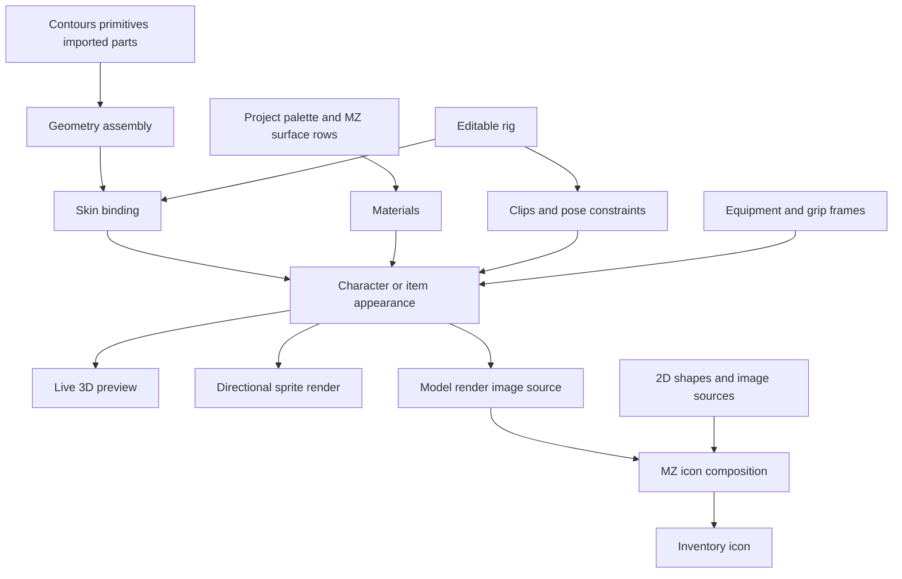

# Unified MZ workflow for geometry materials rigging and icons

For current Creator usage, see [Procedural Materials](../../../docs/docs/building_maps/procedural_materials.md),
[Appearance](../../../docs/docs/characters_items/appearance.md) and
[Rigging](../../../docs/docs/characters_items/rigging.md). The dated concept and
milestone notes below retain their implementation/validation history.

Status: Working concept, 2026-11-01. Documentation only. The capabilities marked
as proposed below are not implemented by writing this concept.

The subsequent [Eldiron geometry prototype](geometry-prototype.md) implements an
initial subset of this direction, including an editable sword and a rigged human
with reusable body/equipment groups, coupled body controls, hand attachments and
idle/walk/attack previews. Its implementation status and limitations are
tracked separately; the full proposal below remains the longer-term design.

The 2026-11-05 integration pass adds model-render image sources, animated mesh
surfaces, joint-space transitions, presentation-event markers, TOML control
publishing, standalone model import/export, content-validated default bakes and
an initial neighbour-aware Auto road composition. See the prototype guide for
the actual workflow and limits. General biome rules, large/chunked road fields,
presentation-node event bindings, IK and retargeting remain extensions.

## Purpose and agreed direction

Eldiron should use one MaterialZ row and tile workflow to author geometry,
materials, rigs, animations, attachments, and inventory icons. Users should be
able to create and extend appearance assets without writing Rust or painting
every animation frame in eight directions. The existing 3D character generator
provides a foundation for reusable body, equipment, and motion sources.

Inventory icons remain authored MZ outputs in their own right. An item can use
a model render as an icon source, build an icon entirely from 2D shapes, or mix
both approaches. Its icon and equipped form can share materials and parameters
without requiring identical compositions.

One workflow means one document model, source catalogue, row interaction,
selection model, preview system, and undo history. It still needs appropriate
tools for editing contours, moving joints, painting weights, and posing a rig.
Putting those tasks behind numeric fields alone would not provide user control.

This broadens the appearance direction beyond the current
[surface integration concept](eldiron-concept.md). Existing map materials,
shape-based terrain composition, image tiles, and baked surface rendering remain
valid consumers. This proposal does not revive the discarded GPU material VM or
require replacing the map texture system.

## Feasibility assessment

The overall architecture is feasible. Geometry generation, skeletal deformation,
socket attachment, material baking, and rendering a model into an image can be
connected through typed rows. The difficult work is making these systems editable,
predictable, visually convincing, and affordable when equipment and body shapes
change. A unified editor does not make arbitrary automatic rigging or clothing
fitting solved problems.

The initial target should be editable rigid items and a compatible humanoid rig.
Arbitrary imported bodies, custom skeletons, cloth simulation, and automatic
retargeting need separate validation. They should have extension points rather
than be prerequisites for the first useful workflow.

### Existing foundations and missing capabilities

These observations describe the source at the date above; they are not claims
that the full workflow already exists.

| Area | Existing foundation | Required extension |
| --- | --- | --- |
| MZ authoring | Stable row/tile identities, material connections, editable bundles, PBR and image evaluation | Geometry, rig, pose, clip, and attachment values and their validation |
| Materials and icons | Palette bindings, shapes, noise, image/tile sources, GPU previews | Model-render image sources, mesh material regions, consistent previews across outputs |
| Characters | Procedural humanoids, human/orc/skeleton variants, body/head controls and several styles | Editable body construction, reusable user parts, more anatomy and clothing control |
| Rigging | A generated 15-joint hierarchy and weighted vertices | General bind transforms, stable joint identities, editable skin weights and rig compatibility |
| Attachments | Generated main/off-hand sockets and rigid held equipment | Full socket and grip transforms, user sockets, stowed items, independent runtime equipment |
| Animation | Procedural idle, walk, cast, death, sit, use, attack and parry | Editable clips, arbitrary clip identities, blending, motion profiles and runtime playback contract |
| Walking | Procedural gait and leg IK in the generator | Movement-speed coupling, transitions, terrain contacts and turning |
| Rendering | GLB export, directional sprite baking, a SceneVM adapter | Shared material appearance, equipment changes, budgets and production integration |

The current generator's item kinds and motion enum are fixed in Rust. Exposing
their existing parameters would be a useful bridge, but would not satisfy the
goal of letting users add new kinds of items and motions.

Its rest joints contain translations, and its skin evaluator assumes that bind
rotations are identity. Sockets currently contain a joint and translation only.
The SceneVM adapter skins vertices on the CPU and submits dynamic meshes; its
existence does not establish a scalable GPU skinning path. Generated Avatar
exports contain final colored images and hand anchor positions. The current
Avatar animation schema has no general loop/hold policy, and the runtime has a
special attack clamp. These are explicit integration gaps.

## One document with typed outputs

An appearance document should contain reusable groups and publish any relevant
outputs: geometry, materials, a rig, a skinned model, attachment frames, motion
clips, a character appearance, and an icon image. A static item need not contain
a skeleton; a standalone icon need not contain geometry.

Rows retain MZ's top-to-bottom dependency order. References use stable identities,
not visible row positions. User labels can change without breaking links.
Connections remain owned by rows; removing the receiving tile must not silently
delete row connections. Type and capability errors should identify the source,
destination, and a useful correction before replacing the last working result.

Proposed value families are:

| Value | Meaning |
| --- | --- |
| Scalar, vector, palette color | Existing parameter and field data |
| Image or field | Sampled texture, mask, or procedural spatial function |
| Contour or profile | Editable curves with explicit plane, units, and closure |
| Mesh or geometry assembly | Vertices, material regions, named parts, UVs and normals |
| Material | PBR surface recipe and mapping settings |
| Rig and skin binding | Joint hierarchy, rest transforms, semantic roles, inverse binds and weights |
| Pose or motion clip | Joint transforms evaluated at a time, with playback metadata |
| Attachment set | Named coordinate frames and equipment requirements |
| Appearance | References joining the model, materials, rig and presentation outputs |

These are design contracts, not names to add mechanically to MZ's current numeric
`ValueType`. Meshes and clips need resource references and structured metadata;
they cannot be represented as extra color channels.



A reusable asset reference can appear as a tile, and users should be able to
open its group and edit its contents. The document dependency graph remains
acyclic. Runtime animation states and explicit time/history sources have their
own bounded evaluation rules; they do not introduce arbitrary feedback through
ordinary row connections. A model-render source cannot feed a material used by
the same model render.

## User control and source extensibility

Built-in sword, shield, head, body and gait sources should become useful starting
presets. Their important construction inputs must remain accessible. A finished
library of opaque presets with sliders would still leave users unable to add
new forms.

Users should be able to author a reusable group, expose parameters and outputs,
give it a source thumbnail/category, and add it to their project catalogue. A
new axe, backpack, animal head, or attack variant should not need a new Rust enum
entry when existing building blocks can express it. Documents should distinguish
a shared asset edit from making an independent copy. Ruleset presets become
project-owned when customized; project files retain their recipes and dependencies.

Imported images and meshes provide an escape route for forms beyond the current
procedural tools. Mesh import and skeleton/animation import are separate
capabilities: displaying a static mesh does not imply that it is already skinned
or compatible with the humanoid rig. New native operations or sandboxed custom
code can be considered later; user groups should work before a plugin system.

The same editor uses Eldiron theme colors, readable typed connections, source
groups, drag and drop, and ranged numeric text edits. Contours and transform
gizmos edit the selected tile's data. Joint/weight tools and a clip timeline are
contextual views of the same saved document and undo history. Large characters
need collapsible groups and output filtering so the sidebar remains usable.
Geometry, rigging and motion authoring use the full central editor viewport,
with contextual controls and construction/properties in the sidebar. The map,
map tools and docks return when leaving geometry. Ordinary surface-material
editing retains its minimap preview. This layout is implemented in the Eldiron
prototype; see [the workflow notes](geometry-prototype.md).

## Geometry and materials

### Building items and body parts

The first geometry vocabulary should include editable contours, simple
primitives, extrusion, revolution, transforms, mirroring, repetition and assembly.
Sweeps along curves, bevels and mesh booleans can follow after robust behavior is
demonstrated. Assembly can retain separate intersecting parts; it should not
silently promise a watertight Boolean union.

Extrusion requires a valid contour and an explicit thickness direction. An
arbitrary noisy MZ mask cannot automatically become a clean, useful mesh.
Mask-to-contour conversion would need a sampling tolerance, topology validation,
and simplification controls. Self-intersections, holes, winding, degenerate
triangles and excessive subdivision need clear diagnostics and resource limits.
Volumetric SDF meshing is a possible later source, not a prerequisite.

Parts require stable semantic identifiers for material assignments, attachments
and binding. Referring to triangle numbers after remeshing would be fragile.
Topology changes must invalidate or rebuild affected UVs and skin weights;
keeping old weights on unrelated vertices is not acceptable. Simple body parts
can generate their own weights; arbitrary imported meshes need manual tools or
an explicit compatible skin.

### Surface coordinates and palette ownership

All Eldiron-authored colors use the project palette. The generator's current
hex-color catalogue is an adapter limitation to remove from the authoring path.
Skin, hair, cloth, steel and icon ramps should preserve palette references through
save, duplication, model rendering and palette switching. Imported full-color
art keeps an explicit conversion policy rather than being silently recolored.

MZ supplies Color, Roughness, Metallic, Opacity and Emission. BSDF editing is not
required. UVs, material regions, scale and coordinate conventions belong to the
geometry/material binding. Patterns intended to follow a character should use
UVs or rest/bind coordinates, so they do not swim as the character moves.

The existing baked material path is the starting point. Baking a rest-space 3D
field onto a mesh requires a defined mesh bake operation and usable UVs; the
current plane preview cannot be assumed to perform it. Material detail, palette
lighting and low-resolution readability must be judged in the actual renderer,
not solely in the generator's WebGL inspection shader.

## Rigs attachments and clothing

### Coordinate and binding contract

Use meters for model dimensions, +Y up and +Z forward in the authoring contract,
with explicit host/export conversions. The current generator places the
character's left on +X. Name left/right and main/off hand semantically; mirroring
must intentionally update orientation and handedness rather than merely negating
vertex positions.

A general rig needs stable joint IDs, parent relationships, complete rest
transforms and inverse bind matrices. Skinning must use the current joint model
transform multiplied by its inverse bind transform. Initial animated rigs can
restrict nonuniform scale; arbitrary scale introduces further skinning and
normal-transform requirements. A material-only edit should not invalidate a rig.

A compatible humanoid profile maps semantic roles such as pelvis, head, hands
and feet onto actual joints. It enables reusable clips and constraints without
requiring a particular user-visible naming scheme. A custom rig declares its
own capabilities and compatible motion set; unknown anatomy must produce a
useful unsupported-profile result rather than a bad humanoid guess.

### Equipment sockets and grip frames

Each body socket and item grip needs a full local transform, including rotation,
plus size/compatibility metadata. Proposed examples include hands, head, back,
belt, scabbard, shield handle, bow grip and spell muzzle. Their IDs persist when
the user edits a label or changes the mesh.

For rigid equipment, the placement contract is:

```text
item_world = entity_world * joint_model * socket_local * inverse(item_grip_local)
```

The socket follows its evaluated joint. The item provides the point and axes
that meet that socket. Body proportions can change while the grip remains in
the hand. An equipped item should stay a reusable asset, rather than being
permanently baked into a generated body mesh.

Two-handed equipment requires a primary grip and a secondary target on the item.
First evaluate the primary hand/item placement, then solve the off-hand toward
that target within a defined pose-constraint order. Avoid a same-frame cycle
where both hands and the item independently drive one another. Reach limits,
elbow poles, constraint weights and failure behavior need authoring controls.
Finger posing can begin with reusable open/grip poses; automatic finger contact
for every custom object is outside the first milestone.

Equipment state determines whether an item is held, sheathed, worn or hidden.
Dropping and throwing require an explicit transition from attachment to a world
object, preserving the evaluated transform. Particle and light emitters can
reference sockets, but their runtime behavior remains an Eldiron responsibility.

### Clothing and armor

Rigid attachments suit helmets, weapons and many armor plates. Flexible shirts,
trousers and sleeves need skinned geometry compatible with the body rig. The
current generator substitutes covered body surfaces; it does not provide a
general garment-fitting system.

An initial clothing profile can expose shared body measurements, compatible
weights, and body-region hiding masks. It must define ordering for underwear,
clothing and armor. Automatic fitting to arbitrary bodies, clipping removal and
capes/skirts with simulation remain substantial later work. Changing body build
must invalidate dependent garment fits and show failures visibly.

## Walking attacks and animation authoring

### Editable motion assets

Clips should have stable identities, arbitrary names, duration in seconds,
loop/hold/return behavior, joint tracks, and optional semantic markers. Users
need keyframe editing and pose scrubbing as well as procedural sources such as
Walk Cycle, Aim and Two Bone IK. Built-in motion presets should expose editable
parameters, and user-authored clips must not require extending a Rust enum.

The generated motions are useful seeds. They are currently tied to a known
skeleton and analytical code, and should not be described as a generic animation
editor or automatic retargeter. Imported clips require bind-pose, axes, scale
and semantic mapping validation. Different limb lengths need contact correction;
changing the body is not just scaling keyframe translations.

### Locomotion and interaction

Eldiron supplies movement velocity, facing and action state. A locomotion profile
chooses idle/walk/run/strafe/turn behavior and relates gait phase to actual travel
distance and a declared stride length. The first useful slice can support idle
and forward walk; side steps, turning, slopes and stairs need later tests.

Foot contact intervals and leg IK reduce sliding. Terrain-aware contacts need
world queries supplied by Eldiron, explicit solver order and reach limits.
In-place motion is the simplest first contract: gameplay owns movement. Authored
root motion can be added through an explicit collision-aware runtime contract so
an animation cannot move an entity through a wall.

Blends should preserve joint orientation and a consistent gait phase. An attack
over a walking lower body needs a joint mask and a priority rule. Sit and use
actions may need target sockets on a chair, workbench or other prop; a generic
sit clip alone does not locate a seat or establish hand contact.

### Combat timing and runtime authority

Attack clips need windup, active and recovery phases; optional markers can place
footsteps, trails, sounds and contact effects. Sword swings, thrusts, bows and
two-handed weapons can select different motion profiles. Repeated attacks need
an action identity/serial so the same clip can restart. Interruption, queueing,
death priority, rate changes and weapon changes during an action need explicit
policies shared by sprites and meshes.

Gameplay owns action acceptance, cooldowns, damage, collision and authoritative
timing. Appearance markers describe presentation and must not award damage each
time a preview scrubs over a frame, a sprite loops, or a client replays a packet.
If mesh-driven hit volumes are added later, their authority and sampling rules
must be designed as a gameplay feature. An attractive swing does not establish
correct combat behavior.

Use a presentation clock with seconds, action start time, phase, playback rate
and loop policy. It must interpolate between server updates; one server tick
must not equal one animation frame. Clients can evaluate the same motion time
for the body, equipment, effects and both output paths. Reconciliation should
correct presentation without firing duplicate events. This also separates
skeletal motion from MZ texture animation and its own explicit duration.

## Icons and the two world presentation paths

### Inventory icons

The default icon output is 32 by 32 with editable resolution, transparency and
pixel filtering. Icon resolution is independent of character sprite size and
the world's tile pixel density. MZ shapes, Image / Tile Source, texturing,
outlines and compositing remain available. A model-render tile adds camera,
lighting, pose and framing as editable inputs. It does not force every item to
use a model render.

Icons may share a metal material or shield silhouette parameters with the 3D
form while exaggerating details for readability. Fully independent icon artwork
is valid. A palette switch or material edit invalidates the relevant icon cache.
Generating an icon should not require creating a gameplay entity or starting a
simulation.

### Live meshes

A live 3D appearance evaluates its pose and attachments at render time, reusing
static geometry and material caches. SceneVM already accepts dynamic meshes,
but CPU skinning cost, mesh submission and draw count need measurement. GPU
skinning or batching is a possible optimization after correctness, not an
assumed existing capability. Rig and appearance bounds must include animated
weapons so culling does not remove them during attacks.

### Generated directional sprites

A sprite path renders the same 3D appearance at declared camera angles and motion
sample times. Users author the form once. Stable ground points, framing,
direction ordering, pixel scale, alpha and pose times must match across every
frame. Quantized views are an output choice; they do not restrict the authoring
model to eight painted perspectives.

Two-dimensional hand anchors alone cannot represent weapon rotation, perspective
or partial occlusion by a torso and fingers. The simplest correct first bake is
the whole equipped appearance with a depth buffer. Independent equipment layers
would need compatible per-pixel depth/coverage, pose/camera metadata and correct
compositing; drawing a weapon wholly in front or behind the body is insufficient.

Baking every body/outfit/weapon/palette combination eagerly is not affordable.
Prefer an on-demand cache of used combinations with memory/disk budgets and
eviction. Raw image memory grows as directions × frames × width × height ×
bytes per pixel, multiplied by clips, material/depth planes and combinations.
Uncached equipment changes must show a defined pending result rather than stall
the game. Whether live offscreen rendering should replace some cached sprite
combinations is an experiment; neither approach is selected as universal here.

Both paths need the same clip phases, action restart, loop/hold semantics,
equipment selection and material appearance. Pixel-exact lighting parity is
not automatic, especially with the current CPU sprite baker. Do not promise it
before testing the production rendering path.

## Evaluation storage and performance

One authoring graph should compile into separate jobs with explicit dependencies:

| Job | Typical invalidation |
| --- | --- |
| Geometry construction | Shape, part transform or subdivision edit |
| Rig and skin preparation | Skeleton, bind pose, topology or weight edit |
| Material bake | Material, palette, mapping or output resolution edit |
| Pose and attachment evaluation | Presentation time, action or constraint target |
| Icon render | Its model/material inputs, camera, pose or icon composition |
| Sprite bake | Appearance, camera profile, clip sampling or palette change |

Pose evaluation must not regenerate topology, compile material shaders or rebake
icons each frame. Existing generic material pipelines should be reused where
possible. Structural material changes can still compile shaders; geometry and
joint edits should not inherently require a new WGSL shader. Compile latency,
first preview time and frame cost need measurements rather than guarantees.

Persist source recipes, reusable dependencies, imported originals, versioned
capabilities and stable identities. Derived meshes, textures, icons and sprites
are replaceable caches. Cache keys include their true inputs: source versions,
exposed parameters, palette, rig/bind data, mapping, output profile and relevant
renderer version. Per-entity pose state is separate from immutable shared assets.

Edits are transactional and undoable. Async jobs coalesce, reject stale results,
and retain the last successful preview while a newer edit evaluates. Topology,
texture, frame-count and dependency limits bound expensive sources. Unsupported
nodes retain their authored data and a diagnostic. Editable recipes live with
the project; packaged games should consume prepared resources and a small pose
runtime where possible. Supported runtime customization must have an explicit
asset-generation policy for each target platform.

The vendored MZ core should own portable appearance types, source validation,
groups and evaluation contracts. Existing character generation can initially
supply geometry/rig/motion operations behind that API. Eldiron owns project
palette bindings, inventory state, gameplay animation requests, collision/world
queries, and SceneVM integration. Standalone MaterialZ should be able to inspect
the same portable assets with sample inputs, without depending on a game server.
Keep renderer and gameplay adapters outside the portable core so this expansion
does not introduce a dependency cycle through Rusterix, Shared or SceneVM.
Existing Eldiron geometry tools may consume or supply compatible appearance
assets through adapters; unifying their entire map-construction workflow is a
separate scope decision.
Future implementation should coordinate format/API changes with the sibling
MaterialZ project; this document makes no changes outside this repository.

## Proposed milestones and acceptance gates

The order below is a proposal for refinement, not implementation authorization.

1. **Shared contract and representative fixtures.** Specify typed ports,
   coordinate/grip conventions, output profiles and clock semantics. Record
   current generator capabilities and choose a small visual test set. Agree on
   how reusable sources are saved and edited before creating parallel formats.
2. **User-authored rigid item.** Build a sword or shield through editable
   contours/parts, MZ materials, a grip transform and an independent 32 by 32
   icon. Demonstrate a new user group such as an axe without changing Rust.
   Prove saving, dependency reopening, palette switching and undo.
3. **Humanoid rig and attachment proof.** Expose the existing body/rig as a
   starting asset; attach independent sword/shield assets and scrub idle, walk,
   attack and parry. Test all view angles, body sizes, mirrored grips and
   equipment replacement. Add one user socket. Judge clipping and silhouettes.
4. **Editable motion and runtime proof.** Create or modify an actual joint
   track, not only choose a preset. Test speed-coupled walking, starts/stops,
   attack restart/interruption, held death/sit endpoints and a two-handed target.
   Run a live mesh and a generated sprite through the same action timeline.
5. **Usable production slice.** Integrate project item/character selection,
   equipment changes, clothing profile/hiding, cache budgets, packaging and
   performance measurements. Keep manual image artwork supported.
6. **Broader authoring.** Validate custom skeletons, imported skinned meshes and
   clips, retargeting, additional anatomy and more geometry operations. Complex
   garment fitting, physics and cloth receive separate milestones.

Acceptance should include round-trip editing and invalid input recovery, plus
visual review at the actual game size. Required scenarios include a long sword
crossing the torso during a turn, a shield seen edge-on, a weapon passing behind
the body, a two-handed reach on different body builds, swapping gear during an
attack, stopping a walk without a pose jump, and palette changes affecting the
icon and equipped appearance. Performance checks should report hardware,
character/vertex/material counts, edit latency, cache growth and frame timings.
Acceptable budgets remain to be set from those measurements.

## Decisions still open

- Which additional context tools belong in the full geometry viewport as rigging
  and motion editing expand? The minimap remains reserved for surface previews.
- Which contour and part operations make the first item presets sufficiently
  editable, and which body parts can become user graphs early?
- What is the smallest humanoid rig/skin profile that preserves usable animation
  across the intended proportions and art styles?
- Should 2D worlds prefer cached complete sprites or live offscreen rendering
  for frequently changing equipment, on each supported target?
- Which clip controls and constraints must be editable in the first motion
  milestone, and which imported formats should follow?
- How should material lighting be quantized to the project palette while keeping
  icons, sprites and live meshes stylistically consistent?

The most important early test is a user-editable item equipped by a moving
character, with its icon edited in the same MZ workflow. It tests the shared
asset model, attachment math and visual output before a large catalogue or a
general character editor is built.

## Source references

- [Current MZ document model](../src/format.rs),
  [numeric source metadata](../src/metadata.rs), and
  [editable integration API](eldiron-integration.md).
- [Character generator capabilities and limitations](../../character_generator/README.md),
  [mesh rig and procedural motion implementation](../../character_generator/src/model.rs),
  and [Avatar and SceneVM adapters](../../character_generator/src/eldiron.rs).
- [Current Avatar schema](../../rusterix/src/avatar.rs) and
  [avatar equipment and playback implementation](../../rusterix/src/avatar_builder.rs).
- [Existing avatar rigging workflow](../../../docs/docs/characters_items/rigging.md)
  and [project palette workflow](../../../docs/docs/creator/tools/palette.md).

## Consolidated project workflow (Eldiron implementation)

The project browser groups item definitions by ruleset category, including Utility
for torches and other practical tools. Character and item definitions expose Name,
Appearance, Behavior and Entity Nodes. Appearance provides a full-width 2D/3D
preview with a small action bar; it has no asset-reference, sharing or variant panel.

### Character setup owns the outfit

Character race, body and equipment are configuration. The Equipment node in
Character → Entity Nodes compiles directly to the existing startup attribute:

```toml
[attributes]
race = "Orc"
class = "Warrior"
start_equipped_items = ["Linen Shirt", "Wool Trousers", "Leather Shoes", "Training Sword", "Round Shield"]
```

Drag an item header from the project tree onto Equipment. Rows display item names;
drops save the stable project item UUID, including for ruleset items and custom
variants. Renaming an item keeps those references valid. A same-slot drop replaces
the existing entry in place; a duplicate drop adds no entry or undo step. Class
restrictions and occupied-slot conflicts (such as a bow with a shield) use the
runtime equipment policy and reject the drop with an explanation. Accepted changes
participate in graph undo/redo. Invalid manual drafts remain editable while generated
configuration keeps its last valid outfit. Manual item names and ruleset IDs also
resolve through the runtime template lookup. With no Equipment node/attribute, the class starting outfit is inherited.
An explicit empty list equips nothing. Setup graphs remain authoritative; editing
MZ bindings updates the relevant configuration attribute without replacing the
user's graph or node positions.

Appearance reads that setup. It does not store a separate preview outfit or alter
`preview_rigging`. Stopped map views and the appearance viewer derive clothing and
attachments from the same ruleset defaults, item templates, equipment permissions
and occupied slots as startup. During gameplay rendering uses actual equipped
items; editor display resolution never spawns or grants inventory items. Equipment,
carried-item state and ground-item changes invalidate both 2D and 3D render caches
immediately, independently of the animation tick.

Character Appearance has Character setup and Edit model entry points. Model, rig,
material projection and fitting remain authored in MZ and the ruleset. Clothes and
weapons are selected by character setup, not by a second material/attachment UI.

### Independent item states

Item Appearance has direct Icon On, Icon Off, Model On and Model Off buttons.
Each opens the corresponding MZ asset independently. A missing state is created
once with its own binding; reopening it edits the same asset. Creating an Off model
starts from the On geometry when available. Worn model and Materials entries are
available when the item has them. On/Off and On character/Object preview switches
show the selected state without opening a nested asset selector. The MZ editor's
return arrow restores the item preview.

The procedural torch keeps a narrow diagonal handle and small orange/yellow flame,
with four frames played at the normal global tile-animation cadence. Its artwork
uses stock MZ shapes, palette-index bindings and a looping flow for the flame.

### Rendering and validation

Idle, walk and attack previews use runtime clip durations, including weapon attack
timing. Pausing holds the displayed pose; the timeline scrubs it. Rotation and zoom
consume their own input. Global palette and character/item pixelization settings
apply in both dimensions. Metadata navigation does not evaluate geometry; preview
jobs run off the UI thread and retain atlas uploads across animation frames.


### Hideout2D-MZ performance benchmark — 2026-11-05

`test_projects/Hideout2D-MZ.eldiron` is the integration benchmark. Keep its authored
appearance and map data unchanged during performance work. The native Creator test
checks that project activation and redraws preserve palette slots, editable recipes,
persisted bake keys, tile pixels and tilepicker positions.

Measured on Apple M1 Max / Metal, in the unoptimized Cargo test profile, with a
1600×1000 UI, scale 1 and a 1169×639 viewport. The harness forces redraw and animation
ticks; these are editor frame costs, not released-game FPS measurements. The final
run takes 12 samples per interaction after ten warm-up frames.

| 2D editor action | Before | After |
| --- | ---: | ---: |
| Hover | 255.67 ms | 24.57 ms |
| Pan | 254.02 ms | 24.49 ms |
| Zoom | 250.30 ms | 24.47 ms |
| First ten redraws | 23.23 s | 1.31 s |

Final 2D p95 was 24.59–25.03 ms. This meets the 30 FPS target for this editor
benchmark, at roughly 41 FPS. GPU/device initialization is separate and varies
with shader caches; the first-ten-frame improvement is not a cold-launch claim.

The pass removes repeated recipe hashing from every redraw. Editable recipe maps
have runtime-only mutation stamps; full content keys are recalculated after edits,
undo or project replacement. Persisted bake keys and the saved map format remain
content based. Repeating materials skip world-bound checks; continuous materials
and compositions still invalidate when authored geometry changes. Linked image
sources track only referenced bitmap data. Identical restored geometry and unrelated
presentation settings reuse appearance resources.

Opening a project no longer reserves colors for the entire unused prefab catalog,
and palette display refreshes preserve transparent slots. These display-time edits could invalidate
saved bakes during loading. Existing project-owned prefab upgrades still run; catalog
colors are assigned when the corresponding assets are actually authored. Activation
records already-published appearance resources rather than rebuilding them on the
first redraw. Effect-free geometry skips particle-anchor posing, while equipped
particle effects retain their own checks. Sprite palette matching remains exact.
Equipment display-name aliases are parsed once and invalidated by item-data edits.
UI separators clear their dirty flags, and solid UI fills use bulk row copies with
identical RGBA output, including fractional display densities.

The isometric diagnostic frames the map bounds and its character placements,
avoiding unrelated saved camera positions from the 2D project. It measures about
86 ms per frame (eight samples per interaction). Hideout’s ground artwork is
authored for 2D, so this diagnostic is not a complete 3D environment benchmark;
use the authored Stonefall fixture described below for that purpose. The diagnostic does **not** meet
30 FPS in this debug build. Renderer timings identify remaining CPU geometry
preparation, visibility classification and upload work. Bake-plan bounds are now queried only when starting a bake; visible runtime
characters avoid unused ground-height queries. The next renderer pass should retain
unchanged instance data and reduce the work needed to upload animated meshes.
Do not lower texture resolution, alter the palette or disable lighting to improve
this benchmark.

Run from the repository root with native GPU access:

```sh
ELDIRON_BENCH_PROJECT_PATH="$PWD/test_projects/Hideout2D-MZ.eldiron" \
ELDIRON_BENCH_FRAMES=12 ELDIRON_BENCH_VERIFY_MATERIALS=1 \
cargo test -p eldiron-creator --lib --offline benchmark_u5_creator_redraw -- --ignored --nocapture
```

Add `ELDIRON_PROFILE_EDITOR=1` for editor/material phase timings,
`ELDIRON_RENDER_DEBUG=1` for SceneVM renderer diagnostics,
`ELDIRON_BENCH_VIEW=3d` for the isometric view,
`ELDIRON_BENCH_UI_SCALE=2` for a Retina-density run, or
`ELDIRON_BENCH_INPUT=1` to drive actual navigation events. Use
`ELDIRON_BENCH_SNAPSHOT=/tmp/hideout-benchmark.png` to capture the warmed viewport.

### Authored 3D renderer benchmark — 2026-11-05

`test_projects/StonefallDungeon.eldiron` complements Hideout-MZ with an authored
3D environment (291 geometry objects), eight character placements and placed items.
Use the same native Metal debug-test configuration and 1169×639 viewport as above.
The whole-environment stationary redraw improved from 136.22 ms to 98.28 ms (about
28%); final p95 was 102.91 ms. Actual camera pan and zoom measured 150.63 ms and
155.80 ms, respectively. The previous harness changed only the 2D offset/grid in
those two cases, so its old pan/zoom numbers are not comparable to real 3D navigation.
These costs still exceed the 33.3 ms budget for 30 FPS. They are not release-build
game frame rates or cold-launch measurements.

The renderer retains converted mesh vertices when positions, normals, UVs,
transform, tile index, opacity and pixel-art classification are unchanged. Mesh
indices and picking identities remain current. World-space meshes skip identity
matrix multiplication, and cached mesh storage is released when objects disappear.
An empty static environment is a valid cached scene; it no longer forces static
geometry rebuilding on every dynamic frame. Shadow bounds retain the same projection
and texel snapping until geometry, sun direction or shadow resolution changes.

Static triangle classification is retained during camera navigation. Transparent
and particle surfaces are still sorted for the current camera, starting from
authored order to preserve stable equal-depth blending. Visibility edits refresh
the static mask even when animated objects are present. Display setup also caches
ruleset defaults and initial equipment using character attributes, equipment,
rules and item-template content; live actions, position, interpolation and inventory
always come from the current entity. None of these changes reduce texture resolution,
mesh detail, lighting, shadow quality or palette fidelity.

CPU tests check edited mesh inputs, transparent depth ordering and display-setup
invalidation. A native GPU regression compares retained and cold-rendered frames
after mesh, opacity, static geometry, sun, transform and visibility edits, including
an empty static scene. Ruleset character tests cover clothing, materials, weapon
attachments, effects and animation events. Continue using Hideout-MZ's preservation
assertions for the 2D path.

The final Hideout-MZ recheck passed those preservation assertions. Hover, pan and
zoom averaged 26.13, 25.96 and 26.58 ms, with p95 below 28.1 ms; the first ten
redraws took 1.41 s. The 2D benchmark remains within the 30 FPS frame budget.

At the end of this pass, camera movement rebuilt substantial actor presentation data
(around 78 ms in this debug benchmark), while drawing/readback remained around
72–76 ms. The following pass separates camera-dependent presentation from world-space
meshes. Stonefall's older
project also performs ruleset upgrades during activation; these redraw results do
not establish fast project loading.

```sh
ELDIRON_BENCH_PROJECT_PATH="$PWD/test_projects/StonefallDungeon.eldiron" \
ELDIRON_BENCH_VIEW=3d ELDIRON_BENCH_FRAMES=12 \
cargo test -p eldiron-creator --lib --offline benchmark_u5_creator_redraw -- --ignored --nocapture
```

Add `ELDIRON_BENCH_FOCUS_PLAYER=1` to use a closer view around the player placement
instead of framing all world geometry. This measured 100.64 ms stationary and
149.77–157.61 ms during navigation (eight samples per action). Dungeon ceilings
occlude the actors in this overhead view; use first-person scenes or the appearance
workspace for character/equipment visual review. Keep the close view separate from
the whole-environment baseline.

### Camera-independent MZ meshes — 2026-11-06

MZ characters remain skinned 3D meshes in the 3D renderer. Camera-facing quads are
still used for sprite avatars and other billboard content. A camera update now
reuses each MZ character/item's posed world mesh when its compiled appearance,
joint transforms, part visibility, position, facing, size and ground orientation
are unchanged. Animation sampling and event delivery still run; advancing a pose,
changing equipment, releasing an arrow or editing an appearance refreshes geometry.
Removed entities/items release their retained mesh data.

Mesh vertex/index arrays are shared between frame descriptions using `Arc` rather
than copied with each dynamic-object clone. Host edits use `Arc::make_mut` so an
instance cannot modify another instance's buffers. Raster3D retains converted
vertices and uploads only changed vertex ranges; ranges that move because another
object was added/removed upload again. Adjacent writes are combined. Billboard
vertices and dynamic index streams still update as required. Backend switches
invalidate geometry so compute/raster buffer representations cannot leak across modes.

Material animation has a separate lifetime from geometry: retained meshes select
the current material frame, and atlas resets restore the required texture uploads.
The 3D item path generates a fallback 2D icon only when a mesh is unavailable.
Presentation tick duration is cached by project-config content, preserving direct
config edits and cloned asset snapshots without reparsing the TOML on every redraw.

The same stopped-editor Stonefall benchmark (Metal, unoptimized Cargo test build,
1169×639 viewport, 12 samples per action after warmup) measured:

| 3D editor action | Previous pass | Mesh reuse pass | Final p95 |
| --- | ---: | ---: | ---: |
| Stationary redraw | 98.28 ms | 91.83 ms | 95.93 ms |
| Camera pan | 150.63 ms | 95.48 ms | 101.02 ms |
| Camera zoom | 155.80 ms | 96.74 ms | 100.89 ms |

Navigation frame time decreased by about 37–38%. During navigation, dynamic
preparation fell from roughly 78 ms to 24 ms. Drawing/readback still costs about
68–69 ms, and stationary dynamic validation about 19 ms. This remains above the
33.3 ms budget for 30 FPS. These results measure editor navigation with stable
poses; they do not establish the cost of continuously skinning a live game scene.
The next targets are drawing/readback and repeated world/presentation validation.

Hideout-MZ's 2D preservation assertions passed again: editable recipes, bake keys,
tile pixels, palette slots and tilepicker positions remain unchanged. Hover/pan/zoom
averaged 24.73/24.58/24.74 ms, p95 stayed below 25.4 ms, and the first ten redraws
took 1.30 s. Mesh-cache tests compare retained and cold geometry after pose,
placement and equipment edits; an arrow visibility change invalidates even a frozen
pose. Native GPU tests verify skipped unchanged vertex uploads, edited-frame
equivalence, backend switching, material animation and atlas upload restoration.
Existing ruleset tests continue to check clothing, weapon attachments, transitions
and effects. Texture resolution, geometry detail, palette and lighting are unchanged.

### CPU draw preparation and atlas summaries — 2026-11-06

Profiling separated CPU draw preparation from GPU completion/readback. The main
cost was repeated CPU work, rather than transferring the finished image: preparation
averaged about 63 ms and readback about 6–7 ms in the Stonefall fixture.

Raster3D now records dynamic mesh spans. Each mesh has uniform material, opacity
and flags, so classification runs once per object and copies its index ranges in
bulk. Transparent surfaces and particles retain their original depth ordering;
paint-alpha routing is unchanged. CPU tests compare this path directly with the
original triangle-by-triangle classification.

Converted meshes retain their world bounds, and static bounds refresh with static
geometry. Lighting combines these bounds with current billboard/particle positions
instead of rescanning every actor vertex. Irradiance occluders are reused until
geometry, topology, opacity, visibility or atlas content changes. Regular billboards
still update their occlusion when the camera changes, including when removed.
Particles remain excluded from occlusion, while their bounds still affect the
lighting domain. The light solver, source budget, occluder budget and shadow settings
are unchanged.

Atlas translucency is summarized by tile identity and content revision. This avoids
repeated scans of all color/PBR pixels, including all animation frames. Color-alpha,
packed-opacity and semantic-material edits invalidate the summaries through the
normal atlas mutation APIs. Static raster classification also tracks atlas content,
so an opacity-only edit refreshes draw categories without requiring a geometry edit.

An isolated before/after run used the same Metal debug-test configuration, 1169×639
viewport and twenty samples per action after ten warmup frames. Both runs enabled
editor and renderer phase diagnostics:

| 3D editor action | Before | After | Final p95 |
| --- | ---: | ---: | ---: |
| Stationary redraw | 92.74 ms | 41.41 ms | 44.93 ms |
| Camera pan | 97.00 ms | 44.60 ms | 49.28 ms |
| Camera zoom | 98.43 ms | 45.35 ms | 48.65 ms |

Frame time decreased by about 54–55%. Steady CPU draw preparation fell to about
11.6 ms; GPU completion/readback remained about 6.5 ms, and the final CPU pixel copy
about 0.05 ms. Drawing/readback is now around 18 ms rather than 69 ms. Character/world
dynamic validation still costs roughly 19–24 ms, so the complete editor frame remains
above the 33.3 ms target. The next target is that repeated presentation validation.
These are stopped-editor measurements, not release-game or continuous-animation FPS.

Hideout-MZ's 2D preservation benchmark passed again. Hover/pan/zoom averaged
26.00/24.86/25.04 ms, with p95 at or below 27.28 ms; the first ten redraws took
1.36 s. Palette slots, material recipes, bake keys, tile pixels and tilepicker
positions remained unchanged.

The renderer suite passed 31 CPU tests plus native 2D and 3D GPU regressions.
The 3D regression compares cached and cold frames after mesh, topology, lighting,
visibility, color-alpha and packed-material edits, billboard additions/removal and
backend switches. The workspace/test-target compilation check passed. Texture
resolution, mesh detail, palette, MSAA and lighting quality were not reduced.

### Screen and 2D consumer audit (2026-11-06)

Screen integration is partial: baked MZ color works, but widget state snapshots,
deco source assignment, CPU alpha compositing, spatial-page sampling and standalone
screen asset packaging need follow-up. See the
[screen material audit](screen-material-audit.md) for consumer coverage, executable
probes and the proposed integration sequence. This audit does not replace the
remaining character/world validation optimization work described above.

### Screen fixes and retained avatar validation (2026-11-06)

The [screen integration audit](screen-material-audit.md) is now resolved: live
widget materials, independent visual states/animation, correct alpha and triangle
coverage, screen spatial-page sampling and portable material-aware screen files.
Screen import remaps asset IDs and project-palette bindings in one undoable change.

Further profiling isolated the remaining 3D validation cost. Legacy avatar
signatures traversed every bitmap frame for each character on every redraw,
including when an MZ appearance was used. That took about 18.8 ms out of 19.2 ms of
hash validation; world geometry and item hashing together took about 0.32 ms.

The runtime avatar registry now retains those content signatures until mutable
access. In-place frame pixels, anchors, animation parameters, entry APIs and
replacement invalidate the cache. Cloned asset registries start with empty
signature caches, and standalone editable avatar definitions retain content-based
validation. Frame generation and 3D dynamic validation share the retained result.
There is no rendering-quality or animation-rate reduction.

The same Stonefall native Metal stopped-editor benchmark used 1169×639 pixels,
ten warmup frames and twenty measured frames per action, with editor/validation
phase diagnostics enabled for both runs:

| Action | Before | After | After p95 |
| --- | ---: | ---: | ---: |
| Stationary redraw | 42.17 ms | 21.74 ms | 25.40 ms |
| Camera pan | 45.65 ms | 26.41 ms | 31.30 ms |
| Camera zoom | 46.61 ms | 26.05 ms | 31.33 ms |

Mean hash validation fell from 19.192 ms to 0.411 ms; retained legacy signature
lookups took about 0.002 ms. Complete frames now meet the 33.3 ms / 30 FPS target
in this benchmark, including p95. The dynamic phase still does roughly 5 ms of
pose/attachment/particle work. These results do not measure cold project loading,
release-game FPS, or all camera/character counts. The standard overview includes
dungeon ceilings; it is not a close-up visual review of character appearance.

The follow-up Hideout-MZ preservation run passed with 25.27/25.32/25.12 ms average
2D frames for stationary/pan/zoom and p95 at or below 26.07 ms. Saved palette slots,
recipes, bake keys, pixels and picker positions remained unchanged. Targeted tests
also verify signature invalidation after bitmap, anchor and animation edits,
registry clones and replacement. Workspace/test-target compilation passes.

### Running-game acceptance and CPU work (2026-11-06)

The game benchmark now enters the world through the public quick-play path after
Toolbar Play, including after a restart. It requires both an active game viewport
and a server-side player. Previously, some game runs stopped at character creation;
their timings describe the menu, not gameplay. The earlier stopped-editor results
above remain valid for that narrower scenario.

This pass retains static screen raster layers and prepared transparent holes,
copies opaque spans directly, and skips transparent spans. Cache keys include
geometry, dimensions/render scale, transforms, sources, tile pixels, UV pages,
animation phase, and viewport holes. Palette rebakes and in-place pixel edits
invalidate the result. Lighting-dependent screen geometry keeps its normal draw
path. Each screen retains at most two raster and two composite layers.

HUD equipment totals reuse the source-checked parsed rules table. Glyph bitmaps
use a render-thread cache bounded to 2,048 entries and 4 MiB; layout, substitutions
and colors remain live. Embedded fallback fonts are parsed once. Solid HUD fills
copy scanlines, and translucent fills retain their exact source-over rounding.

2D rig poses now quantize the wrapped clip phase rather than the growing animation
clock. Non-aligned clip durations previously generated different joint bits on
each loop and continually missed the sprite cache. A regression verifies one
retained sprite across 80 cycles of a 1.3-second clip. Non-looping final poses,
weapon timing, transitions and attachment tests remain covered.

Cold ruleset baking runs independent recipes concurrently on native builds and
publishes them in library order after workers finish. Browser builds stay serial.
The lighting-grid solve likewise computes independent probes concurrently while
preserving source accumulation and neighbor order. Its result matches a serial
full solve exactly; light movement, gates and visibility still invalidate it.

Isolated native Apple M1 Max / Metal **debug test** measurements, including actual
gameplay, HUD and Creator drawing; the first 20 game frames are warmup:

| Scenario | Before mean / p95 | After mean / p95 |
| --- | --- | --- |
| Hideout-MZ 2D, 1,268 × 718 world buffer | 104.50 / 110.53 ms | 40.09 / 58.94 ms |
| Stonefall 3D, 720 × 408 world buffer | 234.10 / 247.99 ms | 157.90 / 169.95 ms |

The final runs measured 180 and 160 frames respectively, with five procedural
actors in the active Harbor region and eight in Stonefall. Captures show the
running world, character appearance, equipment and screen artwork. These are
idle-play captures, not a scripted live combat/equipment-swap walkthrough.

Stonefall's first-load ruleset preparation fell from 30.06 to 22.66 seconds;
archive decoding is a separate approximately two-second phase. OS/GPU discovery
and UI initialization are also separate and vary substantially between runs.
Loading is improved, not solved.

**Sustained 30 FPS is still unmet.** In the final Stonefall sample, character and
dynamic preparation costs roughly 55–56 ms and world rendering roughly 68–69 ms.
The lighting-grid parallel pass reduced the latter from roughly 122–124 ms.
Next targets are native posed-mesh preparation and lighting-grid invalidation /
occluder preparation. Preserve appearance, moving-light and gate behavior when
changing those paths. Release, browser/mobile, long-session memory growth and
live combat acceptance remain separate validation work.

Regression coverage for this pass includes all 14 appearance tests (clothing,
race bodies, bow/spear contacts, weapon grips and torch attachments), 11 CPU and
five native screen-material tests, HUD rules invalidation, bounded glyph reuse,
screen cache invalidation, all-alpha sparse composition, ordered parallel bakes
versus serial pixels/materials, and three lighting-grid/hierarchy tests. The
workspace and test targets compile.

Reproduce a running-game capture with `benchmark_u5_creator_redraw` using
`ELDIRON_BENCH_GAME=1`, `ELDIRON_BENCH_GAME_FRAMES=200`,
`ELDIRON_BENCH_GAME_TIMINGS=1`, `ELDIRON_BENCH_GAME_SNAPSHOT=/tmp/game.png`, and
`ELDIRON_BENCH_PROJECT_PATH` pointing to the benchmark project. Enable
`ELDIRON_PROFILE_EDITOR=1` for cold-load phases. Run measurements without builds
or other benchmarks competing for CPU/GPU time.

### Posed meshes, attached effects and lighting reuse (2026-11-06)

Skinning now expands each joint rotation once per pose and applies the prepared
matrix to its weighted vertices and normals. A quaternion-reference regression
covers idle, walking, attacks and blended transitions, with a 0.00002 tolerance
for floating-point ordering. Attachment transforms retain their original pose
composition. World mesh conversion, normal preparation and bounds scans also use
direct component arithmetic in these hot loops.

Attached particle effects can resolve their joint poses without cloning and
skinning the whole character mesh. This removes unnecessary body work for the
hidden first-person player. Ground-flattened item effects retain the full posed
bounds path, preserving their projection. Visibility keys and transition poses
are checked against full mesh posing.

Lighting rays prepare their slab-test reciprocals once per probe/light segment;
the occlusion hierarchy uses median partitioning rather than repeated full sorts.
Per-light probe contributions survive unrelated geometry movement when every
changed sampled triangle lies outside that light's influence range. Changes
inside the range recompute that light. Changed triangle counts or grid bounds
invalidate conservatively. Regressions compare moved geometry, hidden gates and
resized grids against an uncached serial solve, with identical grid results.

Final isolated native Apple M1 Max / Metal debug gameplay measurements use the
same projects, buffers and diagnostics as the preceding pass. Twenty initial
frames are warmup:

| Scenario | Previous mean / p95 | Current mean / p95 | Measured frames |
| --- | --- | --- | ---: |
| Hideout-MZ 2D, 1,268 × 718 world buffer | 40.09 / 58.94 ms | 35.24 / 45.65 ms | 220 |
| Stonefall 3D, 720 × 408 world buffer | 157.90 / 169.95 ms | 104.50 / 115.32 ms | 200 |

Stonefall character/dynamic preparation fell from roughly 55–56 ms to 23 ms;
world rendering fell from roughly 68–69 ms to 50 ms. Captures were reviewed in
both modes. The native GPU mesh-cache test also verifies animated material texture
updates without unnecessary mesh upload. No mesh detail, lighting-grid resolution
or animation rate was reduced.

All 68 targeted checks passed: 19 core geometry/effect checks, 14 appearance
checks, two runtime mesh-cache checks (including native GPU), and 33 SceneVM
checks. Workspace and test-target compilation passes.

**Sustained 30 FPS remains unmet.** The remaining 3D render phase includes
occluder preparation/grid solving and GPU rendering/readback; character mesh
preparation still costs about 23 ms. These are idle gameplay measurements.
Release builds, walking/combat/equipment changes and long-session memory remain
separate acceptance work.

### Dense material lookup and prepared lighting triangles (2026-11-07)

Finer lighting diagnostics separated source preparation, occluder collection,
hierarchy construction, ray tests and propagation. The starting Stonefall sample
spent about 22 ms preparing the solver inputs and 4–5 ms evaluating lights.
`ELDIRON_PROFILE_IRRADIANCE=1` exposes these phases for future investigation.

Material translucency lookups now use a dense table of atlas indices inside the
triangle loops, avoiding repeated hash lookups for the same material. The table
is local to each classification pass, so atlas edits and animation-frame opacity
remain live. Invalid indices retain the atlas lookup's existing behavior.

Occlusion leaves prepare triangle edges once per geometry revision. Their scalar
intersection kernel preserves the reference intersection thresholds, barycentric
tests and segment endpoints. Lighting vector arithmetic and propagation also use
direct component operations, retaining neighbor order and the same clamping.
Single-joint, unit-weight skin bindings bypass weighted accumulation; blended
skin bindings retain the original weighted path.

All 69 targeted checks pass: 35 SceneVM CPU checks, 19 core geometry/effect checks,
14 runtime appearance checks and the native GPU retained-mesh/cold-rebuild
comparison. New checks compare prepared triangle intersections against the former
kernel, including edges and segment boundaries, and compare two propagation
passes against the original neighbor calculation. The quaternion-reference test
continues to cover rig poses and transitions. Workspace and test targets compile.

Native gameplay acceptance also passes for Stonefall (eight procedural actors,
200 measured frames) and Hideout-MZ (five actors in Harbor, 140 measured frames).
Both captures were reviewed, including equipment, materials and screen artwork.
These remain idle gameplay checks rather than a live combat walkthrough.

The follow-up FPS samples are excluded from the before/after comparison:
unrelated Swift and Rust builds ran during both captures, with large scheduling
spikes across otherwise unrelated phases. No new frame-time baseline is accepted
from these runs. Repeat on a quiet machine before assigning a speedup percentage;
the previous isolated 104.50 ms 3D / 35.24 ms 2D measurements remain the comparison
reference. Sustained 30 FPS has not been demonstrated.

### Debug and release gameplay rerun (2026-11-07)

The latest production code was rebuilt and the same gameplay harness rerun on
Apple M1 Max / Metal, with an active viewport and server-side player asserted.
Both release captures were reviewed. This pass changes no rendering code or
quality settings. The earlier 104.50 ms / 35.24 ms reference values were from an
**unoptimized debug build**, not a release performance measurement.

Each run excludes its first 20 gameplay frames. The harness measures uncapped
redraw throughput including world rendering, HUD and Creator drawing; it is not
a standalone-client or frame-pacing test. It waits for five seconds without a
compiler before starting and polls for compilers every 0.5 seconds. No competing
compiler was detected during any measured window.

| Scenario / build | World buffer | Frames | Mean | Mean FPS | p95 | Within 33.33 ms |
| --- | --- | ---: | ---: | ---: | ---: | ---: |
| Stonefall 3D / debug | 720×408 | 200 | 96.37 ms | 10.38 | 104.51 ms | 0% |
| Hideout-MZ 2D / debug | 1,268×718 | 220 | 36.07 ms | 27.72 | 46.81 ms | 44.09% |
| Stonefall 3D / release, run 1 | 720×408 | 1,000 | 22.24 ms | 44.96 | 27.70 ms | 99.7% |
| Stonefall 3D / release, run 2 | 720×408 | 1,000 | 22.16 ms | 45.13 | 27.66 ms | 99.8% |
| Hideout-MZ 2D / release | 1,268×718 | 1,000 | 8.62 ms | 116.01 | 9.77 ms | 100% |

Stonefall includes eight procedural actors; Harbor includes five, with four more
in Hideout's other region. The two release Stonefall runs combine to 22.20 ms
mean, 27.66 ms p95 and 99.75% within the 30 FPS budget across 2,000 frames.
The five over-budget frames were 33.47, 44.38, 48.30, 52.63 and 67.40 ms. These
rare scene stalls remain worth investigating; the current aggregate diagnostics
do not identify their individual causes. Debug remains below target in both
gameplay samples.

**Release builds meet the 30 FPS budget at p95 in these idle gameplay scenes and
settings.** This establishes native release headroom, not a universal guarantee:
cold loading, movement/chunk streaming, combat, equipment changes, larger render
buffers, denser visible populations and browser/mobile remain separate checks.
In particular, the 3D result uses the project's existing 720×408 world render
buffer, four-sample MSAA and disabled shadows; it is not native 1080p rendering.

Steady release Stonefall diagnostics after frame 100 average approximately
2.5 ms for character/dynamic preparation and 14.1 ms for the world rendering
phase. The latter includes roughly 7.4 ms of GPU-to-CPU readback, with about
6.7 ms in CPU draw preparation/submission. Those scopes overlap; they must not
be added to the 14.1 ms again. The next performance work should investigate
readback and the isolated scene stalls, while retaining the debug responsiveness
improvements. Character posing is no longer the largest release cost here.

Rebuild the appropriate harness with:

```sh
cargo test -p eldiron-creator --lib --no-run --offline -j2
cargo test -p eldiron-creator --release --lib --no-run --offline -j2
```

Run the printed executable from `/tmp` with the existing benchmark environment
variables documented above and `ELDIRON_BENCH_GAME_FRAMES=1020` for a 1,000-frame
release sample. Keep editor/render/frame timing diagnostics enabled consistently
between comparisons. This rerun leaves fine irradiance/validation tracing off.
Raw logs, captures and compiler-monitor summaries use
`/tmp/mz-30fps-20261107-{debug,release,release-repeat}-{stonefall,hideout}` prefixes.

### Movement and combat stress harness (2026-11-07)

`benchmark_u5_creator_redraw` now accepts `ELDIRON_BENCH_GAME_STRESS=1`.
Its default length is 960 frames: 240 each for movement, sword combat, spear
combat and bow combat. Inputs use the normal region `UserAction` pipeline;
walking displacement, walking/attack animation state, attack serial changes and
actual HP loss are asserted. Bows receive real ruleset ammunition. At least three
walkers, including the player, must move; teleporting the fixture into position
does not count toward movement distance.

The fixture modifies only the running, in-memory scene. It raises HP to keep
combatants alive, assigns ruleset equipment and replaces NPC decision making
with scripted commands. Collision, rules, damage, cooldowns, animation, world
materials and the full Creator/HUD draw remain active. This is a controlled
render/navigation/combat load, not an AI or complete quest-playthrough benchmark.
Harbor's extra walking routes are on land above the starting boat; Stonefall's
walkers are placed around the entrance. Saved project files are untouched.

Unlike the older uncapped harness, stress redraws preserve the normal 250 ms
game-tick deadline. Frames are paced to 30 Hz, with pacing sleep and fixture
bookkeeping outside the reported update/draw interval. The first 20 frames are
excluded from the aggregate, but weapon-change frames remain in their combat
phase results. A regression test checks that forcing a benchmark redraw cannot
force a game tick. Frame time measures rendering headroom, not the sleep-inclusive
presentation interval; cold startup and equipment changes must be considered
separately from steady p95.

Use the existing release test executable with `ELDIRON_BENCH_GAME=1`, the project
path and `ELDIRON_BENCH_GAME_STRESS=1`. Set `ELDIRON_BENCH_GAME_FRAMES=960`
explicitly for a full cycle. `ELDIRON_TRACE_FRAME_TIMINGS=1`, together with
`ELDIRON_RENDER_DEBUG=1` and `ELDIRON_BENCH_GAME_TIMINGS=1`, records per-frame
ClientDraw, CPU render/readback/copy, Raster3D and RasterUpload phases. The upload
scope includes CPU irradiance preparation as well as GPU buffer work; its finer
breakdown distinguishes those costs. All tracing is opt-in.

#### Verified stress results

Native release, Apple M1 Max / Metal, full Creator UI at 1,600×1,000.
The project settings remain unchanged: Stonefall's world buffer is 720×408,
four-sample MSAA, shadows disabled; Harbor's is 1,268×718. The compiler monitor
detected no competing compiler in any measured window. Fine per-frame tracing
and fine irradiance profiling were **off** for the following final measurements;
the existing editor and aggregate render diagnostics remained enabled.

| Scenario | Measured frames | Mean update/draw | p95 | Frames within 33.33 ms | Maximum |
| --- | ---: | ---: | ---: | ---: | ---: |
| Hideout-MZ 2D, corrected crowd routes | 940 | 10.26 ms | 11.94 ms | 99.89% | 37.90 ms |
| Stonefall 3D, two complete stress cycles | 1,900 | 26.69 ms | 31.02 ms | 99.32% | 51.64 ms |

Both runs passed server-side assertions for actual movement, walking animation,
attacks, attack animation and damage in all three weapon phases. The three NPCs
each traversed four units in Harbor and eight over Stonefall's two cycles; the
player traversed 2.52 and 4.90 units respectively. Harbor retained five procedural
actors plus four in its other region; Stonefall retained eight. NPCs were brought
near the player for controlled movement/combat load; these counts do not mean
every actor is visible throughout the run. The final 3D capture was inspected
and shows the textured orc using the bow in the running dungeon viewport.

| Final 3D phase | Frames | Mean | p95 | Over budget |
| --- | ---: | ---: | ---: | ---: |
| Movement | 460 | 25.34 ms | 31.34 ms | 3 |
| Sword | 480 | 26.85 ms | 30.68 ms | 4 |
| Spear | 480 | 27.17 ms | 30.94 ms | 2 |
| Bow | 480 | 27.33 ms | 31.51 ms | 4 |

The second movement phase can receive the previous combat phase's queued damage
and animation tail. Phase statistics describe the running sequence, rather than
isolated restarts. Both worlds meet the 30 FPS budget at p95 under this controlled
load, but the 13 over-budget 3D frames and one 2D frame mean this is still not a
stutter-free result.

#### Remaining 3D stalls

Two additional 940-frame 3D diagnostic runs reproduced the stalls, with p95
30.19 and 30.69 ms and maxima 64.83 and 64.57 ms. Per-frame scopes separate two
costs:

- **Cold equipment variants.** The first spear/bow changes spent approximately
  20–21 ms in character/dynamic preparation. In the final normal-threading run,
  first-time sword/spear/bow changes cost 36.34/50.15/49.53 ms for the whole frame;
  the same changes in cycle two cost 28.23/26.23/27.51 ms. Existing variant caching
  works once warm. Preparing a newly requested variant without blocking the draw
  remains the next asset-lifecycle task.
- **CPU lighting and occasional GPU completion waits.** A detailed 64.57 ms
  frame spent 20.61 ms in irradiance preparation, including 14.47 ms evaluating
  light contributions, plus 22.80 ms in readback/GPU completion waiting. Its mesh
  upload was 2.50 ms and did not reallocate the main geometry buffers. Other
  lighting spikes reached 10–11 ms in light contribution evaluation, versus a
  1.49 ms median. The normal irradiance preparation median/p95 were
  2.63/2.97 ms. The broad "upload" timer was therefore not evidence that buffer
  allocation alone caused those hitches. These are elapsed-time scopes; they
  do not by themselves distinguish computation from worker/OS scheduling delays.

A separate `RAYON_NUM_THREADS=1` diagnostic comparison was slower: mean 28.36 ms,
p95 32.68 ms, only 97.13% within budget, with a 76.65 ms lighting stall. Irradiance
preparation median rose to 3.81 ms and a light-evaluation spike still reached
48.80 ms. Keep normal threading; this experiment does not support globally
serializing the work. A useful next investigation is batching light-probe work
or moving preparation off the draw path, with the existing serial-reference and
incremental-cache correctness tests retained. Repeated shader initialization did
not appear in the recorded Raster3D init phase.

The new regression test
`misc::tests::benchmark_redraws_preserve_the_game_tick_deadline` passed, as did
the full native stress assertions. No production rendering quality or threading
setting was changed in this pass; the additions are the benchmark fixture,
tick-preserving redraw helper, opt-in diagnostics and this record.

Final logs/captures and compiler-monitor JSON summaries are under
`/tmp/mz-30fps-20261107-release-stress-crowd-hideout` and
`/tmp/mz-30fps-20261107-release-stress-final-stonefall`.
Diagnostic runs use `release-stress-trace`, `release-stress-detail` and
`release-stress-single-worker` in the same prefix scheme. The first 2D trace run
was not a valid crowd-movement result because its extra walkers were blocked in
water; it is excluded from the final table. The corrected fixture now asserts
movement by at least three actors, including the player, so that failure cannot
silently pass again.

### Background equipment and lighting preparation (2026-11-07)

Native runtime equipment variants now prepare on a bounded worker queue.
Current outfits take priority; at most two speculative inventory variants are
pending ahead of a new equipment request. Geometry, fitted clothing, rig tracks
and palette-based textures use the same evaluator and immutable appearance
resources as synchronous compilation. Jobs never hold the render cache lock
while evaluating. Completed variants publish during the server/update phase,
before any world or HUD drawing, so pose and mesh sampling see one coherent
variant throughout a frame. While a requested variant prepares, a running actor
can retain its last ready appearance. Initial appearances and ordinary editor
previews keep their exact synchronous path.

Preparation plans are cached by the existing canonical equipment/inventory
fingerprints and the registered appearance identity. Movement, HP and animation
timers do not rebuild inventory plans. Item appearance/state changes do. Resource
or palette changes replace the registered appearances and invalidate the job
generation; old completions cannot publish into the new registry. Snapshots
exclude maps, audio and fonts. Removed actors release their fallback bookkeeping,
and temporary id-zero item/editor previews do not accumulate actor entries.

Native interactive SceneHandlers now opt into
`SceneVM::set_background_lighting(true)`. Point-light probe solving, occlusion
hierarchy work, contribution caching and propagation run on a separate two-worker
pool, with one in-flight snapshot per VM. Updates coalesce rather than building
an unbounded frame queue. The renderer uses the preceding completed indirect
lighting grid while a new one prepares; direct lights still update normally.
Clearing the world or all lights rejects obsolete results, and switching the
same light back on correctly starts a fresh solve. The worker owns CPU snapshots
only, never GPU resources.

Snapshot gathering and GPU uploads remain on the render thread, as does native
GPU readback. This trades a small amount of indirect-lighting latency for a
non-blocking solve; it does not claim to eliminate every stall or optimize cold
project startup. Standalone SceneVM rendering remains synchronous by default,
preserving one-shot/offline captures. WASM retains its existing serial solver.

Validation includes 37 SceneVM CPU tests, two native GPU tests (settled pixel
parity against synchronous lighting, light clearing/relighting, and retained
geometry parity), plus two equipment-preparation tests. The equipment tests
check inventory prewarming, palette texture/mesh parity, frame-boundary
publication, obsolete registry rejection, movement-independent plan caching,
item-state invalidation and temporary preview bookkeeping. The existing
appearance tests also passed during this pass. The gameplay stress harness now
asserts that each requested weapon variant is actually prepared within one
second, in addition to movement, animation and damage checks.

The same release stress scenes and render settings were rerun with compiler
monitoring. Fine tracing was disabled. The final 2D run averaged 10.31 ms over
940 measured frames (p95 13.59 ms, maximum 19.79 ms), with every frame inside
33.33 ms. This is approximately unchanged average cost from the 10.26 ms
baseline, with a higher p95 in this run; it is not an across-the-board 2D speedup.

A clean 1,900-frame 3D run with background preparation, before inventory-plan
caching was added, averaged 25.49 ms with p95 29.93 ms. It had three over-budget
frames versus 13 in the 26.69 ms / 31.02 ms baseline; all sword, spear and bow
combat frames stayed inside budget. First-time sword/spear/bow changes were
27.82/26.30/27.29 ms, versus 36.34/50.15/49.53 ms previously. Maximum frame time
was still 44.00 ms during movement, so occasional stalls remain.

The first 3D rerun after adding cached plans measured 24.97 ms mean and 29.65 ms
p95, but other Cargo compilation began during its measurement window (99 of 126
compiler-monitor samples were contaminated). Those numbers are excluded from
clean comparisons. A clean final-build repeat must be recorded separately.
A second repeat (`release-background-clean-stonefall`) also encountered newly
started compilation: 50 of 127 monitor samples were contaminated. Its 25.21 ms
mean / 30.14 ms p95 are likewise excluded. Both repeats passed all movement,
combat and equipment-readiness assertions; they are not uncontaminated timing
evidence. Do not label a run clean based on its filename alone.

Logs and PNGs use `/tmp/mz-30fps-20261107-release-background-work-{scene}` for the
initial background runs and `release-background-final-{scene}` for the cached
plan runs. The final 2D run had no compiler contamination. No project files or
render quality settings were changed by the fixtures.
