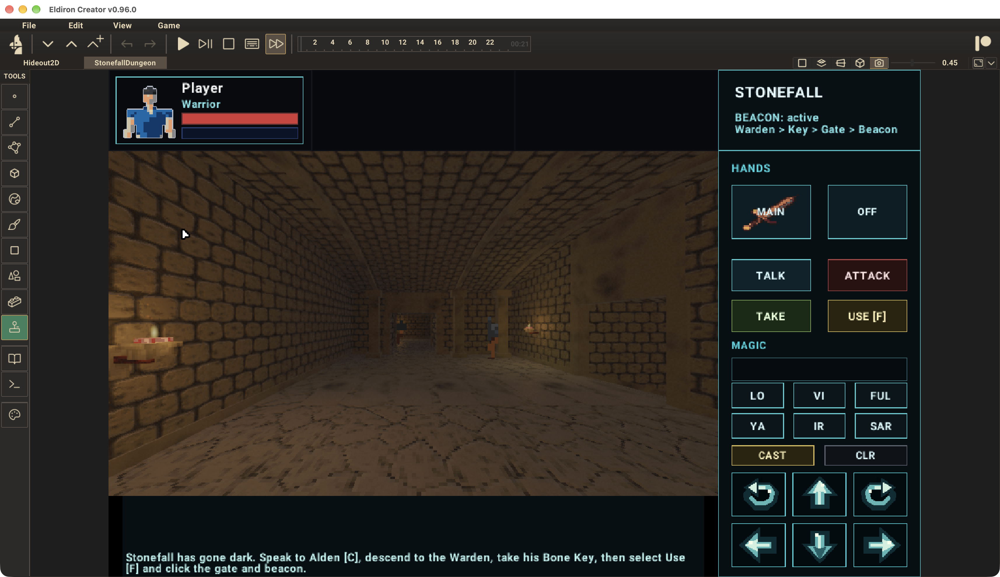

# Eldiron Creator

**Eldiron** is a cross-platform creator for classic retro role-playing games (RPGs). Its primary goal is to enable the creation of RPGs reminiscent of the 1980s and 1990s while incorporating modern features such as multiplayer support, procedural content generation, and more.

Eldiron natively supports **2D** (like Ultima 4/5), **isometric**, and **first-person** RPGs, allowing developers to craft a variety of experiences effortlessly.

The embedded MaterialZ (MZ) core adds editable procedural world materials,
shape-based map composition, ruleset item icons, clothing, models and rigs.
The same project-palette artwork supports 2D sprites and native 3D meshes.
Bitmap tiles and avatars remain supported. See the
[material guide](../docs/docs/building_maps/procedural_materials.md) and
[appearance guide](../docs/docs/characters_items/appearance.md).

| 2D · Hideout | 2D Iso · Wayfarer's Rest | 3D · Stonefall Dungeon |
| :---: | :---: | :---: |
|  |  |  |

Eldiron is open-source and licensed under the **MIT License**.

For a more detailed feature overview please visit [Eldiron.com](https://eldiron.com) or the [GitHub repository](https://github.com/markusmoenig/Eldiron).

```bash
cargo install eldiron-creator
```

## License

Licensed under the MIT License.

## Internal ruleset maintenance

Normal Creator builds use the supplied RPG content without exposing a ruleset
editor. Build worlds with the character/item catalogue, placements, resource
bindings and starting options. Project-owned rules still save and load normally.

Maintainers can explicitly enable the existing editor:

```bash
cargo run --locked -p eldiron-creator --features internal-rules-editor -- [PROJECT.eldiron ...]
```

This opt-in build adds **Game / Rules** to the project tree and registers the
Rules dock. The feature is off in all standard host configurations, including
debug builds. The Apple launcher does not expose a Rules menu command; internal
builds can use the project tree. See the [internal editor reference](../docs/docs/creator/docks/ruleset_nodes.md).

The normal desktop launcher uses the shared native GPU host:

```bash
cargo run --release --locked -p eldiron-creator -- [PROJECT.eldiron ...]
```

`eldiron-creator-native` remains an alias for the same host. Both use ordered GPU
composition and Swash text. `--smoke` requires three successful surface presents
and fails on a timeout; it does not certify physical input or performance.

The CPU presenter is an explicit reference executable:

```bash
cargo run --release --locked -p eldiron-creator --no-default-features --features reference-cpu --bin eldiron-creator-reference -- [PROJECT.eldiron ...]
```

Reference screenshots use the same `reference-cpu` feature. Package the browser
host and its required CPU codec worker from the workspace root:

```bash
python3 tools/package_web.py creator target/web-creator
```

Serve that directory over localhost or HTTPS, with a project archive alongside
`index.html`; `?project=Example.eldiron` selects it. The helper builds release
WASM with pinned bindings. Apple hosts use the `staticlib` feature and the
[Xcode host instructions](../Xcode/Eldiron/README.md). Platform/workflow
acceptance and remaining rewrite work are tracked in
[the progress record](../concepts/native-wgpu-rewrite-progress.md).
